# GewuMind Boot

> **Language / 语言**：[English](README.en.md) | [中文](README.md)

**GewuMind Boot** 是一个 **AI 驱动的低代码后端容器** —— 接口用脚本写，页面用组件文件维护，
菜单 / 角色 / 字典 / 配置全部在线管理。`clone` 下来三步就能跑起一整套可用后端。

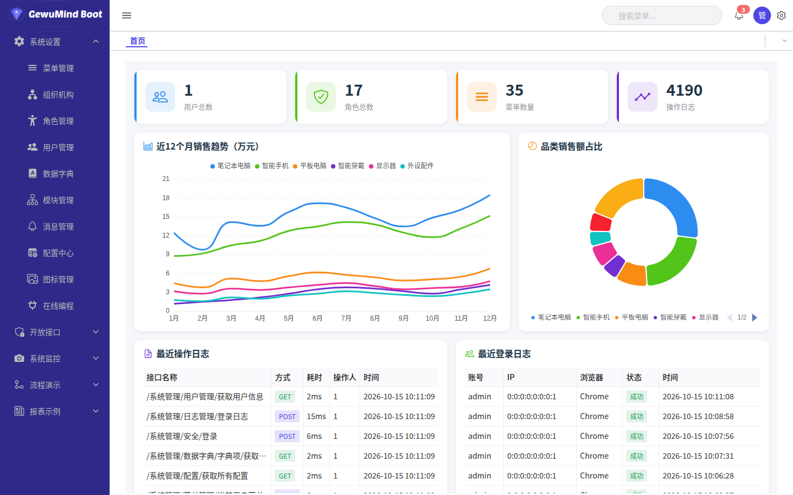

- 官网：https://gewumind.github.io
- 主仓库：https://github.com/gewumind/gewumind-boot ｜ Gitee：https://gitee.com/gewumind/gewumind-boot
- AI 开发技能：https://github.com/gewumind/gewumind-skill ｜ Gitee：https://gitee.com/gewumind/gewumind-skill（版本与 boot 同步，当前 1.0.3）

> GitHub 与 Gitee 内容同步。

### 📖 文档

完整文档入口：**[docs/README.md](docs/README.md)**（中文） · **[docs/en/README.md](docs/en/README.md)**（English）

| 文档 | 内容 | English |
|---|---|---|
| **[部署指南](docs/zh/部署指南.md)** | 环境要求、部署、多平台、HTTPS、升级、备份 | [Deployment](docs/en/deployment.md) |
| **[使用手册](docs/zh/使用手册.md)** | 每个菜单、配置中心每一项、收费能力与授权 | [User Guide](docs/en/user-guide.md) |
| **[低代码开发教程](docs/zh/低代码开发教程.md)** | 写接口、写组件、在线调试、报表、工作流 | [Low-code Guide](docs/en/lowcode-guide.md) |
| **[二次开发指南](docs/zh/二次开发指南.md)** | 源码结构、构建链路、扩展点 | [Development](docs/en/development.md) |
| **[AI 开发](docs/zh/AI开发.md)** | 用 gewumind-skill 让 Agent 帮你开发 | [AI Dev](docs/en/ai-development.md) |
| [架构说明](docs/zh/架构说明.md) | 代码组织、请求流转、常见问题 | [Architecture](docs/en/architecture.md) |

### 🎬 视频教程

一条总览 + AI coding + 三种部署，中文旁白 + 字幕。也可在[官网](https://gewumind.github.io/#videos)直接播放。

> 也发布在 [B 站](https://www.bilibili.com/video/BV11AJd67EMF) ｜ [YouTube](https://youtu.be/hrjdcz6br34)（英文版）。

[](https://gewumind.github.io/#videos)

| 集 | 视频 | 时长 | 播放 |
|---|---|---|---|
| EP 01 | 总览：你不想拥有一个编程大师吗？ | 01:47 | [▶ 播放](https://gewumind.github.io/#videos) |
| EP 02 | AI coding 实战：让 Agent 写设备管理模块 | 00:46 | [▶ 播放](https://gewumind.github.io/#videos) |
| EP 03 | 部署一 · 下载发行包直接用 | 00:41 | [▶ 播放](https://gewumind.github.io/#videos) |
| EP 04 | 部署二 · 源码直接跑 | 00:34 | [▶ 播放](https://gewumind.github.io/#videos) |
| EP 05 | 部署三 · 嵌进已有工程 | 00:25 | [▶ 播放](https://gewumind.github.io/#videos) |

---

## 特性

- **接口即脚本** —— 基于 magic-api，在线编写 HTTP 接口，热更新、免编译、免重启
- **页面即组件文件** —— 页面以 `.ms` 组件文件存放在 `data/magic-api/component/`，后端启动时读取并注册为全局组件，改完刷新即生效
- **在线管理一切** —— 菜单、角色、用户、字典、模块、配置、图标、动态组件可视化维护
- **工作流引擎** —— 条件分支、抄送、逐层驳回、按节点分组审批
- **报表 & 消息** —— 报表设计器 + 导出；Kafka / MQTT / WebSocket / SSE / Redis 统一接入
- **安全与授权** —— 登录/密码策略、Sa-Token 会话、SSO、离线 License

---

## 快速开始

**前置条件**：JDK 17、Maven 3.8+、MySQL 8（默认连 `localhost:3306` 的 `gewumind-boot` 库，端口 **9089**）

脚本在 Linux/macOS 用 `.sh`、Windows 用 `.bat`，行为一致。

### 1. 建库并导入基线

```sql
-- 新建库（字符集必须 utf8mb4，与基线一致）
CREATE DATABASE gewumind-boot DEFAULT CHARACTER SET utf8mb4 COLLATE utf8mb4_general_ci;
```

然后把 [`db/init/01-baseline.sql`](db/init/01-baseline.sql) 导入这个库 ——
Navicat / DBeaver / phpMyAdmin 的「运行 SQL 文件」都行，或者命令行：

```bash
mysql -h127.0.0.1 -uroot -p gewumind-boot < db/init/01-baseline.sql
```

导入后应有 **45 张表**，以及平台自带的菜单、角色、字典、配置与页面组件数据。

### 2. 注入数据库密码

仓库里不写死任何密码：

```bash
export SPRING_DATASOURCE_USERNAME=root
export SPRING_DATASOURCE_PASSWORD='你的数据库密码'
```

### 3. 打包并启动

```bash
mvn clean package -DskipTests
bash scripts/start.sh
```

| 端点 | 地址 | 账号 |
|------|------|------|
| 后台首页 | <http://localhost:9089/> | `admin` / `123456` |
| 在线编程 / 接口文档 | <http://localhost:9089/magic/web> | — |
| Druid 监控 | <http://localhost:9089/druid> | `admin` / `123456` |

停止：`bash scripts/stop.sh`　换端口：`SERVER_PORT=9090 bash scripts/start.sh`

---

## 验证内核签名

每次发布的内核二进制（`libs/`）都带 Ed25519 分离签名，公钥 `gewumind-release.pub`：

```bash
scripts/verify-signature.sh libs/com/gewumind/gewumind-boot/0.3.1/gewumind-boot-0.3.1.jar
# Signature Verified Successfully
```

内核源码不随发布包提供。

## 📸 系统截图

以下均为 v0.3.0 的真实运行界面。

### 工作台

| | |
|---|---|
|  |  |
| **工作台首页** —— 统计卡片、销售趋势、操作动态 | **登录页** —— Logo / 主题可配置 |

### 系统设置

| | | |
|---|---|---|
| 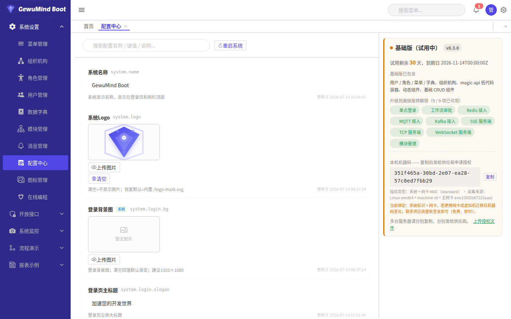 | 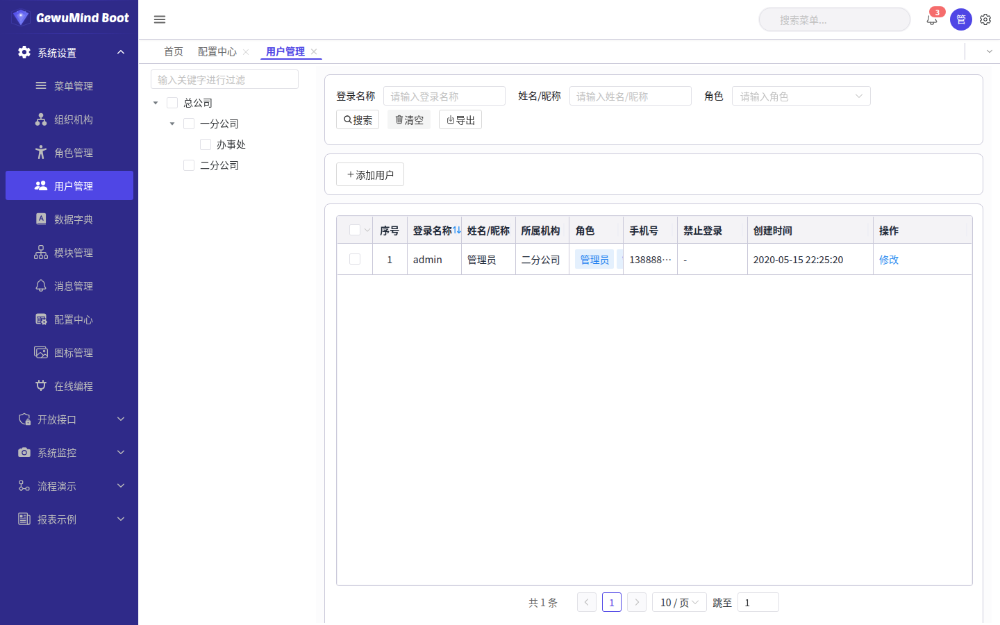 | 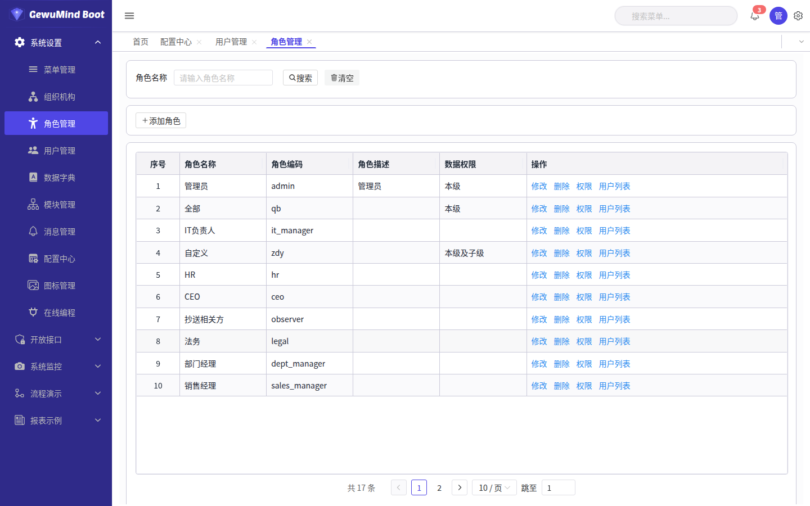 |
| **配置中心** —— 运行期参数 + 授权面板 | **用户管理** —— 组织/角色/登录状态 | **角色管理** —— 菜单+按钮+接口三重授权 |
| 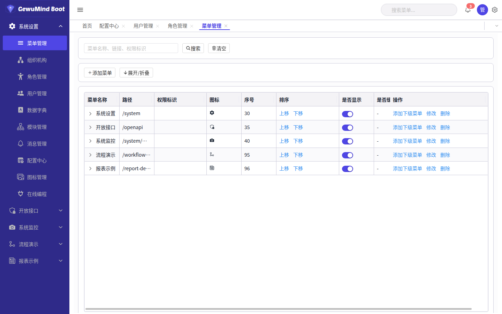 | 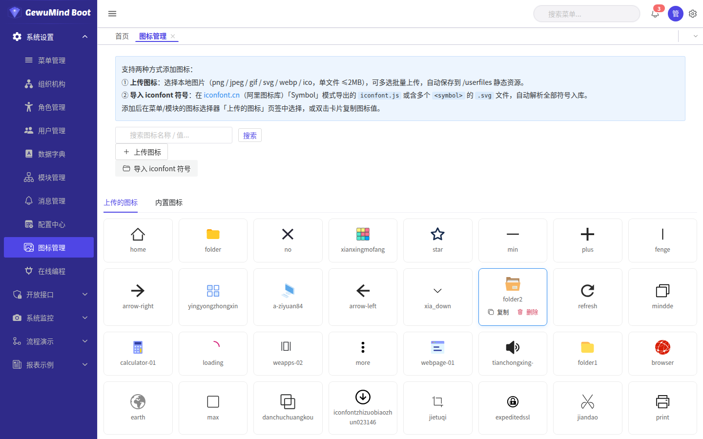 |  |
| **菜单管理** —— 路由与权限码的骨架 | **图标管理** —— iconfont / 上传图标库 | **组织机构** —— 公司部门树 |
| 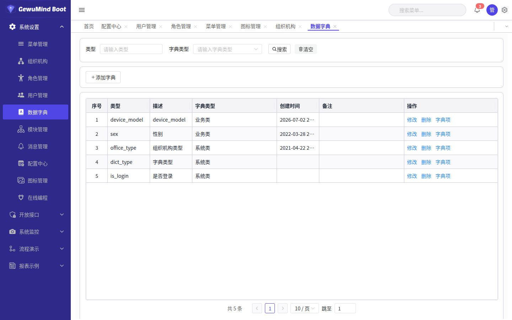 | 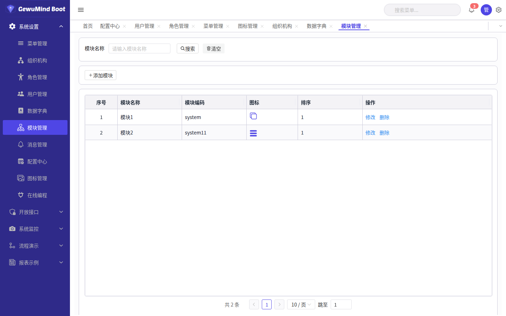 |  |
| **数据字典** —— 枚举值统一维护 | **模块管理** —— 商业授权能力 | **消息管理** —— 公告 / 待办 / 系统消息 |

<details>
<summary><b>配置中心 · 主题选择</b>（13 套预设皮肤 + 自定义取色）</summary>


</details>

<details>
<summary><b>用户管理 · 新增用户</b></summary>

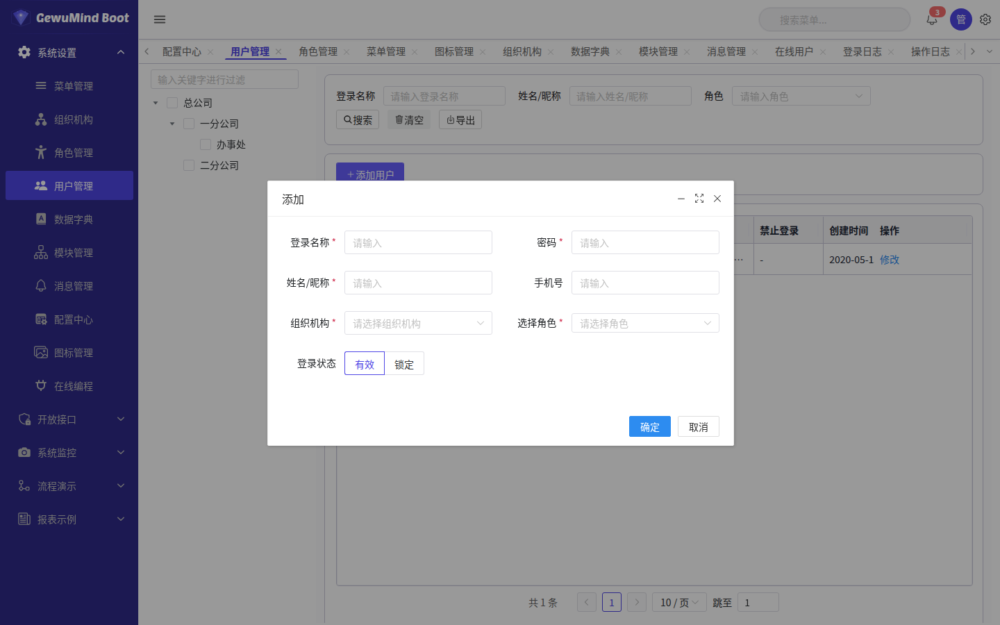

</details>

<details>
<summary><b>消息管理 · 发送消息</b></summary>


</details>

### 系统监控

| | | |
|---|---|---|
|  |  | 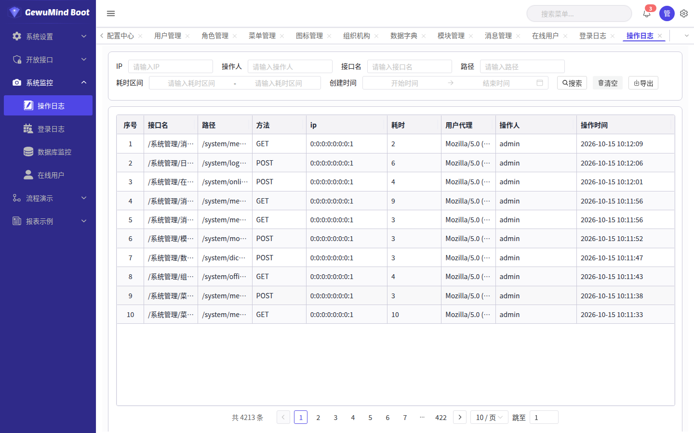 |
| **在线用户** —— 会话管理、一键踢人 | **登录日志** —— 谁进来了 | **操作日志** —— 谁改了什么 |
|  | | |
| **数据库监控** —— Druid 连接池与慢 SQL | | |

### 开放接口（API 网关）

| | | |
|---|---|---|
|  |  | 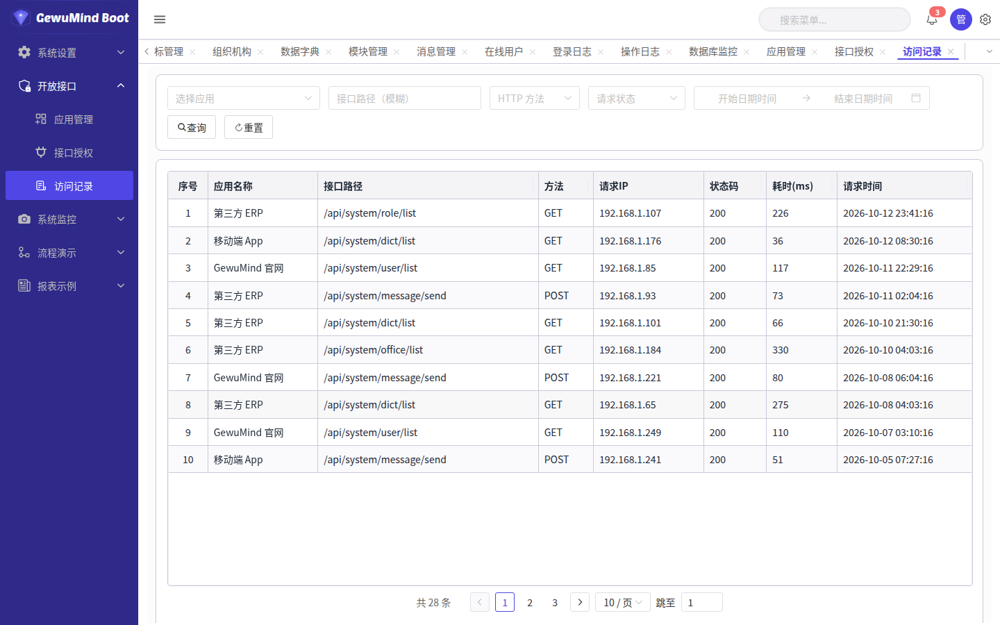 |
| **应用管理** —— appKey / appSecret | **接口授权** —— 按应用授权 + 限流 | **访问记录** —— 第三方调用流水 |

### 低代码 · 在线编程

七个标签对应七类可编辑资源，**改完即生效，无需重启**。

| | | |
|---|---|---|
|  |  | 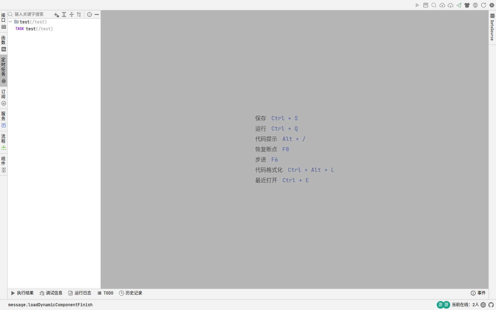 |
| **接口** —— HTTP 定义 + 脚本 | **函数** —— 可复用公共函数 | **定时任务** —— cron 调度 |
| 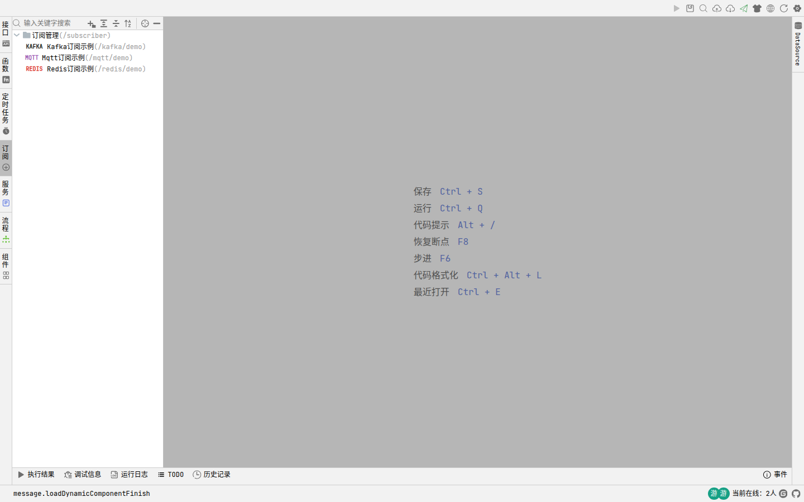 |  | 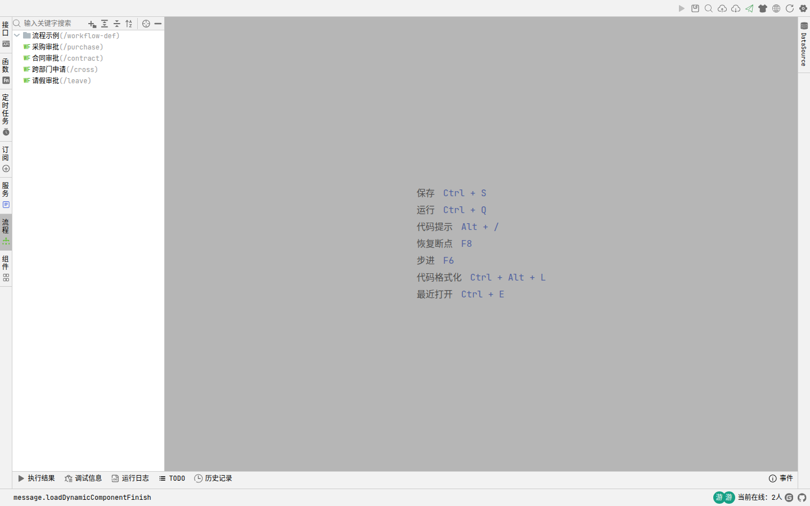 |
| **订阅** —— 消息订阅者 | **服务** —— SSE / TCP / WebSocket | **流程** —— 工作流定义 |
|  |  | |
| **组件** —— 前端动态组件（SFC） | **在线调试** —— 断点 + 变量树 | |

### 报表与流程

| | |
|---|---|
|  |  |
| **报表示例** —— 清单/交叉/中国式/多 Sheet 等 | **流程演示** —— 请假/合同/采购审批 |

### 操作演示（GIF）

| | | | |
|---|---|---|---|
|  |  | 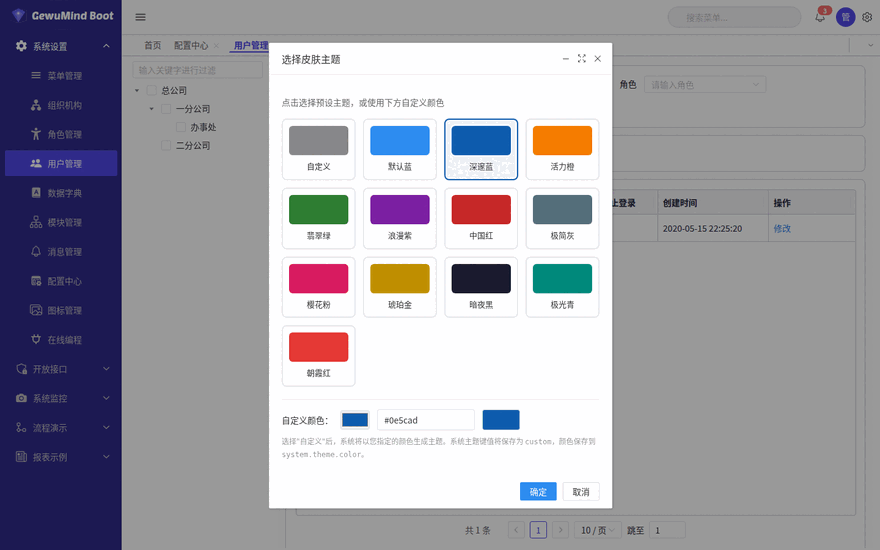 | 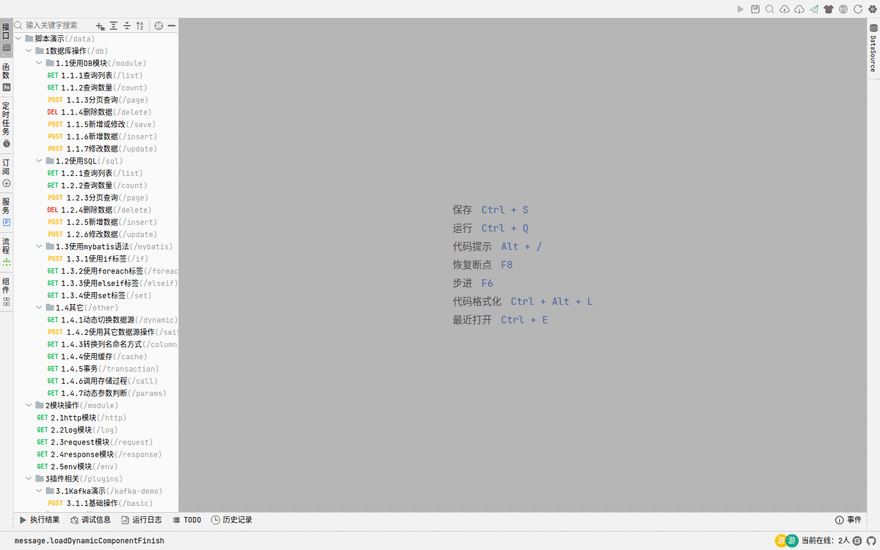 |
| 登录 | 切换皮肤主题 | 新增用户 | 浏览接口树 |
|  | 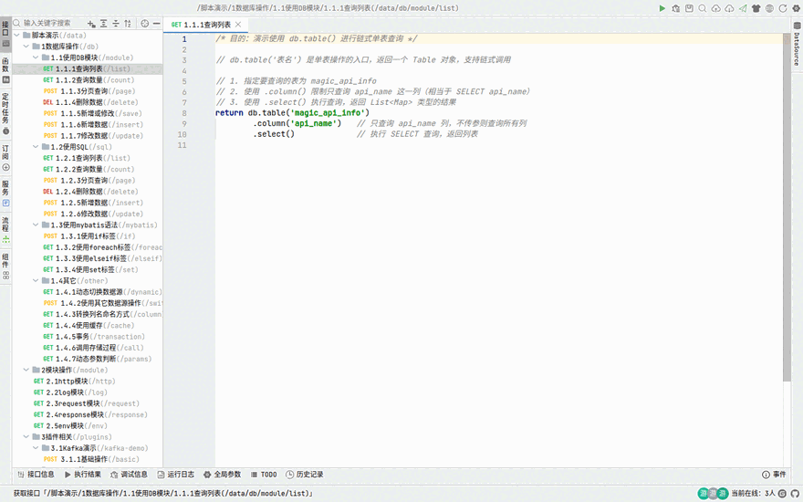 | | |
| **断点调试** —— 设断点 → 运行 → 看变量 | **运行结果** —— 一键执行看输出 | | |

> 各界面的详细操作说明见 [使用手册](docs/zh/使用手册.md)；
> 开发与调试流程见 [低代码开发教程](docs/zh/低代码开发教程.md)。

---

## 关于前端产物

`src/main/resources/static/`（约 28MB）**直接随仓库提交**，所以 clone 完就能打开后台，
不需要任何额外的前端构建步骤。它由独立的前端工程构建产出，本仓库只保留产物。

产物由独立的前端工程构建，本仓库**不提供**重建脚本 —— 那属于内核维护者的工作，
需要能访问前端源码仓库。

> CI 会扫描产物里的内网 IP、本机绝对路径之类的痕迹，发现即失败。

### 环境（profile）

| profile | 用途 | 数据源 | AI Key |
|---------|------|--------|--------|
| `dev`（默认） | 本地开发 | 本机 MySQL，有默认值 | 自动签发 + 允许自助签发 |
| `demo` | 演示 / 试用 | 本机 MySQL，有默认值 | 自动签发 + 允许自助签发 |
| `online` | **生产** | **必须用环境变量提供** | 不签发 + **禁止自助签发** |
| `docker` | 容器 | 指向 compose 里的 `db` | 不签发 + 禁止自助签发 |

切换：

```bash
java -jar target/gewumind-boot-app.jar --spring.profiles.active=online
# 或 SPRING_PROFILES_ACTIVE=online
```

`online` 下的 `SPRING_DATASOURCE_URL / _USERNAME / _PASSWORD` **没有默认值**，
缺任一项会直接启动失败 —— 宁可起不来，也不要静默连上某个不该连的库。

### Windows

`.bat` 与 `.sh` 行为完全一致：

建库与导入在三个平台做法一致（图形化客户端或 `mysql < file.sql`），
之后脚本也一一对应：

```bat
scripts\start.bat
scripts\stop.bat
```

### 用 IntelliJ IDEA 开发

本工程是标准 Maven 项目，clone 下来直接导入即可：

1. **File → Open**，选中仓库根目录（含 `pom.xml` 的那一层）
2. IDEA 自动识别为 Maven 项目并下载依赖
3. 确认 SDK 是 **JDK 17**：`File → Project Structure → Project → SDK = 17`
4. Maven 面板确认已加载 `com.gewumind:gewumind-boot`（来自 `libs/`）

直接运行主类 `com.gewumind.app.GewuMindBootApp` 的 `main` 方法即可（默认 `dev` profile、端口 9089）。
调接口脚本时改 `data/magic-api/` 下的 `.ms`，保存后刷新浏览器即可生效，不用重启。

> 第一次导入需要下载依赖与内核 jar，耐心等它跑完。若报找不到 `mysql-connector-j`，
> 在 Maven 面板点刷新即可（它由内核的 pom 传递引入）。

---

## 本地开发

```bash
# 开发模式启动（classpath 优先，改 Java 代码重启即生效）
bash scripts/start.sh --dev

# 或直接用 Maven
mvn spring-boot:run
```

前端产物已随仓库入库，本地开发无需任何额外步骤。

### 打包发行版

```bash
bash scripts/stop.sh          # 必须先停：实例运行期间覆盖 fat jar 会让运行中的实例 404
bash scripts/build-dist.sh    # → dist/gewumind-boot-app-<版本>.tar.gz + .zip
```

产物是可解压即部署的目录：`libs/` 放 jar、`bin/` 放启停脚本（`.sh` 与 `.bat` 双份）、
`config/` 放配置、`data/magic-api` 放接口与组件（备份重点）、`db/` 放基线 SQL。
详见 [部署指南](docs/zh/部署指南.md)。

> `build-dist.sh` 只在源码仓库里有意义（需要 Maven 与源码树），**不会打进发行包**——
> 收到发行包的用户只需要 `start.sh`。

---

## 目录结构

```
gewumind-boot/
├── pom.xml                    # 依赖 com.gewumind:gewumind-boot:0.3.0
├── libs/                      # 内核 thin jar（标准 Maven 仓库布局，随工程入库）
├── src/main/java/com/gewumind/app/
│   ├── GewuMindBootApp.java   # 启动类
│   ├── config/                # /api 前缀剥离、SSO bean 摘除
│   └── sso/                   # SSO 入口补全
├── src/main/resources/
│   ├── application.yml        # 本工程配置（覆盖内核 jar 内那份）
│   └── static/                # 前端产物（已入库，clone 下来即可打开后台）
├── data/magic-api/            # 脚本工作区：api / component / task / workflow / function
├── db/init/01-baseline.sql    # 建库基线
├── scripts/
│   ├── start.sh / stop.sh     # 启停（另有 Windows .bat）
│   ├── gen-ssl-cert.sh        # 自签证书（另有 .bat）
│   └── build-dist.sh          # 打包发行版 → dist/*.tar.gz + *.zip
├── dist/                      # 发行包产物（不入库）
└── docs/                      # 文档（README.md 为入口，分 zh/ 与 en/）
```

---

## 数据库

**目前只支持 MySQL 8。** 发行包里仅内置 `mysql-connector-j` 一个 JDBC 驱动，
`db/init/01-baseline.sql` 也是 MySQL 语法（`ENGINE=InnoDB`、`utf8mb4_general_ci`、反引号）。

基线文件：[`db/init/01-baseline.sql`](db/init/01-baseline.sql)，45 张表 +
平台自带的菜单/角色/字典/配置/页面组件。建库语句见[快速开始](#快速开始)；
重置就是 `DROP DATABASE` 后重新导入。

连接信息在 `src/main/resources/application-dev.yml` 等 profile 配置里，
也可用环境变量覆盖（推荐用于部署）：

```yaml
spring:
  datasource:
    url: jdbc:mysql://localhost:3306/gewumind-boot?zeroDateTimeBehavior=convertToNull&useUnicode=true&characterEncoding=UTF8&allowPublicKeyRetrieval=true&serverTimezone=Asia/Shanghai
    username: root
    password: ******
```

| 环境变量 | 说明 | 默认值 |
|----------|------|--------|
| `SPRING_DATASOURCE_URL` | 数据源 URL | `jdbc:mysql://localhost:3306/gewumind-boot?...` |
| `SPRING_DATASOURCE_USERNAME` | 数据库用户 | `root` |
| `SPRING_DATASOURCE_PASSWORD` | 数据库密码 | **无默认值，必须注入** |
| `SERVER_PORT` | 服务端口 | `9089` |

> ✅ 仓库里**不写死任何密码**：`password` 为空，必须用 `SPRING_DATASOURCE_PASSWORD` 注入；
> `online` profile 下 URL 与账号也没有默认值，缺配置会直接启动失败。

**换其他数据库**（PostgreSQL / Oracle / SQL Server 等）：需要自行添加对应驱动依赖，
并把 `db/init/01-baseline.sql` 转成目标方言 —— 表选项、字符集、自增与注释语法均不通用。
内核的 `data/magic-api/` 脚本里若有 MySQL 专有 SQL，也需一并适配。

## AI / MCP 接入（X-AI-Key）

MCP 端点 `/mcp` 与 REST 发布接口 `/ai/**` 都要求请求头 `X-AI-Key: <keyId>:<secret>`。

**开发模式**（默认 `dev`）首次启动时会自动生成一个 key，**secret 只在启动日志里打印一次**：

```bash
bash scripts/start.sh
grep "X-AI-Key" logs/gewumind-boot-app.log
```

不想自动生成就关掉：`app.dev-api-key.enabled=false`。

**自助签发**（需后台登录态，dev / demo 可用）：

```bash
TOKEN=<登录后拿到的 token>
curl -X POST http://localhost:9089/system/ai-keys/save \
  -H "token: $TOKEN" -H "Content-Type: application/json" \
  -d '{"name":"my-key","permissions":"*","rateLimit":100}'
# 返回 keyId + secret，secret 只出现这一次（数据库仅存 sha256）
```

其他接口：`GET /system/ai-keys/list`、`POST /system/ai-keys/status?keyId=&disabled=true`、
`POST /system/ai-keys/delete?keyId=`

**生产模式**（`prod` / `production` / `online` profile）：

- 不自动签发
- **禁止自助签发**（返回 403），Key 需线下发放
- 列表 / 启禁 / 删除仍可用，供运维管理
- 需要放开自助签发：`app.ai-key.self-service=true`

> 数据库只保存 `sha256(secret)`，明文不可找回。兼容 PoC 期签发的老 key（`secret == keyId`），
> 建议正式使用时全部重新签发。

---

其他可在线调整的配置在「配置中心」（`sys_configure`）：Kafka、MQTT、Redis、
工作流、WebSocket、SSE、TCP、密码策略等，逐项说明见 [使用手册](docs/zh/使用手册.md)。

---

## 许可

- 内核基于 [Apache License 2.0](LICENSE) 开源（[中文参考译文](LICENSE.zh-CN.md)，以英文原文为准）。
- 部分企业能力（SSO、工作流、模块管理、Redis/共享会话、MQTT、Kafka、SSE、TCP、WS）
  需商业版离线 License 解锁，未授权可免费试用 30 天。授权方式见 [COMMERCIAL_TERMS.md](COMMERCIAL_TERMS.md)。