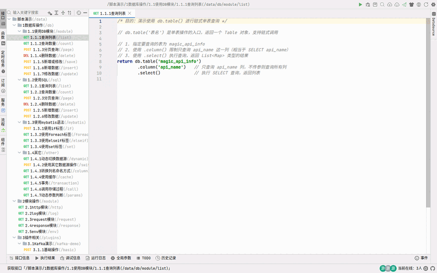
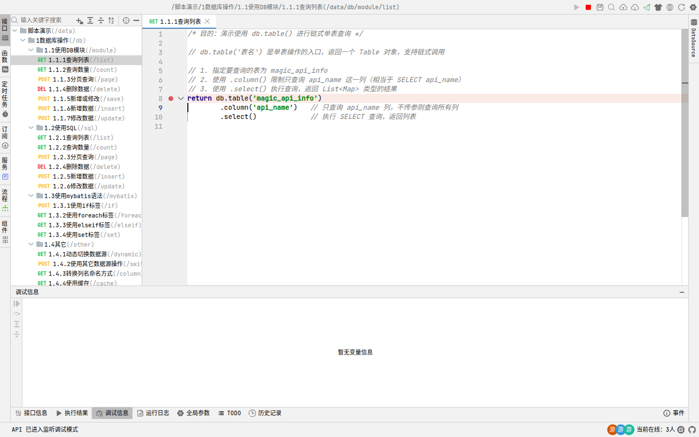
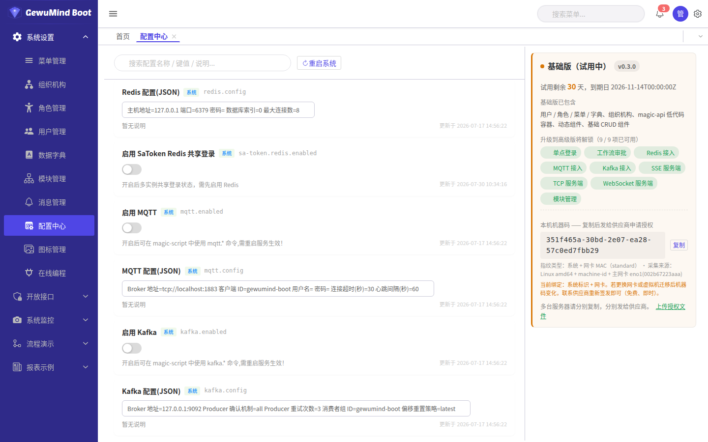

# GewuMind Boot · Low-code Development Guide

> **Language / 语言**：[English](lowcode-guide.md) | [中文](../zh/低代码开发教程.md)

For **implementers**: build business features with the built-in magic-api container — write
APIs as scripts, pages as component files, and manage menus, roles, dictionaries and config
online. **No Java changes and no frontend build required.**

> Menu operations are in the [User Guide](user-guide.md); deployment in the
> [Deployment Guide](deployment.md); source builds in the [Development Guide](development.md).
> For the complete script language and module reference, see
> [magic-api's official documentation](https://sddd.cn/magic-api) — see [14](#14--going-deeper-magic-api-official-docs).

---

## Contents

1. [Mental model](#1--mental-model)
2. [Your first endpoint](#2--your-first-endpoint)
3. [Online debugging](#3--online-debugging)
4. [Script language quick reference](#4--script-language-quick-reference)
5. [Database access](#5--database-access)
6. [CRUD playbook](#6--crud-playbook)
7. [Writing frontend components](#7--writing-frontend-components)
8. [Reports](#8--reports)
9. [Workflows](#9--workflows)
10. [Scheduled tasks and subscribers](#10--scheduled-tasks-and-subscribers)
11. [Commercial features in depth](#11--commercial-features-in-depth)
12. [Permissions and integration](#12--permissions-and-integration)
13. [Common pitfalls](#13--common-pitfalls)
14. [Going deeper: magic-api official docs](#14--going-deeper-magic-api-official-docs)

---

## 1 · Mental model

Code comes in three kinds, each with its own home:

| Kind | Written where | Stored in | Takes effect |
|---|---|---|---|
| **APIs / functions / tasks** | Online programming | `data/magic-api/api,function,task/**.ms` | On save |
| **Frontend components** | Online programming (components tab) | `data/magic-api/component/**.ms` | **Browser refresh** |
| **Reports / workflows** | The matching tab | `data/magic-api/report,workflow/**` | Browser refresh |

**All of them are plain-text `.ms` files** — editable in an IDE, version-controllable,
bulk-generatable.

### 1.1 The `.ms` file format (important)

Each `.ms` is **a JSON header + a separator + source**:

```
{ "id":"...", "path":"/list", "method":"POST", ... }
================================
<source>
```

> ⚠️ **The separator must be `\r\n` + 32 `=` + `\r\n`** — not a bare run of `=`.
> The backend splits on `content.indexOf(SEPARATOR)`. If it doesn't match, the backend returns
> **the whole file including the JSON header** as the "source", and the editor shows raw JSON
> or appears blank.
>
> Node:
> ```js
> const SEP = '\r\n================================\r\n'
> const i = content.indexOf(SEP)
> if (i < 0) throw new Error('separator mismatch: missing leading/trailing \\r\\n')
> ```
>
> **Saving through the admin editor is always safe.** You only need this when processing
> `.ms` files with your own scripts.

---

## 2 · Your first endpoint

### 2.1 Create

Online programming → **Interfaces** tab → **+** next to a group → HTTP interface:

| Field | Value | Example |
|---|---|---|
| Name | Readable | `User list` |
| Path | Starts with `/`, **no `/api`** | `/user/list` |
| Method | Match the frontend caller | `POST` |

A skeleton is generated:

```javascript
return 'hello, gewumind'
```

### 2.2 Calling it from the frontend

The request wrapper adds `/api` automatically — **don't write it yourself**:

```javascript
$common.post('/user/list', { current: 1, size: 10 })
// actual request: POST /api/user/list

$common.get('/user/info', { id: '1' })
// actual request: GET  /api/user/info?id=1
```

> ⚠️ **`$common.post` sends `application/x-www-form-urlencoded`, not JSON.**
> Read parameters as **bare variables** in the script:
> ```javascript
> var page = request.getParameter('page')   // ✅ form field
> ```
> Use `$common.postJson` when you really need JSON, and read `request.body` then.
> Mixing these up is the most common "my parameters are empty" bug.

### 2.3 Return values

Whatever the script returns is what the frontend gets, wrapped as `{code:200, message:'', data:...}`.

```javascript
return { id: 1, name: 'Alice' }       // frontend sees {code:200,data:{id:1,name:'Alice'}}
return db.select('select 1')          // a data set
return db.selectOne('select 1')       // a single row
```

---

## 3 · Online debugging

**The core value of low-code: change it, run it immediately — no restart, no redeploy.**

### 3.1 Breakpoint demo

This GIF shows the four steps: **open the endpoint → click the blank margin left of the line
number to set a breakpoint → open the debug info panel → press `Ctrl+Q`; the script stops at
the breakpoint.**



The paused state (static view):


You can see:
- A **red breakpoint dot** beside the line number; the current line is **highlighted** with a `>` marker
- The bottom **debug info** panel lists every variable in scope (`db`, `session`, `path`, `header`, …),
  each expandable to drill into
- The status bar shows "debugging started" and the endpoint path

> 💡 **Where to click**: the blank margin to the **left of the line number** in the editor.
> The red breakpoint appears there. Click again to clear it.

### 3.2 Running

| Action | Shortcut / location |
|---|---|
| Run the current script | Green **▶** top right, or `Ctrl+Q` |
| Save | `Ctrl+S` |
| Resume breakpoint / continue | `F8` |
| Step | `F6` |
| Suggestions | `Alt+/` |
| Format | `Ctrl+Alt+L` |
| Recent files | `Ctrl+E` |

Results go to the **run result** panel; on error switch to **debug info** for the stack.

### 3.3 What the bottom panels are for

| Panel | Purpose |
|---|---|
| Interface info | Path, method and parameters of the current endpoint |
| Run result | The `return` value / `println` output |
| Debug info | Stack traces, variable values at a breakpoint |
| Run log | History of each run |
| Global params | Variables injected for debugging |
| TODO | `// TODO` markers in the code |
| History | Previous versions, comparable and restorable |

### 3.4 Stepping through

1. Click the blank margin left of the line number → a red dot appears
2. `Ctrl+Q` → execution pauses at the breakpoint
3. Inspect variables in the debug info panel
4. `F6` to step one line, `F8` to run to the next breakpoint or the end

> Debugging is **one execution at a time**: fix the code and press `Ctrl+Q` again — no
> save-and-restart wait.

### 3.5 Printing intermediate values

```javascript
var list = db.select('select * from sys_user')
println('found ' + list.size() + ' users')
return list
```

`println` output appears in the run result panel — the most common debugging trick in low-code.

### 3.6 Debug & listen — unique to GewuMind Boot

> 💡 **GewuMind Boot–specific, not present in upstream magic-api.**
> Upstream only lets you run once inside the editor. Debug & listen lets you **break on real
> requests from the real frontend** — exactly what you need when the problem is "what is the
> frontend actually sending?".



**The problem it solves**

Normal breakpoint debugging (`Ctrl+Q`) uses **made-up parameters**. But real problems are often
"the frontend didn't send this", "the type is wrong", "an interceptor changed it". Debug & listen
breaks on the real request.

**How to use (four steps)**

| Step | Action | What you see |
|---|---|---|
| 1 | Open the endpoint / subscriber / server file | — |
| 2 | Click the blank margin left of the line number | Red breakpoint dot |
| 3 | Click **Debug & listen** in the toolbar (`debug-info` icon) | Status bar: "API is now in debug-listen mode", icon turns into a red stop, ▶ greys out |
| 4 | **Trigger the endpoint from the frontend page** | The request **stops at the breakpoint**; the debug info panel shows the real variables |

Then step with `F6` / `F8`, and click the toolbar again (now a red ■) to exit.

**Comparison**

| | Normal breakpoint (`Ctrl+Q`) | Debug & listen |
|---|---|---|
| Parameter source | Editor sample values | **The real frontend request** |
| Best for | Debugging script logic | **Front/back integration** |
| Manual run | Yes | Disabled while armed |

**Why it's ours**: upstream magic-api has no link between the editor and the live request path.
GewuMind Boot passes breakpoint information with three custom headers
(`Magic-Request-Client-Id` / `-Script-Id` / `-Breakpoints`) and the kernel's `/ai/api/debug`
endpoints take over execution.

### 3.7 Debugging ≠ deployed

Debugging only proves the **script** runs. To make the frontend actually use it you also need:

- `Ctrl+S` to save (otherwise it's lost when you close the tab)
- the endpoint's `permission` configured — see [12.2](#122-giving-a-new-endpoint-a-permission-required)
- that permission code ticked on the role

---

## 4 · Script language quick reference

### 4.1 Variables and types

```javascript
var a = 1                      // number
var b = 'text'                 // string
var c = true                   // boolean
var d = null
var list = [1, 2, 3]
var map = { name: 'x' }
```

### 4.2 Reading input

| Source | How |
|---|---|
| Path variable | `#/{id}` |
| Query parameter | inside `#{}`, or `request.getParameter('name')` |
| Form body | use the bare variable name |
| Header | `request.getHeader('token')` |
| Current user | `request.getAttribute('userId')` (injected by the interceptor) |

### 4.3 Control flow

```javascript
if (score >= 90) { return 'A' }
else if (score >= 60) { return 'B' }
else { return 'C' }

for (item in list) { println(item) }
```

### 4.4 Built-in modules

```javascript
import http;
import db;
import sql;
import date;
import file;
import request;
import response;
```

### 4.5 Common functions

| Function | Purpose |
|---|---|
| `println(x)` | Debug output, visible in the run result panel |
| `uuid()` | Generate a UUID |
| `parseInt` / `parseFloat` | Type conversion |
| `date.now()` | Current timestamp |
| `date.format(ts, 'yyyy-MM-dd')` | Format a timestamp |

---

## 5 · Database access

### 5.1 Core methods

| Method | Purpose | Returns |
|---|---|---|
| `db.select(sql, params)` | Many rows | `List<Map>` |
| `db.selectOne(sql, params)` | One row | `Map` or `null` |
| `db.selectValue(sql, params)` | First column of first row | Scalar |
| `db.selectInt(sql, params)` | Integer | `int` |
| `db.page(sql, params)` | Paged query | `List<Map>` with limit applied |
| `db.insert(sql, params)` | Insert | Key / rows affected |
| `db.update(sql, params)` | Update / delete | Rows affected |
| `db.table('name')` | Fluent single-table access | `Table` |

### 5.2 Fluent `db.table()`

```javascript
return db.table('sys_user')
        .column('id', 'username')
        .where()
        .eq('is_del', 0)
        .like('username', 'adm')
        .orderBy('create_date', 'desc')
        .page()
```

| Chain method | Purpose |
|---|---|
| `column(...)` | Restrict selected columns |
| `eq` / `ne` / `gt` / `ge` / `lt` / `le` | Comparison |
| `like` / `notLike` / `likeLeft` / `likeRight` | Fuzzy match |
| `in` / `notIn` | Set membership |
| `between` | Range |
| `isNull` / `isNotNull` | Null checks |
| `orderBy(column, direction)` | Sorting |
| `groupBy` / `having` | Grouping |
| `select()` / `page()` | Execute |
| `count()` | Row count |

### 5.3 Parameter binding: `#{}`

**Never concatenate user input into SQL** — use `#{}`:

```javascript
var user = db.selectOne("select * from sys_user where username = #{username}", {username: 'admin'})
```

### 5.4 Camel case with `db.camel()`

```javascript
return db.camel().select('select user_name, office_id from sys_user')
// returns { userName: '...', officeId: '...' }
```

### 5.5 Conditional fragments `?{}`

`?{condition, fragment}` — the fragment is appended only when the condition is truthy:

```sql
select * from sys_user
where is_del = 0
?{roleId,  and role_id = #{roleId}}
?{keyword, and (username like concat('%',#{keyword},'%') or name like concat('%',#{keyword},'%'))}
order by create_date desc
```

> ⚠️ The fragment **must include its own `and` / `or`**. Omitting it produces
> `where is_del = 0 status = 1`, which is a syntax error.

### 5.6 Sort columns must be whitelisted

`#{}` is for values, not identifiers — validate sort columns against a map:

```javascript
var allow = { 'date': 'create_date', 'name': 'name', 'amount': 'amount' }
var col = allow[body.sortBy] || 'create_date'
var dir = body.sortOrder == 'asc' ? 'asc' : 'desc'
return db.page("select * from t_sale order by " + col + " " + dir)
```

> Concatenating `body.sortBy` directly is a textbook SQL injection.

### 5.7 `IN` with multiple values

```javascript
var ids = body.ids          // '1,2,3'
if (ids) {
    return db.select('select * from sys_user where id in(#{ids.split(",")})')
}
```

### 5.8 Multi-datasource

The release bundles **only the MySQL driver**. Other databases need the driver added and the
project rebuilt:

```xml
<!-- pom.xml -->
<dependency>
    <groupId>org.postgresql</groupId>
    <artifactId>postgresql</artifactId>
    <version>42.7.3</version>
</dependency>
```

```yaml
# application.yml
gewumind:
  datasource:
    master:
      url: jdbc:mysql://localhost:3306/gewumind-boot?characterEncoding=UTF8&allowPublicKeyRetrieval=true
      username: root
      password: your-password
      driver-class-name: com.mysql.cj.jdbc.Driver
    slave:
      url: jdbc:postgresql://10.0.0.9:5432/analytics
      username: postgres
      password: your-password
      driver-class-name: org.postgresql.Driver
```

```bash
bash scripts/stop.sh && mvn -q -o package -DskipTests && bash scripts/start.sh
```

```javascript
db.slave.select('select 1')     // fixed key
db[dbKey].select('select 1')    // dynamic
```

> Operator-facing notes are in the [User Guide · Multi-datasource](user-guide.md#9--multi-datasource).

### 5.9 Transactions

```javascript
return transaction(() => {
    var id = db.insert("insert into t_order(no, amount) values(#{no}, #{amount})")
    db.update("update t_stock set num = num - #{amount} where goods_id = #{goodsId}")
    return { orderId: id }
})
```

**Throw to roll back.** No exception means commit.

### 5.10 Troubleshooting

| Symptom | Cause |
|---|---|
| `Unknown column` | Wrong column name, or a missing schema prefix |
| Syntax error, `where 1=1 and` | `?{}` fragment missing its `and` |
| No rows although data exists | Forgot `is_del = 0`, or values have stray whitespace |
| Garbled Chinese | Connection string missing `characterEncoding=UTF8` |
| `Communications link failure` | Database unreachable, or missing `allowPublicKeyRetrieval` (MySQL 8) |
| Transaction not rolling back | Not wrapped in `transaction(() => {...})` |

---

## 6 · CRUD playbook

### 6.1 List (paged + filters)

The real implementation from `data/magic-api/api/系统管理/用户管理/列表.ms`:

```javascript
return db.page("""
    select
        distinct
        su.id, su.username, su.name, su.is_login, su.phone,
        so.name office_name,
        (select group_concat(sr.name) from sys_role sr
           left join sys_user_role sur on sr.id = sur.role_id
          where sr.is_del = 0 and sur.user_id = su.id) roles
    from sys_user su
    left join sys_office so on su.office_id = so.id
    left join sys_user_role sur on su.id = sur.user_id
    where su.is_del = 0
    ?{roleId,  and sur.role_id in(#{roleId.split(',')})}
    ?{officeId, and su.office_id in(#{officeId.split(',')})}
    ?{username, and su.username like concat('%',#{username},'%')}
    ?{name,     and su.name like concat('%',#{name},'%')}
    ?{isLogin,  and su.is_login = #{isLogin}}
""")
```

Notes:
- `"""..."""` keeps multi-line SQL readable
- A **subquery** collapses a one-to-many field (role names) into one row, avoiding duplicated rows
- `?{}` handles every optional filter

### 6.2 Create

```javascript
var id = uuid()
db.update("""insert into t_demo(id, name, create_by, create_date, update_date)
            values(#{id}, #{name}, #{userId}, now(), now())""")
if (roleIds) {
    for (rid in roleIds.split(',')) {
        db.update("insert into t_demo_role(demo_id, role_id) values(#{id}, #{rid})")
    }
}
return { id: id }
```

### 6.3 Update / delete

```javascript
db.update("""update t_demo set name = #{name}, update_by = #{userId}, update_date = now()
            where id = #{id} and is_del = 0""")

// soft delete (recommended)
db.update("""update t_demo set is_del = 1, update_by = #{userId}, update_date = now()
            where id = #{id}""")
```

> **Always soft-delete** (`is_del = 1`) and filter with `where is_del = 0`.
> Hard deletes destroy related records and the audit trail.

### 6.4 Export to Excel

`mb-table` has it built in once `cols` is configured:

```javascript
const table = ref()
// <mb-button @click="table.exportExcel({ fileName: 'Users' })">Export</mb-button>
// <mb-table ref="table" :options="tableOptions" />
```

`exportExcel` automatically applies the **current query conditions**. Use `exportRender` to
transform values on the way out:

```javascript
{
    field: 'isLogin', label: 'Status',
    exportRender: (row) => row.isLogin == 1 ? 'Disabled' : 'Active'
}
```

### 6.5 Batch operations

```javascript
const tableOptions = reactive({ url: '/system/user/list', page: true, selection: true, cols: [] })

function batchDelete() {
    const rows = table.value.getSelection()
    if (!rows.length) return $message.warning('Select rows first')
    $common.handleDelete({
        url: '/system/user/batch-delete',
        id: rows.map(r => r.id).join(','),
        done: () => table.value.reload()
    })
}
```

Backend accepting the batch:

```javascript
var ids = body.id
if (!ids) return { success: false, message: 'missing id' }
var arr = ids.split(',')
db.update("update sys_user set is_del = 1 where id in(#{arr})")
return { success: true, affected: arr.length }
```

### 6.6 Batch import (two steps)

**Step 1 — upload, parse, preview:**

```javascript
import cn.hutool.poi.excel.ExcelUtil
import java.io.ByteArrayInputStream

var datas = ExcelUtil.getReader(new ByteArrayInputStream(request.getFile('file').getBytes())).readAll()
return { datas: datas, sourceDatas: datas }
```

**Step 2 — persist after confirmation:**

```javascript
var datas = body.datas
for (d in datas) {
    db.update("insert into sys_user(username, name) values(#{d.username}, #{d.name})")
}
return { success: true }
```

Reference: `component/系统设置/user/用户管理.ms` and `api/系统管理/用户管理/导入*.ms`.

---

## 7 · Writing frontend components

Pages are `.ms` component files (Vue SFCs) under `data/magic-api/component/<group>/<name>.ms`,
registered as global components at startup. **Refresh to take effect — no frontend build.**


### 7.1 The component library

All `mb-*` components are **globally registered** — no import needed.

| Category | Components |
|---|---|
| **Tables** | `mb-table` `mb-pagination` `mb-editor-table` `mb-search` `mb-tree` `mb-tree-select` |
| **Forms** | `mb-form` `mb-input` `mb-textarea` `mb-number` `mb-select` `mb-switch` `mb-checkbox` `mb-date` `mb-radio-dict` `mb-upload-image` `mb-upload-file` `mb-upload-oss-file` |
| **Feedback** | `mb-modal` `mb-table-tooltip` `mb-message` `mb-notification` |
| **Templates** | `mb-list` |
| **Basic** | `mb-icon` |

`n-*` components are Naive UI (`n-input`, `n-select`, `n-button`, `n-modal`, `n-data-table`, …),
also globally available.

> **Tip**: for list pages prefer `mb-table` — it wraps filters, paging, export and batch
> selection. Writing `n-data-table` by hand costs hundreds more lines.

### 7.2 List pages: `mb-table`

A full CRUD list is mostly one `tableOptions` object:

```vue
<template>
    <mb-search :options="tableOptions" :where="tableOptions.where" />
    <div class="toolbar">
        <mb-button @click="handleCreate">New</mb-button>
        <mb-button @click="() => table.exportExcel({ fileName: 'Users' })">Export</mb-button>
    </div>
    <mb-table ref="table" :options="tableOptions" />
</template>

<script setup>
import { ref, reactive, nextTick } from 'vue'

const table = ref()
const dialogTitle = ref('')
const userFormDialog = ref()
const userFormRef = ref()

const tableOptions = reactive({
    id: 'user-list',
    url: '/system/user/list',
    page: true,
    selection: true,
    where: {
        username: { label: 'Login name', props: { width: '80px' } },
        roleId: {
            label: 'Role', component: 'select', multiple: true,
            props: { url: '/system/role/all', width: '200px' }
        }
    },
    cols: [
        { field: 'username', label: 'Login name', realSort: true },
        { field: 'name',     label: 'Name' },
        { field: 'officeName', label: 'Organisation' },
        { field: 'roles',    label: 'Roles', type: 'dynamic' },
        {
            field: 'isLogin', label: 'Disabled', type: 'switch',
            if: (row) => row.id != '1',
            change: (row) => {
                $common.get('/system/user/change/login/status', { id: row.id, isLogin: row.isLogin })
            }
        },
        {
            label: 'Actions', type: 'buttons', width: 140, fixed: 'right',
            buttons: [
                { permission: 'user:save', label: 'Edit', type: 'primary', link: true,
                  click: (row) => handleUpdate(row) },
                { permission: 'user:delete', label: 'Delete', type: 'primary', link: true,
                  if: (row) => row.id != '1',
                  click: (row) => {
                      $common.handleDelete({
                          url: '/system/user/delete', id: row.id,
                          done: () => table.value.reload()
                      })
                  } }
            ]
        }
    ]
})

function handleCreate() {
    dialogTitle.value = 'Add'
    userFormDialog.value.show()
    nextTick(() => userFormRef.value.resetTemp())
}
function handleUpdate(row) {
    dialogTitle.value = 'Edit'
    userFormDialog.value.show()
    nextTick(() => userFormRef.value.getInfo(row))
}
function reloadTable() {
    userFormDialog.value.hide()
    table.value.reload()
}
</script>
```

**Common `cols` fields**

| Field | Purpose |
|---|---|
| `field` | Key matching the response |
| `label` | Header text |
| `type` | `dynamic` (custom render) / `switch` / `buttons` |
| `permission` | **Button permission code** — auto-hides without it |
| `realSort` | `true` delegates sorting to the backend |
| `if` | Function; `false` hides this column/button for the row |
| `change` | Callback after a `switch` toggles |
| `click` | Button click handler, receives the row |
| `width` / `fixed` | Column width / pinned column |
| `exportRender` | Transform the value for Excel export |

**Methods exposed by `mb-table`** (via `ref`)

| Method | Purpose |
|---|---|
| `table.reload()` | Reload data |
| `table.exportExcel({ fileName })` | Export with the current filters applied |
| `table.getData()` | Current table data |
| `table.getSelection()` | Selected rows |
| `table.clearSelection()` | Clear the selection |
| `table.expandByKeys(keys)` | Expand specific rows |

### 7.3 Dialogs: `mb-modal`

`mb-modal` uses layui-layer — control it with **`show()` / `hide()`**, not `v-model`:

```vue
<mb-modal ref="userFormDialog" :title="dialogTitle" @confirm="userFormRef.save($event)" width="670px">
    <user-form ref="userFormRef" @reload-table="reloadTable" />
</mb-modal>
```

```javascript
userFormDialog.value.show()
userFormDialog.value.hide()
```

The `@confirm` callback receives the button `event`, usually forwarded to the form component's
`save(event)`.

> ⚠️ In automated tests the dialog DOM class is **`.layui-layer`**, not `.n-modal`.

### 7.4 Form components

The cleanest pattern is to **extract the form into its own component** and drive it via `ref`
— exactly how the built-in user form works:

```javascript
formRef.value.resetTemp()      // create: clear the form
formRef.value.getInfo(row)     // edit: populate from a row
formRef.value.save(event)      // submit
```

### 7.5 Uploads

| Component | Use |
|---|---|
| `mb-upload-image` | Images |
| `mb-upload-file` | Generic files |
| `mb-upload-oss-file` | Direct to object storage |

### 7.6 Conventions

| Convention | Notes |
|---|---|
| Call APIs with `$common` | Not `fetch` / `axios` (no token interceptor) |
| Don't add `/api` | The wrapper adds it |
| `post` sends form-urlencoded | Use `postJson` for JSON |
| Button permissions | `permission: 'user:save'` |
| Deletes | `$common.handleDelete` |
| Refresh | `table.value.reload()` |
| Dialogs | `show()` / `hide()` |

### 7.7 Troubleshooting

| Symptom | Cause |
|---|---|
| Empty table | Wrong `url`, or the endpoint doesn't return `{list, total}` |
| Filters do nothing | `where` keys don't match the endpoint's parameter names |
| Button missing | Missing `permission`, or the role lacks it |
| `mb-modal is not a function` | Wrong tag name, or the component isn't registered |
| Empty export | The endpoint doesn't honour the query conditions |
| Page unchanged | `.ms` not recompiled; save through the editor to auto-compile |

---

## 8 · Reports

A report is a **Vue component file** using the built-in `<MagicReport>`. It is essentially
"a query endpoint plus a column definition".

### 8.1 Minimal working report

Create `data/magic-api/component/报表示例/my-report.ms`:

```vue
<template>
    <MagicReport title="My report"
                 entryApi="/biz/report/my"
                 :params="params" :columns="columns" />
</template>

<script setup>
import MagicReport from '@/components/report/MagicReport.vue'

const params = [
    { field: 'month', label: 'Month', type: 'month', default: '2026-07' },
    { field: 'keyword', label: 'Keyword', type: 'input', placeholder: 'fuzzy', width: 160 }
]

const columns = [
    { key: 'item',   title: 'Item',   width: 200 },
    { key: 'amount', title: 'Amount', width: 140, align: 'right', format: 'money' }
]
</script>
```

Plus the query endpoint `data/magic-api/api/业务/报表/my.ms`:

```javascript
// MagicReport calls with postJson → read parameters from body
var month = body.month
var keyword = body.keyword

return db.page("""
    select item, amount
    from t_sale
    where 1 = 1
    ?{month,   and month = #{month}}
    ?{keyword, and item like concat('%', #{keyword}, '%')}
    order by month desc
""")
```

> ⚠️ **Report endpoints are called with `postJson`**, so use **`body`** for parameters —
> not the bare variables used by `$common.post`. Getting this wrong means "filters never apply".

Add a menu pointing at the component path (e.g. `/report-demo/my`); refresh to see it.

### 8.2 `params`

| Field | Purpose |
|---|---|
| `field` | Parameter name, sent as a JSON field to the endpoint |
| `label` | Label text |
| `type` | Control type, see below |
| `default` | Default value, also restored by "reset" |
| `placeholder` | Input hint |
| `width` | Control width |

**Supported `type`**

| type | Use |
|---|---|
| `input` / `text` | Single-line text |
| `number` | Numeric input |
| `select` | Dropdown, needs `options` |
| `month` / `date` / `time` | Date pickers |
| `autocomplete` | Type-ahead, needs a source endpoint |
| `cascader` | Cascading picker |

`select` and `autocomplete` need an option source:

```javascript
const params = [{
    field: 'regionId', label: 'Region', type: 'select',
    optionsApi: '/biz/report/regions',
    labelKey: 'name', valueKey: 'id'
}]
```

The options endpoint returns an array like `[{ id: 1, name: 'East' }]`.

### 8.3 `columns`

| Field | Purpose |
|---|---|
| `key` | Must match the response field |
| `title` | Header text |
| `width` | Column width |
| `align` | `left` (default) / `center` / `right` |
| `fixed` | Pin a column: `'left'` / `'right'` |
| `ellipsis` | `true` truncates long values |
| `sorter` | Client-side sorting on by default; `false` disables |
| `format` | See below |
| `children` | Header grouping (multi-level headers) |

**`format` values**

| Value | Effect |
|---|---|
| `money` | Thousands separator + `¥` |
| `number` | Thousands separator |
| `percent` | Percentage (`0.15` → `15.00%`) |
| omitted | Raw value |

### 8.4 Multi-level headers and dynamic columns

```javascript
const columns = [
    { title: 'Previous', children: [
        { key: 'revPrev',  title: 'Revenue', align: 'right', format: 'money' },
        { key: 'costPrev', title: 'Cost',    align: 'right', format: 'money' } ] },
    { title: 'Current', children: [
        { key: 'revNow',  title: 'Revenue', align: 'right', format: 'money' },
        { key: 'costNow', title: 'Cost',    align: 'right', format: 'money' } ] }
]
```

```javascript
const productKeys = (await $common.post('/biz/report/cross', {})).data.map(r => r.product)

const columns = [
    { key: 'region', title: 'Region', width: 100 },
    ...productKeys.map(k => ({ key: k, title: k, width: 130, align: 'right', format: 'money' })),
    { key: 'total', title: 'Total', width: 130, align: 'right', format: 'money' }
]
const scrollX = 100 + productKeys.length * 130 + 130
```

### 8.5 Totals and grouping

```javascript
const aggregates = [{ key: 'amount', label: 'Total', align: 'right', format: 'money' }]
```

```vue
<MagicReport ... :groupBy="'region'" :aggregates="aggregates" />
```

### 8.6 Exporting

```javascript
const exportMeta = { title: 'Monthly P&L', subtitle: 'As of 2026-07', maker: 'Finance', remark: 'Internal' }
```

```vue
<MagicReport entryApi="/biz/report/my" :columns="columns" :exportMeta="exportMeta" />
```

### 8.7 Other props

| Prop | Purpose |
|---|---|
| `subtitle` | Shown under the title |
| `maxHeight` | Max table height, scrolls beyond |
| `scrollX` | Horizontal scroll width, default `1200` — increase with many columns |
| `colsPerRow` | Filters per row, `0` = all in one row |
| `loadOptions` | Auto-load options, default `true` |
| `rowClassName` | Function for custom row styling |

### 8.8 Bundled examples

Nine ready-made forms ship under the "report examples" menu: list, cross-tab, Chinese-style
grid, grouped totals, conditional formatting, nested detail, multi-sheet, cross-row merge and
extended header.

> **Best way to learn**: open these `.ms` files and read the source — each pattern has a
> runnable reference implementation.

### 8.9 Troubleshooting

| Symptom | Cause |
|---|---|
| Empty table | The endpoint errored or returned a non-array; check the console for `[MagicReport] query failed` |
| Filters ignored | Endpoint reads bare variables instead of `body` |
| Columns show `undefined` | `columns[].key` doesn't match the response |
| No thousands separators | Missing `format: 'money'` |
| Columns cramped | Increase `scrollX` |
| `MagicReport is not defined` | Forgot `import MagicReport from '@/components/report/MagicReport.vue'` |

---

## 9 · Workflows

Workflows model **multi-level approval**: leave, contract, purchase, reimbursement.

It's a **commercial capability** (`workflow.enabled`), but the runtime is entirely in-process —
no external engine.


### 9.1 Three parts

| Part | Where | Purpose |
|---|---|---|
| Definition | `data/magic-api/workflow/<group>/<name>.ms` | Nodes, roles, branches |
| Entry endpoint | `api/.../<name>_entry.ms` | Start / approve / query |
| Wrapper pages | `component/...` | Start form + detail page |

### 9.2 Writing a definition

```javascript
var action = body.action

if (action == 'getDefinition') {
    return {
        description: 'Employee requests leave. Manager approves; over 3 days needs the director.',
        title: '{applicantName} requests {days} days ({leave_type})',
        nodes: [
            { id: 'apply',       label: 'Request',   type: 'start',   role: '${initiator}' },
            { id: 'mgr_approve', label: 'Manager',   type: 'approve', role: 'dept_manager' },
            { id: 'dir_approve', label: 'Director',  type: 'approve', role: 'director' },
            { id: 'hr_record',   label: 'HR record', type: 'cc',      role: 'hr' },
            { id: 'end',         label: 'End',       type: 'end' }
        ],
        routes: [
            { from: 'apply',       to: 'mgr_approve' },
            { from: 'mgr_approve', to: 'dir_approve', when: 'variables.days > 3' },
            { from: 'mgr_approve', to: 'hr_record',   when: 'variables.days <= 3' },
            { from: 'dir_approve', to: 'hr_record' },
            { from: 'hr_record',   to: 'end' }
        ]
    }
}
```

| Field | Meaning |
|---|---|
| `nodes[].id` | Identifier referenced by `routes` |
| `nodes[].label` | Display name |
| `nodes[].type` | `start` / `approve` / `cc` (carbon copy) / `end` |
| `nodes[].role` | Approver role, see below |
| `routes[].when` | Condition; **omit for an unconditional transition** |
| `title` | Instance title template; `{var}` is replaced with form values |

**Condition expressions** can use `variables.xxx` (form values passed at start), comparison and
logic operators, and function calls such as `variables.amount > 10000`.

**`role` values**: `${initiator}` (the starter, for start nodes), a role identifier such as
`dept_manager`, or a user identifier.

### 9.3 The `workflow` API

**Starting and advancing**

| Method | Purpose |
|---|---|
| `workflow.start(processId, {initiator, title, currentNode, variables, biz})` | Create the instance |
| `workflow.createTask(instanceId, nodeId, nodeLabel, assignee)` | Create a to-do task |
| `workflow.findNextNode(processId, nodeId, variables, instanceId, userId, limit)` | Resolve the next node |
| `workflow.moveToNext(instanceId, nodeId, nodeLabel, assignee)` | Advance |
| `workflow.getInstance(instanceId)` | Instance details |
| `workflow.getTask(taskId)` / `getNodeLabel` / `getNodeRole` | Task and node info |

**Approval actions**

| Method | Purpose |
|---|---|
| `workflow.approve(taskId, userId, comment)` | Approve |
| `workflow.reject(taskId, userId, comment)` | Send back to the initiator |
| `workflow.deny(taskId, userId, comment)` | Refuse — ends the flow |
| `workflow.confirm(taskId, userId, comment)` | Carbon-copy confirmation |
| `workflow.resubmit(...)` / `resubmitNodeTask(...)` | Resubmit after rejection |
| `workflow.withdraw(instanceId, userId)` | Initiator withdraws |
| `workflow.findPreviousNode(...)` | Previous node, for rejection |

**Queries**

| Method | Purpose |
|---|---|
| `workflow.queryMyStarted(userId, processId, extra)` | Started by me |
| `workflow.queryMyTasksFiltered(userId, processId, extra)` | Awaiting me |
| `workflow.queryHistory(instanceId)` | Transition history |
| `workflow.resolveRole(role, userId)` | Role → users |
| `workflow.applyTitle(processId, vars)` | Render the title template |
| `workflow.updateBizFields(instanceId, fields)` | Update business fields |

### 9.4 Starting a flow

```javascript
var action = body.action
var processId = body.processId

if (action == 'start') {
    var uid = body.userId || 'employee'

    var data = {}
    for (k, v in body) {
        if (k == 'action' || k == 'processId' || k == 'userId') continue
        data[k] = v
    }

    var titleVars = {}
    for (kv, vv in data) titleVars[kv] = vv
    titleVars.applicant = uid
    var title = workflow.applyTitle(processId, titleVars)

    var inst = workflow.start(processId, {
        initiator: uid,
        title: title,
        currentNode: 'apply',
        variables: body,          // powers variables.xxx in routes[].when
        biz: { type: processId, title: title, data: data }
    })

    var task = workflow.createTask(inst.id, 'apply', 'Request', uid)
    workflow.approve(task.id, 'system', 'submitted')

    var nextNode = workflow.findNextNode(processId, 'apply', body, inst.id, '' + uid, 50)
    var nextLabel = workflow.getNodeLabel(processId, nextNode)
    var users = workflow.resolveRole(workflow.getNodeRole(processId, nextNode), uid)
    var assignee = users.size() > 0 ? users.get(0) : null
    var nextTask = workflow.moveToNext(inst.id, nextNode, nextLabel, assignee)

    return { success: true, instanceId: inst.id, nextNode: nextNode,
             nextNodeLabel: nextLabel, assignee: assignee, nextTask: nextTask }
}
```

> **`variables` must be `body`** — otherwise `variables.days` in `routes[].when` resolves to
> nothing, no branch matches, and the flow jumps straight to the end.

### 9.5 Approving and querying

```javascript
if (action == 'myStarted') {
    return { success: true, data: workflow.queryMyStarted(body.userId, processId, {}) }
}
if (action == 'myTasks') {
    return { success: true, data: workflow.queryMyTasksFiltered(body.userId, processId, {}) }
}

if (action == 'approve') {
    var task = workflow.getTask(body.taskId)
    workflow.approve(task.id, body.userId, body.comment || 'ok')

    var nextNode = workflow.findNextNode(processId, task.nodeId, task.variables,
                                         task.instanceId, body.userId, 50)
    if (nextNode == 'end' || nextNode == null) {
        workflow.moveToNext(task.instanceId, 'end', 'End', null)
        return { success: true, finished: true }
    }
    var label = workflow.getNodeLabel(processId, nextNode)
    var users = workflow.resolveRole(workflow.getNodeRole(processId, nextNode), body.userId)
    workflow.moveToNext(task.instanceId, nextNode, label,
                        users.size() > 0 ? users.get(0) : null)
    return { success: true, finished: false, nextNode: nextNode, nextNodeLabel: label }
}

if (action == 'reject')   { workflow.reject(body.taskId, body.userId, body.comment);   return { success: true } }
if (action == 'deny')     { workflow.deny(body.taskId, body.userId, body.comment);     return { success: true } }
if (action == 'withdraw') { workflow.withdraw(body.instanceId, body.userId);           return { success: true } }
if (action == 'history')  { return { success: true, data: workflow.queryHistory(body.instanceId) } }
```

> The frontend calls the entry endpoint with **`postJson`**, so read from `body`.

### 9.6 Bundled flows

The "workflow demos" menu ships four runnable flows — leave, contract, purchase and
cross-department — plus a detail page. **Read their source and adapt it.**

Entry scripts live in `api/脚本演示/3插件相关/3.7工作流演示/`.

### 9.7 Where the data lives

| Table | Holds |
|---|---|
| `sys_wf_instance` | Instances (title, status, initiator, variables JSON) |
| `sys_wf_task` | To-do tasks |
| `sys_wf_history` | Transition history |
| `sys_wf_process_biz` | Business data links |

### 9.8 Troubleshooting

| Symptom | Cause |
|---|---|
| Flow ends immediately | `variables` not passed to `start`, so `routes[].when` never matches |
| No approver found | `resolveRole` returned nothing — check the role identifier exists |
| Wrong branch taken | `when` syntax, or a type mismatch (string vs number) |
| `{}` left in the title | Template variable doesn't match a key in `titleVars` |
| Stuck after approval | `findNextNode` returned null without `moveToNext(..., 'end', ...)` |

---

## 10 · Scheduled tasks and subscribers

These scripts live in their own tabs, not under Interfaces.

### 10.1 Scheduled tasks

Online programming → **Scheduled tasks** → **+** next to a group. Fill in a cron expression
and the script:

```javascript
var rows = db.select("select id from sys_login_log where create_date < date_sub(now(), interval 30 day)")
for (r in rows) {
    db.update("delete from sys_login_log where id = #{r.id}")
}
println('cleaned ' + rows.size() + ' rows')
```

**Cron is the standard 6 fields** (second minute hour day month weekday):

| Expression | Meaning |
|---|---|
| `0 0 2 * * ?` | 02:00 daily |
| `0 0/5 * * * ?` | Every 5 minutes |
| `0 0 3 ? * MON-FRI` | 03:00 on weekdays |
| `0 30 8,20 * * ?` | 08:30 and 20:30 daily |

> 💡 **Dry-run first**: temporarily use `0 0/1 * * * ?` (every minute) to validate the logic,
> then switch to the production frequency. Errors in a scheduled task only reach the run log —
> nothing pops up in the UI.

### 10.2 Subscribers

Online programming → **Subscribers**. Redis, Kafka and MQTT examples ship with the platform and
all have the same shape: the file body is what executes when a message arrives.

```javascript
println('[Redis] received: ' + _message)
println('[Redis] channel: ' + _channel)
// business logic here
// print(...) goes to the run log
```

| Variable | Meaning |
|---|---|
| `_message` | Message body |
| `_channel` | Source channel / topic / partition |

> Subscriber scripts can be debugged in the editor like anything else — but to actually execute
> one you have to make the far end send a message.

| Type | File | `target` | Requires |
|---|---|---|---|
| Redis | `subscriber/订阅/*.ms` | channel name, e.g. `demo:news` | `redis.enabled` |
| Kafka | `subscriber/订阅/*.ms` | topic name | `kafka.enabled` |
| MQTT | `subscriber/订阅/*.ms` | topic, e.g. `demo/topic` | `mqtt.enabled` |

### 10.3 Servers (SSE / TCP / WebSocket)

Online programming → **Servers**. A server script runs **once on connection**; pushing data
happens by calling the matching helper from an **endpoint**.


**SSE**

```javascript
println('[SSE] client connected: ' + _clientId + ' @ ' + _path)
// push from an endpoint:
//   sseHelper.broadcastToPath('/notifications', 'alert', '{"msg":"new order"}')

// browser:
//   const es = new EventSource('/sse/notifications')
//   es.addEventListener('welcome', e => console.log('welcome:', e.data))
```

`target` is the path (`/notifications`); **clients actually connect to `/sse/notifications`**.

**WebSocket**

```javascript
println('[WS] connected: ' + _clientId + ' @ ' + _path)
```

`target` is the path (`/echo`); **clients connect to `ws://<host>:<main-port>/ws/echo`**.

**TCP**

```javascript
println('[TCP] connected: ' + _clientId + ' @ ' + _port)
```

`target` is a **port number** (`9000`); one port per script. TCP has no message boundaries, so
agree a delimiter with the client — `\n` per line is simplest.

> ⚠️ Server switches and port/path changes require a **restart**.

### 10.4 Verifying a server is up

```bash
ss -ltn | grep 9000                       # TCP: is the port listening?
curl -N http://<host>:9089/sse/notifications   # SSE: expect text/event-stream
```

Startup logs show registrations:

```
[SSE] registered path: /notifications (subscriberId=server-sse-notify-001)
[TCP] listening on port: 9000
[WS]  registered path: /echo (subscriberId=server-ws-echo-001)
```

> **SSE paths carry an `/sse` prefix and WebSocket paths a `/ws` prefix** — getting this wrong
> returns 404 or the SPA's HTML.

---

## 11 · Commercial features in depth

Nine capabilities are licensed. See the [User Guide](user-guide.md#8--commercial-features-and-licensing)
for licensing mechanics; this chapter covers the **scripting**.



### 11.1 The nine capabilities

| Code | Name | Switch | Parameters |
|---|---|---|---|
| `module` | Module management | `system.module.enable` | — |
| `workflow` | Workflow approval | `workflow.enabled` | — |
| `sso` | Single sign-on | — | `application.yml` `sso` section |
| `redis` | Redis | `redis.enabled` | `redis.config` |
| `mqtt` | MQTT | `mqtt.enabled` | `mqtt.config` |
| `kafka` | Kafka | `kafka.enabled` | `kafka.config` |
| `sse` | SSE server | `sse.enabled` | `sse.config` |
| `tcp` | TCP server | `tcp.enabled` | — (port is in the script) |
| `ws` | WebSocket server | `ws.enabled` | `ws.config` |

> ⚠️ **Switches require a restart.** Config watching only covers the WebSocket module's own
> settings; capability switches are decided at startup.

### 11.2 Bundled demo scripts

Every capability has runnable demos under
**Online programming → Interfaces → 脚本演示 → 3 插件相关**.


| Directory | Contents |
|---|---|
| `3.1Kafka演示/` | Send, keyed send, batch send |
| `3.2MQTT演示/` | Plain publish, QoS publish |
| `3.3Redis演示/` | String / Hash / List / expiry / TTL |
| `3.4SSE演示/` | Broadcast to connected clients |
| `3.5TCP演示/` | Connection count, unicast, broadcast, raw bytes |
| `3.6WebSocket演示/` | Connection count, unicast, broadcast |
| `3.7工作流演示/` | Entry endpoints for the leave / purchase / contract / cross-department flows |

Every demo **starts with a capability check**, so an unconfigured capability returns a readable
error instead of throwing:

```javascript
if (!redis.isEnabled()) {
    return { success: false, message: 'Redis is not enabled — set redis.enabled = true' }
}
```

### 11.3 Redis

`redis.config`: `host` `port` `password` `database` `pool.max-active`

```javascript
redis.set('demo:name', 'Magic-Boot')
var name = redis.get('demo:name')
redis.setex('demo:code', '123456', 60)

redis.hSet('demo:user:1', 'name', 'Alice')
redis.hSet('demo:user:1', 'age', '25')
var user = redis.hGetAll('demo:user:1')

redis.lPush('demo:queue', 'task1')
var tasks = redis.lRange('demo:queue', 0, -1)

var hasKey = redis.exists('demo:name')
var ttl    = redis.ttl('demo:code')
redis.isEnabled()
```

> **Sa-Token tie-in**: `sa-token.redis.enabled` shares login sessions across instances
> (requires Redis first). Essential for multi-instance deployments.

### 11.4 MQTT

`mqtt.config`: `broker` `client-id` `username` `password` `timeout` `keepalive`

```javascript
mqtt.publish('demo/test', 'Hello Magic-Boot!')
mqtt.publishQos('demo/important', 'important', 2)
mqtt.isEnabled()
```

### 11.5 Kafka

`kafka.config`: `bootstrap-servers` `producer.acks` `producer.retries` `consumer.group-id`
`consumer.auto-offset-reset`

```javascript
kafka.send('demo-test', 'Hello Magic-Boot!')
kafka.sendKeyed('demo-orders', 'order-001', '{"id":1}')
kafka.sendBatch('demo-events', [
    {key: 'evt-1', value: '{"type":"click"}'},
    {key: 'evt-2', value: '{"type":"view"}'}
])
kafka.isEnabled()
```

### 11.6 WebSocket

Clients connect to `ws://<host>:<main-port>/ws/<target>`.

```javascript
var count = ws.getConnectionCount('/push')
ws.broadcastToPath('/push', payload)
ws.sendToClient(clientId, payload)
```

> ⚠️ In the current version WebSocket is registered on the **main port** under `/ws/**`;
> the `wsPort` value in `ws.config` does **not** open a separate port.

### 11.7 SSE

Clients connect to `http://<host>:<main-port>/sse/<target>` (**`/sse` prefix**).

```javascript
sse.broadcastToPath('/notifications', 'message', '{"msg":"new order"}')
sse.getConnectionCount('/notifications')
```

Browser:

```javascript
const es = new EventSource('/sse/notifications')
es.addEventListener('welcome', e => console.log('welcome:', e.data))
es.addEventListener('message', e => console.log(JSON.parse(e.data)))
```

> 💡 The `path` in `sse.config` does not change the client address — the real path is
> `/sse/` + the script's `target`.

### 11.8 TCP

```javascript
var count = tcp.getConnectionCount(9000)
var ids   = tcp.getClientIdsByPort(9000)
tcp.broadcastToPort(9000, 'PING\n')
tcp.sendToClient(clientId, payload)
```

### 11.9 Single sign-on

The backend exposes `GET /sso/login` (redirect to the IdP) and `GET /sso/logout`.
IdP address, client id and secret are configured in the `sso` section of `application.yml`.

### 11.10 Module management and workflows

Module management: [User Guide · 3.7](user-guide.md#37-module-management).
Workflows: [9 · Workflows](#9--workflows) in this guide.

---

## 12 · Permissions and integration

A new endpoint **must** have a permission configured, or the frontend gets 403 — the single
most common "the code is clearly right but it doesn't work".

### 12.1 The three permission layers

| Layer | Effect | Configured in |
|---|---|---|
| Menu permissions | Which menus appear | Role → menu permissions |
| Button permissions | Which buttons appear | Role → button permissions |
| **API permissions** | **Whether the backend allows it** | Role → API permissions |

> ⚠️ **API permissions are the real security boundary.** Frontend `permission` bindings only
> control visibility.

### 12.2 Giving a new endpoint a permission (required)

1. In online programming, open the endpoint → **interface options** tab → set
   `permission`, e.g. `"permission": "demo:view"`
2. In role management, tick `demo:view` under API permissions
3. Bind buttons in the component: `permission: 'demo:save'`

### 12.3 Naming convention

`<module>:<action>`, lowercase:

| Module | Actions |
|---|---|
| `demo` / `user` / `role` / `menu` / `office` | `view` `save` `delete` |
| `user` | `change:login:status` |
| `online` | `view` `logout` |

> One code per button. Reusing a single `demo:save` everywhere means you can't allow
> "create but not delete".

### 12.4 Permission cache

Permission changes take up to **10 seconds** to take effect. Wait ~11 seconds or sign in again
if you still get 403 — this is routinely mistaken for "my change didn't save".

### 12.5 Integration in three steps

```
1. Ctrl+Q in the editor        → the script itself runs
2. Call the real endpoint      → verifies path, permissions, parameters
3. Wire it up in the component → verifies the end result
```

Passing step 1 and failing step 2 with 403 means **permissions, not code**.

### 12.6 Testing with curl

```bash
TOKEN=$(curl -s -X POST http://localhost:9089/system/security/login \
  -H 'Content-Type: application/x-www-form-urlencoded' \
  -d 'username=admin&password=123456' | jq -r .data.token)

curl -X POST http://localhost:9089/api/demo/list \
  -H "token: $TOKEN" \
  -H 'Content-Type: application/x-www-form-urlencoded' \
  -d 'page=1&size=10'
```

> Match the Content-Type to what the frontend sends: `$common.post` uses **form-urlencoded**
> (bare variables in the script); `$common.postJson` sends JSON (read `body`).

### 12.7 Troubleshooting

| Symptom | Cause |
|---|---|
| 403 | Permission missing, role not ticked, or cache not expired |
| 404 | Wrong path, a missing `/api` prefix in the frontend, or an unregistered route |
| Parameters empty | Reading `body` on a `post` endpoint, or vice versa |
| Button missing | Wrong `permission`, or the role lacks it |
| Menu empty | Role has no menu permissions, or frontend/backend mismatch |

---

## 13 · Common pitfalls

### Q: 403 even though the script looks fine

Nine times out of ten it's **permissions**. Check the endpoint's `permission` option and the
role's codes, then wait out the 10-second cache.

### Q: Parameters come back empty

`$common.post` sends form-urlencoded — read bare variables. Use `body` only with `postJson`.

### Q: A component opens blank or shows raw JSON

The `.ms` separator is malformed (missing the leading/trailing `\r\n`). See [1.1](#11-the-ms-file-format-important).

### Q: I changed a component but nothing happened

Components are hot-loaded — **refresh the browser**. If it still doesn't apply, confirm you
edited the right `.ms` under `data/magic-api/component/`.

### Q: SQL syntax error that looks fine

A `?{}` fragment must carry its own `and` / `or`.

### Q: Passing several values to `IN`

```sql
where id in(#{ids.split(',')})
```

### Q: Sort column causes SQL injection

Whitelist the column — see [5.6](#56-sort-columns-must-be-whitelisted).

### Q: New endpoint returns 404

Duplicate path, or no menu registered. Check uniqueness and that the menu `url` matches.

---

## 14 · Going deeper: magic-api official docs

This guide covers **using magic inside GewuMind Boot**. The complete definitions of the script
engine, modules and syntax live in the magic-api documentation — this project uses
**magic-api 2.2.2**.

### 14.1 When to go to the official docs

| Your question | Where |
|---|---|
| What other methods does this module have? | Module reference |
| SQL magic beyond `?{}`, stored procedures | SQL support |
| Why is this feature designed this way? | Syntax docs |
| Built-in functions (aggregate, type, collections) | Function reference |
| Full API for db / Redis / MongoDB / http | Module reference |
| Writing custom modules or functions | Extension guide |

### 14.2 Official entry points

- **Documentation**: https://sddd.cn/magic-api (this project is based on 2.2.2)
- **Source**: https://gitee.com/ssssssss/magic-api
- **Live demo**: https://www.sddd.cn

> 💡 When a method isn't covered here, **search the official docs** rather than guessing a
> method name. The documented module surface is far larger than what any guide can list.

### 14.3 What GewuMind Boot adds on top

| Aspect | Upstream magic-api | GewuMind Boot |
|---|---|---|
| Frontend | Bundled magic-editor | Integrated into the GewuMind Boot admin, unified permissions |
| Auth | Its own | Sa-Token + permission codes |
| Debugging | Single run in the editor | **Additionally debug & listen** ([3.6](#36-debug--listen--unique-to-gewumind-boot)) |
| Exposure | You configure a gateway | Built-in Open API gateway (appKey/secret + rate limits) |
| Commercial extras | — | SSE / TCP / WS / Redis / MQTT / Kafka and more ([11](#11--commercial-features-in-depth)) |

### 14.4 Suggested learning path

```
1. This guide, chapters 1–4    mental model, write / run / debug
2. Official docs: Syntax       master magic-script
3. Official docs: Modules      look up db / http / sql APIs as needed
4. This guide, chapters 5–11   database, CRUD, pages, reports, workflows, commercial features
5. This guide, chapter 12      permissions and integration — mandatory before going live
```

---

## Related documents

| Document | Contents |
|---|---|
| [User Guide](user-guide.md) | Menus, settings, licensing |
| [Deployment Guide](deployment.md) | Install, platforms, upgrade, backup |
| [Development Guide](development.md) | Building from source, architecture, extension |
| [AI Development](ai-development.md) | Let an agent build with gewumind-skill |
