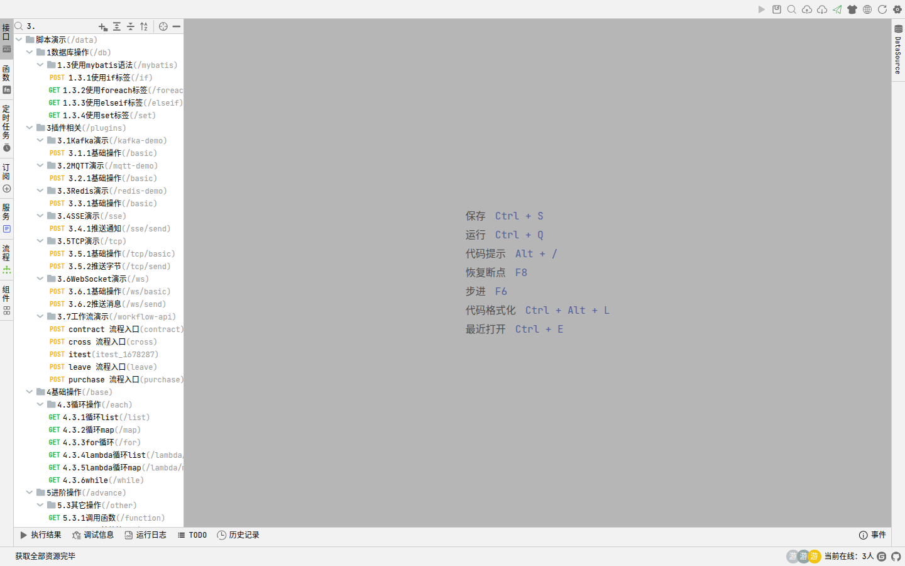

# GewuMind Boot 低代码开发教程

面向**实施开发者**：用内置的 magic-api 容器直接写接口、写前端组件、设计报表与流程，**不需要改 Java 代码、不需要重新构建前端**。

> 菜单操作见《使用手册》，源码构建见《二次开发指南》。

---

## 目录

- [1 · 心智模型](#1--心智模型)
- [2 · 第一个接口](#2--第一个接口)
- [3 · 在线调试（开发闭环）](#3--在线调试开发闭环)
- [4 · 脚本语言速查](#4--脚本语言速查)
- [5 · 数据库访问](#5--数据库访问)
- [6 · 增删改查标准套路](#6--增删改查标准套路)
- [7 · 写前端组件](#7--写前端组件)
- [8 · 报表](#8--报表)
- [9 · 工作流（审批流）](#9--工作流审批流)
- [10 · 定时任务与订阅](#10--定时任务与订阅)
- [11 · 收费能力（商业版）详解](#11--收费能力商业版详解)
- [12 · 权限与联调](#12--权限与联调)
- [13 · 常见坑](#13--常见坑)
- [14 · 想深入学？去 magic-api 官方文档](#14--想深入学去-magic-api-官方文档)

---

## 1 · 心智模型

代码分三类，各有各的存放位置：

| 类型 | 在哪写 | 存哪 | 生效方式 |
|---|---|---|---|
| **接口 / 函数 / 任务** | 在线编程 | `data/zh/magic-api/api|function|task/**.ms` | 保存即生效 |
| **前端组件** | 在线编程（组件标签）/ 动态组件 | `data/zh/magic-api/component/**.ms` | **刷新页面**生效 |
| **报表 / 工作流** | 对应标签 | `data/zh/magic-api/report|workflow/**` | 刷新页面生效 |

**全部是纯文本 `.ms` 文件**，可以直接用 IDE 编辑、可以用 Git 管理、可以批量生成。

### 1.1 `.ms` 文件格式（务必了解）

每个 `.ms` = **JSON 头 + 分隔符 + 源码**：

```
{ "id":"...", "path":"/list", "method":"POST", "script":"...", ... }
================================
<源码正文>
```

> ⚠️ **分隔符必须带首尾 `\r\n`**，即 `"\r\n" + 32个"=" + "\r\n"`。
> 后端用 `content.indexOf(SEPARATOR)` 切分；写成裸的 32 个 `=` 会导致切分失败，
> 后端把**整个文件（含 JSON 头）当成源码**，在线编辑器里就表现为"内容是空的"或一大坨 JSON。
>
> 正确格式（Node 示例）：
> ```js
> const SEP = '\r\n================================\r\n'
> const i = content.indexOf(SEP)
> if (i < 0) throw new Error('分隔符不匹配：缺少首尾 \\r\\n')
> ```
>
> **通过在线编辑器保存是安全的**（后端自己写回）。用脚本批量改时才必须自己保证。

---

## 2 · 第一个接口

### 2.1 新建

在线编程 → 左侧「接口」标签 → 点分组旁的 **+** → 选 HTTP 接口 → 填写：

| 字段 | 填什么 | 示例 |
|---|---|---|
| 接口名称 | 中文可读名 | `用户列表` |
| 路径 | 以 `/` 开头，**不要加 `/api`** | `/user/list` |
| 请求方式 | 与前端调用方一致 | `POST` |

保存后自动生成脚本骨架：

```javascript
return 'hello, gewumind'
```

### 2.2 前端调用

前端请求封装会自动补 `/api` 前缀，**代码里不要自己写**：

```javascript
$common.post('/user/list', { current: 1, size: 10 })
// 实际请求：POST /api/user/list

$common.get('/user/info', { id: '1' })
// 实际请求：GET  /api/user/info?id=1
```

> ⚠️ **`$common.post` 发的是 `application/x-www-form-urlencoded`，不是 JSON。**
> 后端脚本里要用**裸变量**接参数：
> ```javascript
> var page = request.getParameter('page')   // ✅ 表单字段直接读
> ```
> 确实要发 JSON 时用 `$common.postJson`，此时后端要用 `request.body` 读。
> 搞混这两者是新手最常见的"参数取不到"的原因。

### 2.3 返回值

脚本 `return` 什么，前端就收到什么（统一包成 `{code:200, message:'', data:...}`）。

```javascript
return { id: 1, name: '张三' }          // 前端拿到 {code:200,data:{id:1,name:'张三'}}
return db.select('select 1')            // 返回数据集
return db.selectOne('select 1')         // 返回单条
```

### 2.4 动手试：脚本演示里的演示表

「在线编程 → 接口 → 脚本演示(/data)」提供了大量可**直接运行**的示例。它们查询两张**演示专用表**：

| 表 | 用途 |
|---|---|
| `magic_api_info` | 模拟"接口信息"，含 `api_name` / `api_method` / `api_path` / `api_group_id` 等 |
| `magic_group` | 接口分组，含 `group_name`；演示脚本会 join 这两张表 |

```javascript
return db.table('magic_api_info')
        .column('api_name')
        .select()
```

> 这两张表只是**演示夹具（fixture）**，已随基线脚本一并初始化，不参与任何业务逻辑。
> 你可以随便改、随便删，也可以自己换成真实业务表来练手。

---

## 3 · 在线调试（开发闭环）

**这是低代码最核心的价值：改完立刻能跑、能断点、能看结果，不用重启服务、不用重新部署前端。**

打开「在线编程 → 接口」，点左侧任意接口即可在编辑器里写脚本并**直接运行**。

### 3.1 断点调试演示

下面这段 GIF 完整演示了断点调试的四个步骤：**打开接口 → 在行号左侧点一下设断点 → 展开调试信息面板 → 按 `Ctrl+Q` 运行，脚本停在断点行**。


停下来后的状态（静态大图）：


可以看到：
- **红色断点圆点**在行号旁，当前执行行**高亮**并带 `>` 标记
- 底部「调试信息」面板列出当前作用域的**全部变量**（`db`、`session`、`path`、`header` 等），左侧箭头可**逐层展开**查看对象内部
- 状态栏提示「开始调试」和当前接口路径

> 💡 **设断点的位置**：把鼠标移到编辑器**行号左侧的空白边距**（红色断点会出现在那里），点击即可切换断点。再点一次取消。

### 3.2 怎么运行

| 操作 | 快捷键 / 位置 |
|---|---|
| 运行当前脚本 | 右上角绿色 **▶**，或 `Ctrl+Q` |
| 保存 | `Ctrl+S` |
| 恢复断点 / 继续 | `F8` |
| 单步执行 | `F6` |
| 代码提示 | `Alt+/` |
| 格式化 | `Ctrl+Alt+L` |
| 最近打开 | `Ctrl+E` |

运行结果会输出到底部的「**运行结果**」面板；出错时切到「**调试信息**」看堆栈。

### 3.3 底部面板各干什么

| 面板 | 用途 |
|---|---|
| 接口信息 | 当前接口的路径、方法、参数定义 |
| 运行结果 | 脚本 `return` 的值 / `println` 的输出 |
| 调试信息 | 报错堆栈、断点命中时的变量值 |
| 运行日志 | 每次运行的记录 |
| 全局参数 | 调试时注入的全局变量 |
| TODO | 代码里标注的待办（`// TODO`） |
| 历史记录 | 这个资源的历史版本，可回滚对比 |

### 3.4 断点调试操作步骤

1. 在编辑器**行号左侧的空白边距**点一下 → 出现红色断点圆点（再点一次取消）
2. `Ctrl+Q` 运行 → 执行到断点处暂停，当前行高亮
3. 在「调试信息」面板查看当前变量的值，左侧箭头逐层展开
4. `F6` 单步一行，或 `F8` 继续跑到下一个断点 / 结束

> 调试是**逐次执行**的：改完代码再按一次 `Ctrl+Q` 即可，不需要任何"保存后重启"的等待。

### 3.5 用 `println` 看中间值

不确定某个变量是什么时，在脚本里插一行：

```javascript
var list = db.select('select * from sys_user')
println('查到 ' + list.size() + ' 个用户')
return list
```

`println` 的内容会出现在「运行结果」面板。这是低代码里最常用的排查手段。

### 3.6 监听调试：前后台联调神器（GewuMind Boot 独有）

> 💡 **这是 GewuMind Boot 在 magic-api 之上自研的能力，官方 magic-api 没有。**
> 官方只有「运行一次看结果」，而监听调试让你能**用真实的页面请求打断点**——
> 这正是前后台联调时最需要的。


**它解决什么问题？**

普通断点调试（3.4）只能在在线编辑器里按 `Ctrl+Q` 运行，**参数是编造的**。
但真实问题常常出在「前端传了什么」上——某个参数没传、类型不对、被拦截器改过。
监听调试让你**用真实页面的请求**打断点，看到的就是线上真实数据。

**怎么用（四步）**

| 步骤 | 操作 | 现象 |
|---|---|---|
| 1 | 打开要调的前后端分离接口所在文件 | — |
| 2 | 在代码行号**左侧空白处**点一下设断点 | 出现红色断点圆点 |
| 3 | 点工具栏的 **「监听调试」**（`debug-info` 图标） | 状态栏提示「API 已进入监听调试模式」，图标变红色停止键，▶ 运行键变灰 |
| 4 | **去前端页面触发这个接口** | 请求被**拦在断点处**，底部「调试信息」面板显示真实变量 |

**进入监听模式后能做什么**

- 前端发来的真实请求**不会直接执行完**，而是停在第一个命中的断点
- 在「调试信息」面板看真实入参、会话、请求头
- `F6` 单步、`F8` 继续，直到脚本跑完
- 再次点工具栏（此时是红色 ■）**退出监听**，恢复普通执行

**适用范围**

| 类型 | 说明 |
|---|---|
| 接口（api） | 前后台联调主力场景 |
| 订阅（subscriber） | 消费消息时断点，看消息体与处理过程 |
| 服务端（server） | 客户端连上来时断点 |

> ⚠️ 监听模式下**不能手动 `Ctrl+Q` 运行**（按钮会置灰），因为要等真实请求。
> 退出监听后即可恢复手动运行。

**为什么这是自研能力**

上游 magic-api 的调试模型是「编辑器内单次执行」，没有把**编辑器**与**真实请求链路**打通。
GewuMind Boot 通过三个自定义请求头
（`Magic-Request-Client-Id` / `Magic-Request-Script-Id` / `Magic-Request-Breakpoints`）
把断点信息随请求带给后端，由内核 `/ai/api/debug` 系列端点接管执行，
从而实现「用真实请求命中断点」。这层能力在内核 `com.gewumind.boot` 中，不在 magic-api 里。

---

### 3.7 调试 ≠ 已生效

在线调试只验证**脚本本身**能跑通。要让前端真正用上这个接口，还需要：

- `Ctrl+S` 保存（否则关闭标签就丢了）
- 配置好接口的 `permission`（见 [12.2](#122-给新接口加权限必做)）
- 在角色里勾上该权限码

## 4 · 脚本语言速查

脚本引擎是 magic-script，语法接近 JS 但有自己的规则。

### 4.1 变量与类型

```javascript
var a = 1                      // 数字
var b = 'text'                 // 字符串（单引号或双引号）
var c = true                   // 布尔
var d = null
var list = [1, 2, 3]
var map = { name: 'x' }
```

### 4.2 取值

| 来源 | 写法 |
|---|---|
| 路径参数 | `#/{id}` |
| 查询参数 | `#{}` 内置模板，或 `request.getParameter('name')` |
| 请求体（form） | 裸变量名直接用 |
| 请求头 | `request.getHeader('token')` |
| 会话用户 | `request.getAttribute('userId')`（经拦截器注入） |

### 4.3 控制流

```javascript
if (score >= 90) {
    return 'A'
} else if (score >= 60) {
    return 'B'
} else {
    return 'C'
}

for (item in list) {
    println(item)
}
```

### 4.4 内置模块（用 `import`）

```javascript
import http;
import db;
import sql;
import date;
import file;
import request;
import response;
```

### 4.5 常用函数

| 函数 | 作用 |
|---|---|
| `println(x)` | 调试输出（运行结果面板可见） |
| `uuid()` | 生成 UUID |
| `parseInt` / `parseFloat` | 类型转换 |
| `date.now()` | 当前时间戳 |
| `date.format(ts,'yyyy-MM-dd')` | 时间格式化 |

---

## 5 · 数据库访问

脚本里用 `db` 模块访问数据库。**所有 `.ms` 脚本共用主数据源**（`application.yml` 的
`spring.datasource`），连接池由 Spring Boot 的 HikariCP 管理。

### 5.1 核心方法

| 方法 | 作用 | 返回 |
|---|---|---|
| `db.select(sql, 参数)` | 查询多行 | `List<Map>` |
| `db.selectOne(sql, 参数)` | 查询一行 | `Map`（无则 `null`） |
| `db.selectValue(sql, 参数)` | 取第一行第一列 | 标量 |
| `db.selectInt(sql, 参数)` | 取整数 | `int` |
| `db.page(sql, 参数)` | 分页查询 | `List<Map>`，自动拼 limit |
| `db.insert(sql, 参数)` | 插入 | 主键 / 影响行数 |
| `db.update(sql, 参数)` | 更新 / 删除 | 影响行数 |
| `db.table('表名')` | 链式单表操作 | `Table` 对象 |

### 5.2 链式操作 `db.table()`

`db.table()` 返回 `Table` 对象，适合单表 CRUD，方法名直观：

```javascript
return db.table('sys_user')
        .column('id', 'username')       // 只查这几列
        .where()                        // 开启 where 链
        .eq('is_del', 0)
        .like('username', 'adm')
        .orderBy('create_date', 'desc')
        .page()
```

| 链式方法 | 作用 |
|---|---|
| `column(...)` | 指定要查询的列 |
| `eq` / `ne` / `gt` / `ge` / `lt` / `le` | 比较 |
| `like` / `notLike` / `likeLeft` / `likeRight` | 模糊 |
| `in` / `notIn` | 集合 |
| `between` | 区间 |
| `isNull` / `isNotNull` | 空值 |
| `orderBy(列, 方向)` | 排序 |
| `groupBy` / `having` | 分组 |
| `select()` / `page()` | 执行 |
| `count()` | 计数 |

`count()` 很常用（比如「查询数量」演示就是它）：

```javascript
return db.table('magic_api_info').count()
```

### 5.3 参数绑定：`#{}` 而不是拼接

**永远不要把用户输入拼进 SQL 字符串**，用 `#{}` 占位符：

```javascript
var user = db.selectOne("select * from sys_user where username = #{username}", {username: 'admin'})
```

第二个参数可以传对象，也可以不传（直接用裸变量）。`?{}` 条件片段见 5.5。

### 5.4 驼峰转换 `db.camel()`

数据库字段通常是 `user_name` 这种下划线风格，前端想要 `userName`，
在链上挂 `camel()` 即可自动转：

```javascript
return db.camel().select('select user_name, office_id from sys_user')
// 返回 { userName: '...', officeId: '...' }
```

> `db.table(...)` 是链式的，`camel()` 同样返回一个 db 实例，所以两者能叠加：
> `db.camel().table('sys_user').where().eq('id',1).select()`

### 5.5 条件片段 `?{}`（重点）

`?{条件, 片段}` —— 条件为真才把片段拼进 SQL，用来写动态 WHERE：

```sql
select * from sys_user
where is_del = 0
?{roleId,  and role_id = #{roleId}}
?{keyword, and (username like concat('%',#{keyword},'%') or name like concat('%',#{keyword},'%'))}
?{status,  and status = #{status}}
order by create_date desc
```

- 条件为**真**（变量有值）→ 拼接片段
- 条件为**空/未定义** → 整段丢弃，SQL 不会留下多余的 `and`

> ⚠️ 片段内部**必须自带 `and` 或 `or`**，这是最容易写错的地方。
> 漏了会拼出 `where is_del = 0 status = 1` 这种语法错误。

### 5.6 排序防注入

排序字段**不能用 `#{}`**（它是值占位符），必须先做白名单校验：

```javascript
var allow = { 'date': 'create_date', 'name': 'name', 'amount': 'amount' }
var col = allow[body.sortBy] || 'create_date'
var dir = body.sortOrder == 'asc' ? 'asc' : 'desc'
return db.page("select * from t_sale order by " + col + " " + dir)
```

> 直接把 `body.sortBy` 拼进 SQL 是 SQL 注入的典型入口。

### 5.7 批量 `in`

```javascript
var ids = body.ids          // '1,2,3'
if (ids) {
    return db.select('select * from sys_user where id in(#{ids.split(",")})')
}
```

`#{ids.split(',')}` 会展开成 `1,2,3`。

### 5.8 多数据源

#### 默认只带 MySQL，但不止 MySQL

发行包**默认只内置了 MySQL 驱动**（`mysql-connector-j`）——因为绝大多数场景够用，包体也最小。
要用 PostgreSQL / Oracle / SQL Server / 达梦 / 人大金仓等，**加驱动 + 配数据源即可**。

> ⚠️ 这也是《部署指南》里「目前只支持 MySQL 8」的由来——指默认发行包，
> 不是说内核不支持别的数据库。

#### 第一步：加数据库驱动（二次开发）

在 `pom.xml` 的 `dependencies` 里加对应驱动，并**重新打包**：

```xml
<!-- PostgreSQL -->
<dependency>
    <groupId>org.postgresql</groupId>
    <artifactId>postgresql</artifactId>
    <version>42.7.3</version>
</dependency>
<!-- SQL Server -->
<dependency>
    <groupId>com.microsoft.sqlserver</groupId>
    <artifactId>mssql-jdbc</artifactId>
    <version>12.6.1.jre11</version>
</dependency>
<!-- Oracle -->
<dependency>
    <groupId>com.oracle.database.jdbc</groupId>
    <artifactId>ojdbc11</artifactId>
    <version>23.4.0.24.05</version>
</dependency>
```

```bash
bash scripts/stop.sh && mvn -q -o package -DskipTests && bash scripts/start.sh
```

#### 第二步：配置数据源

**方式 A · `application.yml`（推荐，适合固定的数据源）**

```yaml
gewumind:
  datasource:
    master:
      url: jdbc:mysql://localhost:3306/gewumind-boot?characterEncoding=UTF8&allowPublicKeyRetrieval=true
      username: root
      password: 你的密码
      driver-class-name: com.mysql.cj.jdbc.Driver
    slave:                                    # 任意 key 名
      url: jdbc:postgresql://10.0.0.9:5432/analytics
      username: postgres
      password: 你的密码
      driver-class-name: org.postgresql.Driver
```

> key 名自己定（示例用 `master` / `slave`），脚本里就用这个 key。

**方式 B · 后台「数据源」页面（适合运行期增删）**

在线编程 → 数据源标签 → 新增，填名称、JDBC 地址、账号密码。
支持在线新增多个，业务代码用 key 引用，改完**即时生效**。

#### 第三步：在脚本里用

```javascript
// 主库（application.yml 的 spring.datasource，也是 db 的默认数据源）
return db.select('select * from sys_user')

// 指定数据源：db.<key>
return db.slave.select('select * from report_daily')

// 动态切换：db[key]
const dsKey = body.dbKey || 'slave'
return db[dsKey].select('select 1')
```

切换后 `db.xxx` 的**所有方法**（`select`/`update`/`insert`/`page`/`table`…）都作用于该数据源。

#### 典型场景：主从分离

```javascript
// 读走从库
var orders = db.slave.select("select * from t_order where user_id = #{userId}")
// 写走主库
db.update("insert into t_order(user_id, amount) values(#{userId}, #{amount})")
```

#### 想支持更多数据库类型（扩展数据源驱动）

默认的 `DataSource` SPI 只内置了 MySQL。如果你要接入的是**驱动本身不支持的类型**
（如 ClickHouse、TDengine、国产库的自研协议），可以自己写扩展：

```java
// 1) 实现 magic-api 的数据源工厂，注册进 Spring
@Component
public class ClickHouseDataSourceFactory {
    // 按 magic-api 的 SPI 接口产出 DataSource 实例
    // 参考 magic-api 源码 org.ssssssss.magicapi.datasource.model
}

// 2) 打包进 jar，或直接放在 gewumind-boot 的 libs/ 下
// 3) 重启后即可在「数据源」页面选用该类型
```

magic-api 的数据源模型位于 `org.ssssssss.magicapi.datasource.model`，
扩展点与内置实现可以参考官方文档的「自定义数据源」章节。

### 5.9 事务

```javascript
return transaction(() => {
    var id = db.insert("insert into t_order(no, amount) values(#{no}, #{amount})")
    db.update("update t_stock set num = num - #{amount} where goods_id = #{goodsId}")
    return { orderId: id }
})
```

回调里**抛异常**即整体回滚。不抛异常就提交。

批量写入时建议用事务包起来，否则中途失败会留下脏数据。

### 5.10 排查

| 现象 | 原因 |
|---|---|
| `Unknown column` | 字段名写错，或漏了数据库前缀 |
| SQL 语法错误、`where 1=1 and` | `?{}` 片段没带 `and` |
| 查不到数据但数据确实在 | 忘了 `is_del = 0`；或值有前后空格 |
| 中文乱码 | 连接串缺 `characterEncoding=UTF8` |
| `Communications link failure` | 数据库不可达，或没开 `allowPublicKeyRetrieval`（MySQL 8） |
| 事务没生效 | 忘了用 `transaction(() => {...})` 包住 |

## 6 · 增删改查标准套路

系统自身的接口就是这套写法，**照抄最省事**。

### 6.1 列表（分页 + 多条件）

`data/zh/magic-api/api/系统管理/用户管理/列表.ms` 的真实实现：

```javascript
return db.page("""
    select
        distinct
        su.id,
        su.username,
        su.name,
        su.is_login,
        so.name office_name,
        (select group_concat(sr.name) from sys_role sr
           left join sys_user_role sur on sr.id = sur.role_id
          where sr.is_del = 0 and sur.user_id = su.id) roles
    from sys_user su
    left join sys_office so on su.office_id = so.id
    left join sys_user_role sur on su.id = sur.user_id
    where su.is_del = 0
    ?{roleId,  and sur.role_id in(#{roleId.split(',')})}
    ?{officeId, and su.office_id in(#{officeId.split(',')})}
    ?{username, and su.username like concat('%',#{username},'%')}
    ?{name,     and su.name like concat('%',#{name},'%')}
    ?{isLogin,  and su.is_login = #{isLogin}}
""")
```

要点：
- `"""..."""` 多行字符串，SQL 可读性好
- 用**子查询**把多值字段（角色名）拼成一行，避免一对多 join 导致主表行重复
- `?{}` 处理全部可选筛选条件

### 6.2 新增

```javascript
// 1) 生成主键
var id = uuid()
// 2) 写主表
db.update("""insert into t_demo(id, name, create_by, create_date, update_date)
            values(#{id}, #{name}, #{userId}, now(), now())""")
// 3) 写关联表
if (roleIds) {
    for (rid in roleIds.split(',')) {
        db.update("insert into t_demo_role(demo_id, role_id) values(#{id}, #{rid})")
    }
}
// 4) 返回
return { id: id }
```

### 6.3 修改 / 删除

```javascript
// 修改
db.update("""update t_demo
            set name = #{name}, update_by = #{userId}, update_date = now()
            where id = #{id} and is_del = 0""")

// 逻辑删除（推荐）
db.update("""update t_demo
            set is_del = 1, update_by = #{userId}, update_date = now()
            where id = #{id}""")
```

> **一律逻辑删除**（`is_del=1`），所有查询都带 `where is_del = 0`。
> 物理删除会带走关联记录与审计线索。

### 6.4 前端组件调用

```javascript
const res = await $common.post('/user/list', {
    current: page.value,
    size: pageSize.value,
    username: search.value
})
list.value = res.data.list
total.value = res.data.total
```

---

### 6.5 导出 Excel

列表导出不用自己写脚本——`mb-table` 内置了，配好 `cols` 就能导：

```javascript
const table = ref()

// 组件模板里
// <mb-button @click="table.exportExcel({ fileName: '用户数据' })">导出</mb-button>
// <mb-table ref="table" :options="tableOptions" />
```

`exportExcel` 会**自动带上当前的查询条件**，并把影响导出的列按 `cols` 转成表头。
需要自定义导出内容时，用 `exportRender`：

```javascript
{
    field: 'isLogin', label: '状态',
    exportRender: (row) => row.isLogin == 1 ? '已禁用' : '正常'
}
```

> 导出是**前端行为**，不需要额外的后端接口；数据量大时接口要支持 `size` 传大值。

### 6.6 批量操作

`mb-table` 开 `selection: true` 后可拿到选中行，配合删除接口：

```javascript
const tableOptions = reactive({
    url: '/system/user/list',
    page: true,
    selection: true,              // 开启多选
    cols: [ /* ... */ ]
})

function batchDelete() {
    const rows = table.value.getSelection()
    if (!rows.length) return $message.warning('请先选择要删除的数据')
    $common.handleDelete({
        url: '/system/user/batch-delete',
        id: rows.map(r => r.id).join(','),
        done: () => table.value.reload()
    })
}
```

后端要支持批量接收（**参数名和前端一致**）：

```javascript
var ids = body.id
if (!ids) return { success: false, message: '缺少 id' }
var arr = ids.split(',')
db.update("update sys_user set is_del = 1 where id in(#{arr})")
return { success: true, affected: arr.length }
```

### 6.7 批量导入（两步走）

**第一步：上传 → 后端解析并预览**

```javascript
import cn.hutool.poi.excel.ExcelUtil
import java.io.ByteArrayInputStream

var datas = ExcelUtil.getReader(new ByteArrayInputStream(request.getFile('file').getBytes())).readAll()
return { datas: datas, sourceDatas: datas }
```

**第二步：用户确认 → 入库**

```javascript
var datas = body.datas
for (d in datas) {
    db.update("insert into sys_user(username, name, office_id) values(#{d.username}, #{d.name}, #{d.officeId})")
}
return { success: true }
```

前端用弹窗把解析结果渲染成表格让用户确认，确认后再提交——系统的用户导入就是这个套路，
可直接参考 `component/系统设置/user/用户管理.ms` 与 `api/系统管理/用户管理/导入*.ms`。


## 7 · 写前端组件

页面是 `.ms` 组件文件（一个 Vue SFC），存放在 `data/zh/magic-api/component/<组>/<名称>.ms`，
后端在启动时读取并注册为全局组件。**改完刷新页面即生效，不用重新构建前端。**


### 7.1 组件库里有什么

所有 `mb-*` 组件都是**全局注册**的，直接写标签，不用 import。

| 分类 | 组件 |
|---|---|
| **表格** | `mb-table` `mb-pagination` `mb-editor-table` `mb-search` `mb-tree` `mb-tree-select` |
| **表单** | `mb-form` `mb-input` `mb-textarea` `mb-number` `mb-select` `mb-switch` `mb-checkbox` `mb-date` `mb-radio-dict` `mb-upload-image` `mb-upload-file` `mb-upload-oss-file` |
| **反馈** | `mb-modal` `mb-table-tooltip` `mb-message` `mb-notification` |
| **模板** | `mb-list` |
| **基础** | `mb-icon` |

`n-*` 是 Naive UI 的组件（`n-input` `n-select` `n-button` `n-modal` `n-data-table` …），同样全局可用。

> **选型建议**：列表页优先用 `mb-table`，它把「查询条件 + 分页 + 导出 + 批量」都封装好了，
> 手写 `n-data-table` 要多写几百行。

### 7.2 列表页：`mb-table`（最常用）

一个完整的增删改查列表，核心就是一份 `tableOptions` 配置。

```vue
<template>
    <mb-search :options="tableOptions" :where="tableOptions.where" />
    <div class="toolbar">
        <mb-button @click="handleCreate">新增</mb-button>
        <mb-button @click="() => table.exportExcel({ fileName: '用户数据' })">导出</mb-button>
    </div>
    <mb-table ref="table" :options="tableOptions" />
</template>

<script setup>
import { ref, reactive, nextTick } from 'vue'

const table = ref()
const dialogTitle = ref('')
const userFormDialog = ref()
const userFormRef = ref()

const tableOptions = reactive({
    id: 'user-list',
    url: '/system/user/list',      // 列表接口
    page: true,                   // 开启分页
    selection: true,               // 开启多选（批量操作用）
    where: {                      // 查询条件
        username: { label: '登录名称', props: { width: '80px' } },
        name:     { label: '姓名/昵称' },
        roleId: {
            label: '角色',
            component: 'select',   // 渲染成下拉
            multiple: true,
            props: { url: '/system/role/all', width: '200px' }
        }
    },
    cols: [
        { field: 'username', label: '登录名称', realSort: true },
        { field: 'name',     label: '姓名/昵称' },
        { field: 'officeName', label: '所属机构' },
        { field: 'roles',    label: '角色', type: 'dynamic' },
        {
            field: 'isLogin', label: '禁止登录', type: 'switch',
            if: (row) => row.id != '1',                       // 行级隐藏
            change: (row) => {
                $common.get('/system/user/change/login/status', { id: row.id, isLogin: row.isLogin })
            }
        },
        {
            label: '操作', type: 'buttons', width: 140, fixed: 'right',
            buttons: [
                {
                    permission: 'user:save', label: '修改', type: 'primary', link: true,
                    click: (row) => handleUpdate(row)
                },
                {
                    permission: 'user:delete', label: '删除', type: 'primary', link: true,
                    if: (row) => row.id != '1',
                    click: (row) => {
                        $common.handleDelete({
                            url: '/system/user/delete',
                            id: row.id,
                            done: () => table.value.reload()
                        })
                    }
                }
            ]
        }
    ]
})

function handleCreate() {
    dialogTitle.value = '添加'
    userFormDialog.value.show()
    nextTick(() => userFormRef.value.resetTemp())
}
function handleUpdate(row) {
    dialogTitle.value = '修改'
    userFormDialog.value.show()
    nextTick(() => userFormRef.value.getInfo(row))
}
function reloadTable() {
    userFormDialog.value.hide()
    table.value.reload()
}
</script>
```

**`cols` 常用字段**

| 字段 | 说明 |
|---|---|
| `field` | 字段名，对应接口返回的键 |
| `label` | 表头文字 |
| `type` | `dynamic`（自定义渲染）/ `switch`（开关列）/ `buttons`（操作列） |
| `permission` | **按钮权限码**，无权限自动隐藏 |
| `realSort` | `true` 时把排���交给后端 |
| `if` | 函数，返回 `false` 则该行隐藏此列/按钮 |
| `change` | `switch` 列切换后的回调 |
| `click` | 按钮点击回调，参数是行数据 |
| `width` / `fixed` | 列宽 / 固定列 |
| `exportRender` | 导出时的显示值转换 |

**`mb-table` 暴露的方法**（通过 `ref` 调）

| 方法 | 说明 |
|---|---|
| `table.reload()` | 重新加载数据 |
| `table.exportExcel({ fileName })` | 导出 Excel（自动带上当前查询条件） |
| `table.getData()` | 取当前表格数据 |
| `table.getSelection()` | 取选中的行 |
| `table.clearSelection()` | 清空选择 |
| `table.expandByKeys(keys)` | 展开指定行 |

### 7.3 新增/修改弹窗：`mb-modal` + 子组件

`mb-modal` 用的是 layui-layer，**通过 `show()` / `hide()` 控制，不是 `v-model`**：

```vue
<mb-modal ref="userFormDialog" :title="dialogTitle" @confirm="userFormRef.save($event)" width="670px">
    <user-form ref="userFormRef" @reload-table="reloadTable" />
</mb-modal>
```

```javascript
userFormDialog.value.show()    // 打开
userFormDialog.value.hide()    // 关闭
```

`@confirm` 回调收到的是按钮 `event` 对象，一般直接转发给表单组件的 `save(event)`。

> ⚠️ 自动化测试里找弹层要用 **`.layui-layer`**（不是 `.n-modal`），这是 `mb-modal` 的真实 DOM 类。

### 7.4 表单组件

最省事的方式是**把表单拆成独立组件**，主组件通过 `ref` 调它——系统的用户表单就是这么做的。

```javascript
const formRef = ref()

formRef.value.resetTemp()      // 新增：清空表单
formRef.value.getInfo(row)     // 修改：回填一行数据
formRef.value.save(event)      // 提交
```

自己写表单时常用：

```vue
<mb-form :model="formModel" :rules="rules" label-placement="left" label-width="90px">
    <n-form-item label="名称" path="name">
        <n-input v-model:value="formModel.name" />
    </n-form-item>
</mb-form>
```

### 7.5 上传

| 组件 | 用途 |
|---|---|
| `mb-upload-image` | 图片 |
| `mb-upload-file` | 普通文件 |
| `mb-upload-oss-file` | 传到 OSS |

### 7.6 导入 Excel（两步走）

系统的用户导入是标准范式：**先上传预览 → 确认后入库**。

```javascript
// 第一步：上传后预览，返回解析出的数据
function importUserSuccess(res, file) {
    importUserRef.value.handlerRemove(file)
    sourceDatas.value = res.data.sourceDatas
    previewDialog.value.show(() => {
        previewTableOptions.data = res.data.datas     // 直接塞进表格预览
        previewTableOptions.cols = Object.keys(res.data.datas[0] || {})
            .map(key => ({ field: key, label: key }))
    })
}

// 第二步：确认导入
function importUsers() {
    $common.postJson('/system/user/import', { datas: sourceDatas.value })
        .then(() => { $message.success('导入成功'); previewDialog.value.hide(); table.value.reload() })
}
```

后端用 hutool 解析：

```javascript
var datas = ExcelUtil.getReader(new ByteArrayInputStream(request.getFile('file').getBytes())).readAll()
```

### 7.7 关键约定（写之前先看）

| 约定 | 说明 |
|---|---|
| API 调用用 `$common` | 不要用 `fetch` / `axios`（拿不到 token 拦截） |
| 路径**不加** `/api` | `$common` 会自动补 |
| `post` 是表单格式 | 需要 JSON 用 `postJson` |
| 按钮权限 | `permission: 'user:save'`，无权限自动隐藏 |
| 删除用 `$common.handleDelete` | 自带确认框与回调 |
| 表格刷新 | `table.value.reload()` |
| 弹层用 `show()/hide()` | `mb-modal` 不是 `v-model` |

### 7.8 排查

| 现象 | 原因 |
|---|---|
| 表格空白 | `url` 写错，或接口返回结构不是 `{list, total}` |
| 查询条件没值 | `where` 的键要和列表接口的参数名一致 |
| 按钮不显示 | 缺 `permission`，或角色没勾该权限码 |
| `mb-modal is not a function` | 标签写错，或组件未注册（检查文件名） |
| 导出内容为空 | 接口没按查询条件返回全量数据 |
| 页面没变化 | `.ms` 没重新编译；用后台编辑器保存可自动重编译 |

## 8 · 报表

报表不是写配置文件，而是**一个 Vue 组件文件**（`.ms`），内部用内置的 `<MagicReport>` 组件渲染。
本质是「一段查询接口 + 一份列定义」。

### 8.1 最小可运行报表

新建 `data/zh/magic-api/component/报表示例/我的报表.ms`：

```vue
<template>
    <MagicReport
        title="我的报表"
        entryApi="/biz/report/my"
        :params="params"
        :columns="columns"
    />
</template>

<script setup>
import MagicReport from '@/components/report/MagicReport.vue'

// 查询条件（渲染在表格上方的筛选区）
const params = [
    { field: 'month', label: '月份', type: 'month', default: '2026-07' },
    { field: 'keyword', label: '关键字', type: 'input', placeholder: '模糊查询', width: 160 }
]

// 列定义
const columns = [
    { key: 'item', title: '项目', width: 200 },
    { key: 'amount', title: '金额', width: 140, align: 'right', format: 'money' }
]
</script>
```

再建查询接口 `data/zh/magic-api/api/业务/报表/my.ms`：

```javascript
// 报表组件用 postJson 发 JSON，所以这里要用 body 取参数
var month = body.month
var keyword = body.keyword

return db.page("""
    select item, amount
    from t_sale
    where 1 = 1
    ?{month,   and month = #{month}}
    ?{keyword, and item like concat('%', #{keyword}, '%')}
    order by month desc
""")
```

> ⚠️ **报表接口用 `postJson` 发 JSON**，所以脚本里要用 **`body`** 取参数，
> 而不是 `$common.post` 那套裸变量。写错就是「参数永远是空」。

挂到菜单：`报表明细` 菜单，路由填组件的 path（如 `/report-demo/my`），改完**刷新页面**即可看到。

### 8.2 `params` 查询条件

| 字段 | 说明 |
|---|---|
| `field` | 参数名，会原样作为 JSON 字段发给接口 |
| `label` | 界面上的标签文字 |
| `type` | 控件类型，见下表 |
| `default` | 默认值，点「重置」也会回到它 |
| `placeholder` | 输入框提示文字 |
| `width` | 控件宽度 |

**支持的 `type`**

| type | 用途 |
|---|---|
| `input` / `text` | 单行文本 |
| `number` | 数字输入 |
| `select` | 下拉，需配 `options` |
| `month` / `date` / `time` | 日期类选择 |
| `autocomplete` | 联想输入，需配对应的接口 |
| `cascader` | 级联选择 |

`select` 与 `autocomplete` 还要配数据来源，通常是另一个「选项接口」：

```javascript
const params = [
    {
        field: 'regionId', label: '区域', type: 'select',
        optionsApi: '/biz/report/regions',       // 选项接口
        labelKey: 'name', valueKey: 'id'
    }
]
```

> 选项接口要返回数组，形如 `[{ id: 1, name: '华东' }]`。

### 8.3 `columns` 列定义

| 字段 | 说明 |
|---|---|
| `key` | 字段名，必须与接口返回的字段一致 |
| `title` | 表头文字 |
| `width` | 列宽 |
| `align` | `left`（默认）/ `center` / `right` |
| `fixed` | 固定列，`'left'` / `'right'` |
| `ellipsis` | `true` 时超长省略 |
| `sorter` | 默认开启前端排序；设 `false` 关闭 |
| `format` | 格式化，见下 |
| `children` | 表头分组（双层表头） |

**`format` 可选值**

| 值 | 效果 |
|---|---|
| `money` | 千分位 + `¥` 前缀 |
| `number` | 千分位数字 |
| `percent` | 转百分比（`0.15` → `15.00%`） |
| 不写 | 原样输出 |

### 8.4 双层表头与动态列

列支持 `children` 做**多层表头**（中国式报表的用法）：

```javascript
const columns = [
    {
        title: '上期', children: [
            { key: 'revPrev', title: '收入', align: 'right', format: 'money' },
            { key: 'costPrev', title: '成本', align: 'right', format: 'money' }
        ]
    },
    {
        title: '本期', children: [
            { key: 'revNow', title: '收入', align: 'right', format: 'money' },
            { key: 'costNow', title: '成本', align: 'right', format: 'money' }
        ]
    }
]
```

**动态列**（交叉报表的用法）：先用 `db.select` 拿到所有产品名，再拼列：

```javascript
const res = await $common.post('/biz/report/cross', {})
const productKeys = (res.data || []).map(r => r.product)

const columns = [
    { key: 'region', title: '区域', width: 100 },
    ...productKeys.map(k => ({
        key: k, title: k, width: 130, align: 'right', format: 'money'
    })),
    { key: 'total', title: '合计', width: 130, align: 'right', format: 'money' }
]

// 列变多时把横向滚动宽度调大
const scrollX = 100 + productKeys.length * 130 + 130
```

### 8.5 合计与分组汇总

**`aggregates`** —— 表格底部的合计行：

```javascript
const aggregates = [
    { key: 'amount', label: '合计', align: 'right', format: 'money' }
]
```

**`groupBy`** —— 按字段分组并小计（明细带汇总报表）：

```javascript
<MagicReport ... :groupBy="'region'" :aggregates="aggregates" />
```

### 8.6 导出 Excel

传 `exportMeta` 就能导出（需有对应权限）：

```javascript
const exportMeta = { title: '月度利润表', subtitle: '数据截止 2026-07', maker: '财务部', remark: '内部资料' }
```

```vue
<MagicReport entryApi="/biz/report/my" :columns="columns" :exportMeta="exportMeta" />
```

### 8.7 其它 props

| prop | 说明 |
|---|---|
| `subtitle` | 副标题，显示在标题下方 |
| `maxHeight` | 表格最大高度，超出滚动 |
| `scrollX` | 横向滚动宽度，默认 `1200`；列多时要调大 |
| `colsPerRow` | 查询条件每行几个，默认 `0`（一行铺满） |
| `loadOptions` | 是否自动加载选项，默认 `true` |
| `rowClassName` | 函数，自定义行样式 |

### 8.8 系统预置的报表示例

「报表达例」菜单下有 9 个可直接参考源码的例子：

| 示例 | 演示了什么 |
|---|---|
| 清单报表 | 最简结构：查询条件 + 列 + 金额格式化 |
| 交叉报表 | 动态列 + 合计列 |
| 中国式报表 | 多层表头（`children`） |
| 明细带汇总 | `groupBy` 分组小计 |
| 带条件格式 | 按值着色 |
| 嵌套明细 | 主子表联动 |
| 多 Sheet | 一个组件多个页签 |
| 跨行合并 | 相邻同值自动合并 |
| 列头扩展 | 自定义表头 |

> **学习建议**：直接打开这 9 个 `.ms` 看源码，比看文档快得多——
> 每种形态都有一个现成可跑的范本。

### 8.9 排查

| 现象 | 原因 |
|---|---|
| 表格空白 | 接口报错或返回非数组；看浏览器控制台的 `[MagicReport] query failed` |
| 查询条件没生效 | 接口里用了裸变量取参，但报表走的是 `postJson`，应改用 `body` |
| 列全是 undefined | `columns[].key` 与接口返回字段对不上 |
| 数字显示成 `1234` 没千分位 | 该列少了 `format: 'money'` |
| 列多时横向挤在一起 | 调大 `scrollX` |
| `MagicReport is not defined` | 忘了 `import MagicReport from '@/components/report/MagicReport.vue'` |

## 9 · 工作流（审批流）

工作流用来做**多级审批**：请假、合同、采购、报销这类「发起 → 逐级审批 → 结束」的流程。

它是**收费能力**（`workflow.enabled`），但流程运行时完全在本项目内，不需要外部引擎。


### 9.1 三个组成部分

| 部分 | 存哪 | 作用 |
|---|---|---|
| **流程定义** | `data/zh/magic-api/workflow/<组>/<名称>.ms` | 节点、角色、条件分支 |
| **入口接口** | `api/.../<name>_entry.ms` | 前端调它来发起/审批/查询 |
| **包装页面** | `component/...` | 发起表单 + 流程详情页 |

### 9.2 流程定义怎么写

流程定义脚本接受一个 `action` 参数，`getDefinition` 时返回结构：

```javascript
var action = body.action

if (action == 'getDefinition') {
    return {
        description: '员工填写请假类型、天数与事由发起申请。部门经理审批；超过 3 天需总经理审批。',
        title: '{applicantName} 请假 {days} 天（{leave_type}）',   // 标题模板
        nodes: [
            { id: 'apply',       label: '员工申请',   type: 'start',   role: '${initiator}' },
            { id: 'mgr_approve', label: '部门经理审批', type: 'approve', role: 'dept_manager' },
            { id: 'dir_approve', label: '总经理审批',  type: 'approve', role: 'director' },
            { id: 'hr_record',   label: 'HR 备案',    type: 'cc',      role: 'hr' },
            { id: 'end',         label: '结束',       type: 'end' }
        ],
        routes: [
            { from: 'apply',       to: 'mgr_approve' },
            { from: 'mgr_approve', to: 'dir_approve', when: 'variables.days > 3' },
            { from: 'mgr_approve', to: 'hr_record',   when: 'variables.days <= 3' },
            { from: 'dir_approve', to: 'hr_record' },
            { from: 'hr_record',   to: 'end' }
        ]
    }
}
```

**字段说明**

| 字段 | 说明 |
|---|---|
| `nodes[].id` | 节点标识，`routes` 里引用它 |
| `nodes[].label` | 节点显示名 |
| `nodes[].type` | `start` 发起 / `approve` 审批 / `cc` 抄送 / `end` 结束 |
| `nodes[].role` | 审批人角色，见下 |
| `routes[].when` | 条件表达式，**不写表示无条件跳转** |
| `title` | 实例标题模板，`{变量名}` 会被发起时的表单数据替换 |

**条件表达式里能用什么**

- `variables.xxx` —— 发起时传的表单变量（`body` 里的字段）
- 基础比较与逻辑运算符，支持 `> >= < <= == != && ||`
- 可以调函数，如 `variables.amount > 10000`

**`role` 取值**

| 写法 | 含义 |
|---|---|
| `${initiator}` | 发起人自己（用于 start 节点） |
| 角色标识，如 `dept_manager` | 该角色下的用户 |
| 用户标识 | 指定某人 |

### 9.3 `workflow` 模块 API

这是发起与审批用到的全部方法，直接在脚本里调用：

**发起与流转**

| 方法 | 说明 |
|---|---|
| `workflow.start(processId, {initiator, title, currentNode, variables, biz})` | 创建实例 |
| `workflow.createTask(instanceId, nodeId, nodeLabel, assignee)` | 建待办任务 |
| `workflow.findNextNode(processId, nodeId, variables, instanceId, userId, limit)` | 按条件找下一个节点 |
| `workflow.moveToNext(instanceId, nodeId, nodeLabel, assignee)` | 推进到下一节点 |
| `workflow.getInstance(instanceId)` | 取实例详情 |
| `workflow.getTask(taskId)` / `workflow.getNodeLabel` / `workflow.getNodeRole` | 取任务/节点信息 |

**审批动作**

| 方法 | 说明 |
|---|---|
| `workflow.approve(taskId, userId, comment)` | 通过 |
| `workflow.reject(taskId, userId, comment)` | 驳回到发起人 |
| `workflow.deny(taskId, userId, comment)` | 拒绝（流程终止） |
| `workflow.confirm(taskId, userId, comment)` | 抄送确认 |
| `workflow.resubmit(taskId, ...)` / `workflow.resubmitNodeTask(...)` | 驳回后重新提交 |
| `workflow.withdraw(instanceId, userId)` | 发起人撤回 |
| `workflow.findPreviousNode(processId, nodeId, ...)` | 找上一节点（驳回用） |

**查询**

| 方法 | 说明 |
|---|---|
| `workflow.queryMyStarted(userId, processId, extra)` | 我发起的 |
| `workflow.queryMyTasksFiltered(userId, processId, extra)` | 待我处理的（支持状态/时间/标题过滤） |
| `workflow.queryHistory(instanceId)` | 流转历史 |
| `workflow.resolveRole(role, userId)` | 角色 → 用户列表 |
| `workflow.applyTitle(processId, vars)` | 用标题模板生成标题 |
| `workflow.updateBizFields(instanceId, fields)` | 更新业务字段 |

### 9.4 发起一个流程（完整示例）

入口接口按 `action` 分发处理，这是标准写法：

```javascript
var action = body.action
var processId = body.processId

// 发起
if (action == 'start') {
    var uid = body.userId || 'employee'

    // 把控制字段剔掉，剩下的当作表单变量
    var data = {}
    for (k, v in body) {
        if (k == 'action' || k == 'processId' || k == 'userId') continue
        data[k] = v
    }

    var titleVars = {}
    for (kv, vv in data) titleVars[kv] = vv
    titleVars.applicant = uid
    var title = workflow.applyTitle(processId, titleVars)

    var inst = workflow.start(processId, {
        initiator: uid,
        title: title,
        currentNode: 'apply',
        variables: body,          // 供 routes[].when 里的 variables.xxx 使用
        biz: { type: processId, title: title, data: data }
    })

    // 自动完成发起节点并流转到下一节点
    var task = workflow.createTask(inst.id, 'apply', '员工申请', uid)
    workflow.approve(task.id, 'system', '员工提交申请')

    var nextNode = workflow.findNextNode(processId, 'apply', body, inst.id, '' + uid, 50)
    var nextLabel = workflow.getNodeLabel(processId, nextNode)
    var users = workflow.resolveRole(workflow.getNodeRole(processId, nextNode), uid)
    var assignee = users.size() > 0 ? users.get(0) : null
    var nextTask = workflow.moveToNext(inst.id, nextNode, nextLabel, assignee)

    return {
        success: true,
        instanceId: inst.id,
        nextNode: nextNode,
        nextNodeLabel: nextLabel,
        assignee: assignee,
        nextTask: nextTask
    }
}
```

**要点**：`variables` 必须传 `body`，否则 `routes[].when` 里 `variables.days` 取不到值，
条件分支会全部走不到，流程直接跳到结束。

### 9.5 审批与查询

```javascript
// 我发起的 / 待我处理的
if (action == 'myStarted') {
    return { success: true, data: workflow.queryMyStarted(body.userId, processId, {}) }
}
if (action == 'myTasks') {
    return { success: true, data: workflow.queryMyTasksFiltered(body.userId, processId, {}) }
}

// 审批：查详情 → 通过/驳回 → 推进
if (action == 'approve') {
    var task = workflow.getTask(body.taskId)
    workflow.approve(task.id, body.userId, body.comment || '同意')

    var nextNode = workflow.findNextNode(processId, task.nodeId, task.variables, task.instanceId, body.userId, 50)
    if (nextNode == 'end' || nextNode == null) {
        workflow.moveToNext(task.instanceId, 'end', '结束', null)
        return { success: true, finished: true }
    }
    var label = workflow.getNodeLabel(processId, nextNode)
    var users = workflow.resolveRole(workflow.getNodeRole(processId, nextNode), body.userId)
    workflow.moveToNext(task.instanceId, nextNode, label, users.size() > 0 ? users.get(0) : null)
    return { success: true, finished: false, nextNode: nextNode, nextNodeLabel: label }
}

// 驳回 / 拒绝 / 撤回
if (action == 'reject') { workflow.reject(body.taskId, body.userId, body.comment); return { success: true } }
if (action == 'deny')   { workflow.deny(body.taskId, body.userId, body.comment);   return { success: true } }
if (action == 'withdraw'){ workflow.withdraw(body.instanceId, body.userId);       return { success: true } }

// 历史
if (action == 'history') {
    return { success: true, data: workflow.queryHistory(body.instanceId) }
}
```

> 前端调入口接口记得用 **`postJson`**（和工作流示例一致），脚本里用 `body` 取参。

### 9.6 系统预置的四个流程

「流程演示」菜单下有四个可直接运行的完整流程，**建议直接打开源码改**：

| 流程 | 演示了什么 |
|---|---|
| 请假审批 | 条件分支（>3 天加一级）、抄送 |
| 合同审批 | 多级串签 |
| 采购审批 | 金额分级审批 |
| 跨部门申请 | 跨部门协作 |
| 流程详情 | 审批页面范本 |

对应的入口脚本在 `api/脚本演示/3插件相关/3.7工作流演示/`。

### 9.7 数据落在哪

| 表 | 存什么 |
|---|---|
| `sys_wf_instance` | 流程实例（标题、状态、发起人、变量 JSON） |
| `sys_wf_task` | 待办任务 |
| `sys_wf_history` | 流转历史 |
| `sys_wf_process_biz` | 业务数据关联 |

> 变量以 JSON 存在 `sys_wf_instance.variables_json`，字段多时该列会变长，
> 表单特别复杂的流程建议把大对象放 `biz.data` 并考虑分表。

### 9.8 排查

| 现象 | 原因 |
|---|---|
| 发起后直接结束 | `routes[].when` 的 `variables` 取不到值 → 检查 `start` 是否传了 `variables: body` |
| 找不到审批人 | `resolveRole` 返回空 → 检查流程定义里的 `role` 标识是否存在 |
| 条件分支走错 | `when` 表达式语法，或变量类型不对（字符串 vs 数字） |
| 标题里 `{}` 没替换 | `applyTitle` 的模板变量名与 `titleVars` 的键对不上 |
| 审批后卡住 | `findNextNode` 返回 null 但没走 `moveToNext(..., 'end', ...)` |

## 10 · 定时任务与订阅

这两类脚本不在「接口」里，在**独立的标签页**上维护。

### 10.1 定时任务

**在线编程 → 定时任务**标签，点分组旁的 `+` 新建。填 cron 表达式与脚本：

```javascript
// 每天 02:00 清理 30 天前的登录日志
var rows = db.select("select id from sys_login_log where create_date < date_sub(now(), interval 30 day)")
for (r in rows) {
    db.update("delete from sys_login_log where id = #{r.id}")
}
println('清理完成，共 ' + rows.size() + ' 条')
```

**cron 是标准 6 位**（秒 分 时 日 月 周）：

| 表达式 | 含义 |
|---|---|
| `0 0 2 * * ?` | 每天 02:00 |
| `0 0/5 * * * ?` | 每 5 分钟 |
| `0 0 3 ? * MON-FRI` | 工作日每天 03:00 |
| `0 30 8,20 * * ?` | 每天 08:30 与 20:30 |

> 💡 **上线前先试跑**：把 cron 临时改成 `0 0/1 * * * ?`（每分钟）验证逻辑无误，
> 再改成生产频率。定时任务里的错误只记在运行日志里，不会弹到界面。

**任务里可以用**：完整的 magic-script 语法 + `db` 模块 + 定时任务上下文变量。

### 10.2 订阅（消息消费者）

**在线编程 → 订阅**标签。系统内置 Redis / Kafka / MQTT 三个示例，结构完全一样：
一个文件消费一类消息，**脚本体就是收到消息后要执行的全部逻辑**。

```javascript
// Redis 订阅示例：收到 demo:news 频道消息时执行

println('[Redis] 收到消息: ' + _message)
println('[Redis] 频道: ' + _channel)

// 业务逻辑写这里
// print(...) 输出到运行日志
```

| 上划线变量 | 含义 |
|---|---|
| `_message` | 消息内容 |
| `_channel` | 来源频道 / topic / partition |

> 订阅脚本的调试方式和接口一样：在线编辑器里可以直接设断点。
> 但要触发执行，得先让对端真的发一条消息。

**三种订阅的对照**

| 类型 | 订阅文件 | `target` 填什么 | 依赖 |
|---|---|---|---|
| Redis | `subscriber/订阅/*.ms` | 频道名，如 `demo:news` | `redis.enabled` |
| Kafka | `subscriber/订阅/*.ms` | topic 名 | `kafka.enabled` |
| MQTT | `subscriber/订阅/*.ms` | topic，如 `demo/topic` | `mqtt.enabled` |

> 这三项都属**收费能力**，见 [11 · 收费能力详解](#11--收费能力商业版详解)。

### 10.3 服务端（SSE / TCP / WebSocket）

**在线编程 → 服务**标签。服务端脚本与订阅不同：**连接建立时执行一次**，负责初始化与维持连接；
主动推送数据要走**接口**调用对应的 helper。


**SSE 服务端示例**

```javascript
// 客户端连 /sse/notifications 时执行：做连接初始化
println('[SSE] 客户端连接: ' + _clientId + ' @ ' + _path)

// 主动推送请走 API：
//   sseHelper.broadcastToPath('/notifications', 'alert', '{"msg":"新订单"}')
//   sseHelper.emitToClient(clientId, 'notice', '{"content":"..."}')

// 浏览器订阅：
//   const es = new EventSource('/sse/notifications')
//   es.addEventListener('welcome', e => console.log('welcome:', e.data))
```

| 配置 | 说明 |
|---|---|
| 文件位置 | `data/zh/magic-api/server/<组>/sse/<名称>.ms` |
| `target` | 路径，如 `/notifications`；**客户端实际连 `/sse/notifications`** |
| 依赖 | `sse.enabled = true` |

**WebSocket 服务端示例**

```javascript
// 客户端连 /ws/echo 时执行
println('[WS] 连接: ' + _clientId + ' @ ' + _path)
// 收发消息的处理写在配套的 ws.* 能力里，或用 wsHelper
```

| 配置 | 说明 |
|---|---|
| 文件位置 | `data/zh/magic-api/server/<组>/ws/<名称>.ms` |
| `target` | 路径，如 `/echo`；**客户端连 `ws://<host>:<主端口>/ws/echo`** |
| 依赖 | `ws.enabled = true` |

**TCP 服务端示例**

```javascript
// 客户端连上 9000 端口时执行
println('[TCP] 连接: ' + _clientId + ' @ ' + _port)

// TCP 没有消息边界，收到的每个 _message 取决于客户端如何分包。
// 约定用 \n 分行最省事：客户端每条消息以换行结尾。
```

| 配置 | 说明 |
|---|---|
| 文件位置 | `data/zh/magic-api/server/<组>/tcp/<名称>.ms` |
| `target` | **端口号**（字符串），如 `9000`；一个脚本一个端口 |
| 依赖 | `tcp.enabled = true` |

> ⚠️ 三种服务端的**开关与端口/路径配置改完都要重启**才生效。
> TCP 端口若被占用，该脚本不会启动，去掉冲突的端口或停掉占用进程。

### 10.4 怎么验证服务真的起来了

```bash
# TCP：看端口有没有监听
ss -ltn | grep 9000

# WebSocket：连一下看有没有回包（需要 ws 客户端或浏览器控制台）
# ws://<host>:9089/ws/echo

# SSE：用 curl 看是不是 text/event-stream
curl -N http://<host>:9089/sse/notifications
# 期望：event:welcome 紧跟着一行 data:{...}
```

后台启动日志里也会打印注册信息：

```
[SSE] 注册 path: /notifications (subscriberId=server-sse-notify-001)
[TCP] 已监听 port: 9000
[WS]  注册 path: /echo (subscriberId=server-ws-echo-001)
```

> **SSE 的路径带 `/sse` 前缀、WebSocket 带 `/ws` 前缀**，这是最容易搞错的地方——
> 连错会拿到 404 或 SPA 首页 HTML。

## 11 · 收费能力（商业版）详解

GewuMind Boot 有 **9 项商业能力**。基础版不含，试用期与正式授权后全部可用。


> 上图右侧就是授权面板：版本、有效期、已解锁能力（本机试用中 9/9 全开）、机器码，以及「上传授权文件」入口。左侧是各能力的开关与参数。

### 11.1 授权模型

| 项 | 说明 |
|---|---|
| 试用 | 首次启动自动记录起点，**默认 30 天**，期内 9 项能力全开 |
| 正式授权 | 在配置中心右侧「上传授权文件」上传供应商签发的 `license.json`，**即时生效，无需重启** |
| 机器码 | 面板上的指纹，**换网卡或虚拟机迁移后会变**，需供应商重新签发 |
| 试用起点 | 记录在 `sys_configure` 的 `license.trial.startedAt`，**勿手工改** |

**9 项能力一览**

| 能力码 | 名称 | 配置开关 | 配置项 |
|---|---|---|---|
| `module` | 模块管理 | `system.module.enable` | — |
| `workflow` | 工作流审批 | `workflow.enabled` | — |
| `sso` | 单点登录 | — | 见 11.7 |
| `redis` | Redis 接入 | `redis.enabled` | `redis.config` |
| `mqtt` | MQTT 接入 | `mqtt.enabled` | `mqtt.config` |
| `kafka` | Kafka 接入 | `kafka.enabled` | `kafka.config` |
| `sse` | SSE 服务端 | `sse.enabled` | `sse.config` |
| `tcp` | TCP 服务端 | `tcp.enabled` | —（端口写在脚本里） |
| `ws` | WebSocket 服务端 | `ws.enabled` | `ws.config` |

> ⚠️ **开关改完必须重启服务**。配置文件监听只覆盖 WebSocket 模块的自身配置，能力开关在启动时判定。

### 11.2 系统自带演示脚本

这 9 项能力在「在线编程 → 接口 → 脚本演示 → **3 插件相关**」下都有**可直接运行的演示脚本**，建议先跑一遍再改。



| 目录 | 演示内容 |
|---|---|
| `3.1Kafka演示/` | 发送、带 key 发送、批量发送 |
| `3.2MQTT演示/` | 普通发布、按 QoS 发布 |
| `3.3Redis演示/` | 字符串 / Hash / List / 过期 / TTL |
| `3.4SSE演示/` | 向已连接的客户端广播事件 |
| `3.5TCP演示/` | 连接数、单播、广播、推字节 |
| `3.6WebSocket演示/` | 连接数、单播、广播 |
| `3.7工作流演示/` | 请假 / 采购 / 合同 / 跨部门 四个流程的发起入口 |

所有演示脚本**第一行都是能力开关检查**，没开启会直接返回可读的错误，不会抛异常：

```javascript
if (!redis.isEnabled()) {
    return { success: false, message: 'Redis 未启用，请在配置中心设置 redis.enabled = true' }
}
```

### 11.3 Redis 接入

**配置**：`redis.config`（JSON）→ `host` `port` `password` `database` `pool.max-active`


```javascript
// 字符串
redis.set('demo:name', 'Magic-Boot')
var name = redis.get('demo:name')
redis.setex('demo:code', '123456', 60)          // 带 60 秒过期

// Hash
redis.hSet('demo:user:1', 'name', '张三')
redis.hSet('demo:user:1', 'age', '25')
var user = redis.hGetAll('demo:user:1')
var age  = redis.hGet('demo:user:1', 'age')

// List
redis.lPush('demo:queue', 'task1')
var tasks = redis.lRange('demo:queue', 0, -1)

// 杂项
var hasKey = redis.exists('demo:name')
var ttl    = redis.ttl('demo:code')
redis.isEnabled()                                  // 开关状态
```

> **与 Sa-Token 联动**：另有 `sa-token.redis.enabled` 开关，开启后多实例共享登录态（需先启用 Redis）。分布式部署必备。

### 11.4 MQTT 接入

**配置**：`mqtt.config`（JSON）→ `broker` `client-id` `username` `password` `timeout` `keepalive`

```javascript
mqtt.publish('demo/test', 'Hello Magic-Boot!')            // 普通发布
mqtt.publishQos('demo/important', '重要消息', 2)          // QoS 2
mqtt.publish('demo/device/status', JSON.stringify({
    type: 'heartbeat', data: { status: 'ok' }
}))
mqtt.isEnabled()
```

**消费端**在「在线编程 → 订阅」标签里维护，系统已内置 Redis / Kafka / MQTT 三个订阅示例。

### 11.5 Kafka 接入

**配置**：`kafka.config`（JSON）→ `bootstrap-servers` `producer.acks` `producer.retries` `consumer.group-id` `consumer.auto-offset-reset`

```javascript
kafka.send('demo-test', 'Hello Magic-Boot!')                        // 无 key
kafka.sendKeyed('demo-orders', 'order-001', '{"id":1}')             // 带 key（保证同分区有序）
kafka.sendBatch('demo-events', [
    {key: 'evt-1', value: '{"type":"click"}'},
    {key: 'evt-2', value: '{"type":"view"}'}
])
kafka.isEnabled()
```

### 11.6 服务端能力（SSE / TCP / WebSocket）

三者都是**在「在线编程 → 服务」标签里维护**的 `.ms` 脚本，每个脚本自带端口或路径，配置在脚本头部。


#### WebSocket

客户端连 **`ws://<host>:<主端口>/ws/<target>`**。

```javascript
// ws 模块
var count    = ws.getConnectionCount('/push')
var clientIds = ws.getClientIdsByPath('/push')
ws.broadcastToPath('/push', payload)     // 广播给该 path 下所有客户端
ws.sendToClient(clientId, payload)       // 单播
```

> ⚠️ **实测提示**：当前版本 WebSocket 注册在**主端口**（默认 9089）的 `/ws/**` 下，
> `ws.config` 里的 `wsPort` **不会另起独立端口**。实测：
> ```
> ws://localhost:9089/ws/echo  →  Echo: hello-gewumind   ✓
> ```

#### SSE（服务端单向推送）

客户端连 **`http://<host>:<主端口>/sse/<target>`**（注意有 `/sse` 前缀）。

```javascript
sse.broadcastToPath('/notifications', 'message', '{"msg":"新订单"}')
sse.getConnectionCount('/notifications')
```

浏览器端：

```javascript
const es = new EventSource('/sse/notifications')
es.addEventListener('welcome', e => console.log('welcome:', e.data))
es.addEventListener('message', e => console.log(JSON.parse(e.data)))
```

实测（`sse.enabled=true` 重启后）：

```
GET /sse/notifications  →  200 text/event-stream
event:welcome
data:{"clientId":"...","msg":"欢迎连接 SSE 通知服务"}
```

> 💡 `sse.config` 的 `path` 目前不影响客户端地址，实际路径 = `/sse/` + 脚本的 `target`。

#### TCP（自定义协议）

脚本里直接写端口，每个脚本一个端口。

```javascript
var count = tcp.getConnectionCount(9000)
var ids   = tcp.getClientIdsByPort(9000)
tcp.broadcastToPort(9000, 'PING\n')      // 报文通常用 \n 分行
tcp.sendToClient(clientId, payload)
```

实测：内置三个 TCP 示例分别监听 **9000 / 9001 / 9002**。

```bash
nc localhost 9000     # 手动验证
```

### 11.7 单点登录（SSO）

后端已提供 `GET /sso/login`（跳转 IdP 授权页）与 `GET /sso/logout`。
IdP 地址、clientId、密钥等在 `application.yml` 的 `sso` 段配置。

> 单点登录在基础版也可用，不属于收费项，但需要 IdP 环境配合。

### 11.8 模块管理

按「模块」把菜单分组，不同模块分配不同菜单权限。
基础版点击「模块管理」会跳到「需商业授权」页。

详见《使用手册》[3.7 模块管理](./使用手册.md#37-模块管理)。

### 11.9 工作流审批

「流程演示」菜单下的请假 / 合同 / 采购 / 跨部门四个流程可直接运行，
发起入口脚本在 `api/脚本演示/3插件相关/3.7工作流演示/`。

---

## 12 · 权限与联调

新建接口后**必须配权限**，否则前端会拿到 403——这是新手最常见的「代码明明没问题却调不通」。

### 12.1 权限是怎么工作的

GewuMind Boot 有**三处权限**，互相独立，缺一不可：

| 层面 | 作用 | 配在哪 |
|---|---|---|
| 菜单权限 | 决定侧栏显示哪些菜单 | 角色管理 → 菜单权限 |
| 按钮权限 | 决定页面内按钮是否显示 | 角色管理 → 页面按钮权限 |
| **接口权限** | **决定后端放不放行** | 角色管理 → 接口权限 |

> ⚠️ **接口权限是真正的安全边界**。前端的 `v-permission` / `permission` 只是显示控制，
> 即使按钮隐藏了，只要知道接口地址，直接发请求仍会被后端拦截。

后端流程（`PermissionInterceptor`）：

```
请求进来 → 取 token → 取当前用户的权限码集合
        → 读目标接口配置的 permission
        → 权限码不在集合里 → 403
```

### 12.2 给新接口加权限（必做）

**第一步：接口填权限码**

在线编程里打开接口 → 「接口选项」标签 → 填 `permission`：

```json
{ "permission": "demo:view" }
```

**第二步：角色勾权限码**

角色管理 → 编辑角色 → 接口权限列表里找到 `demo:view` → 勾上。

**第三步：页面按钮挂权限**

组件里按权限码控制按钮显示：

```vue
<n-button v-permission="'demo:save'">新增</n-button>
```

或用 `mb-table` 的按钮列：

```javascript
{ label: '修改', permission: 'demo:save', click: (row) => handleUpdate(row) }
```

### 12.3 权限码命名规范

格式统一为 **`<模块>:<动作>`**，全小写，用 `:` 分隔：

| 模块 | 动作 |
|---|---|
| `demo` / `user` / `role` / `menu` / `office` | `view` `save` `delete` |
| `user` | `change:login:status` |
| `menu` | `icon:save` `icon:delete` |
| `online` | `view` `logout` |

> 每个按钮用独立权限码，**不要复用**。一个 `demo:save` 管所有按钮，
> 就没法做到「能新增但不能删除」。

### 12.4 权限缓存

权限变更有 **10 秒缓存**。改完角色权限如果仍 403，等约 11 秒或重新登录。

这是最容易被误判的点——很多人以为改完没生效，其实只是缓存没过期。

### 12.5 联调三步

```
1. 在线编程里 Ctrl+Q 直接运行 → 验证脚本本身能跑通
2. 用真实路径调一次接口        → 验证路径、权限、参数都对
3. 前端组件里联调数据         → 验证最终效果
```

第 1 步能过、第 2 步 403，就是**权限没配**，不是代码问题。

### 12.6 自测接口

```bash
# 取 token：先登录
TOKEN=$(curl -s -X POST http://localhost:9089/system/security/login \
  -H 'Content-Type: application/x-www-form-urlencoded' \
  -d 'username=admin&password=123456' | jq -r .data.token)

# 调接口
curl -X POST http://localhost:9089/api/demo/list \
  -H "token: $TOKEN" \
  -H 'Content-Type: application/x-www-form-urlencoded' \
  -d 'page=1&size=10'
```

> 注意 Content-Type 要与前端一致：前端 `$common.post` 发的是 **form-urlencoded**，
> 所以脚本里用裸变量取参；`$common.postJson` 才发 JSON，脚本里用 `body`。

### 12.7 排查

| 现象 | 原因 |
|---|---|
| 403 | 权限码没配，或角色没勾，或缓存没过 |
| 404 | 路径写错，或漏了 `/api` 前缀（前端），或路由没注册 |
| 参数取不到 | `post` 的接口用了 `body` 取参（应��裸变量），或反之 |
| 按钮不显示 | `permission` 写错，或角色没该权限码 |
| admin 也 403 | 极少数接口配了 `permission` 但没把 admin 排除；先看接口选项里的 permission |

## 13 · 常见坑

### Q：接口 403，但脚本看着没问题

**九成是权限没配**。检查接口的 `permission` 与角色权限码；权限缓存 10s，等一会儿再试。

### Q：参数取不到

`$common.post` 发的是 **form-urlencoded**。用裸变量或 `request.getParameter()` 读，**不要**用 `request.body`。

### Q：前端组件打开是空白 / 一大坨 JSON

`.ms` 分隔符格式错了（少了首尾 `\r\n`）。见 [1.1](#11-ms-文件格式务必了解)。

### Q：改了组件但页面没变

组件是**运行时热加载**，需要**刷新浏览器**（不是重启服务）。若刷新后仍不生效，确认改的是 `data/zh/magic-api/component/` 下对应的 `.ms`。

### Q：SQL 报语法错误但看着没问题

`?{}` 里的片段**不含** `and`/`or` 前缀会拼出非法 SQL。约定：片段统一以 `and ` 开头。

### Q：怎么给 `in` 传多个值

前端传逗号分隔字符串，脚本里 `#{ids.split(',')}`：

```sql
where id in(#{ids.split(',')})
```

### Q：排序字段导致 SQL 注入

不要直接把前端传来的列名拼进 SQL。做白名单：

```javascript
var sortMap = { 'date': 'create_date', 'amount': 'amount' }
var col = sortMap[orderByColumn] || 'create_date'
```

### Q：新增接口后前端 404

路径重复，或没加菜单。检查接口 `path` 是否唯一、菜单 `url` 是否与之一致。

---

## 14 · 想深入学？去 magic-api 官方文档

本教程讲的是**在 GewuMind Boot 里怎么用**。而底层脚本引擎、模块、语法规则的**完整定义**
在 magic-api 官方文档里——本项目用的是 **magic-api 2.2.2**。

### 14.1 什么时候该去看官方文档

| 你的问题 | 去哪查 |
|---|---|
| 某个模块还有哪些方法（本文只列了常用的） | magic-api 官方文档 · 模块手册 |
| `?{}` 之外的 SQL 魔法、存储过程、特殊语法 | magic-api 官方文档 · SQL 支持 |
| 想了解某个语法特性为什么这么设计 | magic-api 官方文档 · 语法文档 |
| 内置函数（聚合、类型转换、集合操作） | magic-api 官方文档 · 函数手册 |
| 数据库、Redis、MongoDB、HTTP 等模块的完整 API | magic-api 官方文档 · 模块手册 |
| 自定义模块 / 自定义函数怎么写 | magic-api 官方文档 · 二次开发 |

### 14.2 官方入口

- **官方文档**：https://sddd.cn/magic-api （本项目基于 2.2.2）
- **源码仓库**：https://gitee.com/ssssssss/magic-api
- **在线体验**：https://www.sddd.cn

> 💡 **建议的用法**：遇到「本文没覆盖的方法」先去官方文档搜一下，
> 而不是猜一个方法名去试。文档里列的模块方法远多于本文。

### 14.3 本项目在 magic-api 之上做了什么

理解了官方文档后，这些差异能帮你少踩坑：

| 方面 | 官方 magic-api | GewuMind Boot |
|---|---|---|
| 前端 | 自带 magic-editor | 集成到 GewuMind Boot 后台，权限统一 |
| 认证 | 自己实现 | 走 Sa-Token + 权限码 |
| 调试 | 编辑器内单次执行 | **额外支持监听调试**（见 3.6，GewuMind 独有） |
| 接口暴露 | 需自行配置网关 | 内置开放接口网关（appKey/secret + 限流） |
| 商业能力 | — | SSE/TCP/WS/Redis/MQTT/Kafka 等 9 项（见第 11 章） |

### 14.4 学习路线建议

```
1. 本文第 1~4 章      建立心智模型，能写能跑能调
2. 官方文档「语法」   把 magic-script 的语法吃透
3. 官方文档「模块」   按需查 db / http / sql 等模块的完整 API
4. 本文第 5~11 章     数据库、CRUD、前端、报表、流程、收费能力
5. 本文第 12 章       权限与联调（上线前必看）
```

---

## 相关文档

| 文档 | 内容 |
|---|---|
| [使用手册](./使用手册.md) | 菜单与配置中心详解 |
| [部署指南](./部署指南.md) | 环境与部署 |
| [二次开发指南](./二次开发指南.md) | 架构、源码构建、Java 扩展 |
