# GewuMind Boot 使用手册

面向**使用者和实施顾问**：系统里每个菜单能干什么、配置中心每一项是什么含义，改错了会怎样。

> 部署见《部署指南》，接口/组件开发见《低代码开发教程》，源码构建见《二次开发指南》。

---

## 目录

- [1 · 登录](#1--登录)
- [2 · 界面总览](#2--界面总览)
- [3 · 系统设置](#3--系统设置)
  - [3.1 菜单管理](#31-菜单管理) · [3.2 图标管理](#32-图标管理) · [3.3 组织机构](#33-组织机构) · [3.4 角色管理](#34-角色管理)
  - [3.5 用户管理](#35-用户管理) · [3.6 数据字典](#36-数据字典) · [3.7 模块管理](#37-模块管理) · [3.8 消息管理](#38-消息管理) · [3.9 配置中心](#39-配置中心)
- [4 · 系统监控](#4--系统监控)
- [5 · 开放接口](#5--开放接口)
- [6 · 在线编程](#6--在线编程)
- [7 · 报表与流程](#7--报表与流程)
- [8 · 收费能力与授权](#8--收费能力与授权)
- [9 · 多数据源](#9--多数据源)
- [10 · 配置中心逐项详解](#10--配置中心逐项详解)
- [11 · 权限码速查](#11--权限码速查)

---

## 1 · 登录

访问 `http://<服务器IP>:9089`，默认账号 **`admin` / `123456`**。


> **首次登录后立即修改密码。**

登录页可由配置中心定制：Logo、主标题、副标题、背景图、版权文案（见 [10.2 登录页外观](#102-登录页外观)）。

---

## 2 · 界面总览


| 区域 | 说明 |
|---|---|
| 左侧栏 | 菜单树，按角色权限显示；顶部为系统 Logo 与名称 |
| 顶部 | 面包屑、页签（多页签可并行处理）、搜索菜单、**消息铃铛**、用户头像、设置 |
| 主区 | 当前页面内容 |
| 底部 | 主题/水印等由配置中心控制 |

---

## 3 · 系统设置

### 3.1 菜单管理


系统的导航骨架。**菜单决定"谁能看见什么、点进去能做什么"。**

| 操作 | 说明 |
|---|---|
| 新增 | 填名称、图标、路由地址 `url`、权限码、排序 |
| 编辑 | 改任意字段 |
| 删除 | 逻辑删除（`is_del=1`），不再显示 |
| 选择图标 | 弹窗从内置图标库中挑，选中自动填 `icon` 字段 |

**关键字段**

| 字段 | 含义 | 填写要点 |
|---|---|---|
| 名称 | 侧栏显示文字 | 简短，如「用户管理」 |
| 图标 | 图标库 key | 用「选择图标」弹窗挑，别手写 |
| `url` | 路由路径 | **必须以 `/` 开头**；同层不可重复 |
| 权限码 | 后端接口校验用 | 格式 `<模块>:<动作>`，如 `user:view` |
| 排序 | 数字越小越靠上 | 同级用 10 / 20 / 30 留出插入空间 |
| 是否显示 | 关闭后侧栏隐藏 | 临时下线某功能用这个，比删除安全 |

> **父子关系**：上级菜单的 `url` 是分组前缀（如 `/system`），本身不指向页面；叶子菜单才指向具体页面。

### 3.2 图标管理


维护系统可用的**图标库**，供「菜单管理 → 选择图标」等处取用。

支持按名称/类名搜索、预览、增删改。图标来自 IonIcons（`mb-icon icon="AddOutline"` 这种 key）。

> 删图标前先想清楚：被菜单引用的图标删掉后，菜单会显示成默认图标（不会崩，但会丢样式）。

### 3.3 组织机构

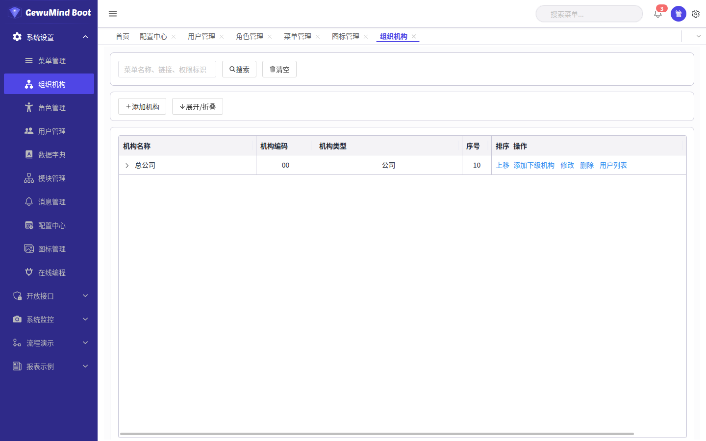

维护公司/部门树（系统表 `sys_office`）。

树形结构，**新增下级前必须先选中父节点**。用户必须归属某个组织机构才能创建。

### 3.4 角色管理


角色 = **一组权限的集合**。分配顺序是：**先建角色 → 勾权限 → 再给用户赋角色**。

三类权限独立勾选：

| 类型 | 作用 | 生效位置 |
|---|---|---|
| **菜单权限** | 决定侧栏显示哪些菜单 | 登录后下发给前端 |
| **页面按钮权限** | 决定页面内按钮是否显示 | 前端 `v-permission="'user:save'"` |
| **接口权限** | 决定能否调用后端接口 | 后端 `PermissionInterceptor` 强制校验 |

> ⚠️ **接口权限是安全底线**，不是可选项。只勾菜单不勾接口，用户会看到按钮但一点就 403。
> 勾选接口权限时，列表里是**接口路径 + 权限码**，建议按业务模块整块勾，别零散挑。

> 内置 `admin` 角色默认拥有全部权限，不受角色配置影响。

### 3.5 用户管理


「添加用户」表单：


| 操作 | 说明 |
|---|---|
| 添加用户 | 登录名称、密码、姓名、手机号、组织机构、角色、登录状态 |
| 导出 | 导出用户列表 Excel |
| 禁止登录 | 禁用账号（保留数据，历史记录不失真） |
| 重置密码 | 恢复为初始密码 |

**必填项**：登录名称、密码、姓名、组织机构、角色。

> 登录名称唯一。禁用账号优先于删除——删除会带走该用户的所有操作痕迹。

### 3.6 数据字典


管理「枚举值」：`dict_type` 定义字典类型（如 `order_status`），`dict_items` 定义该类型下的每个选项及其 `value`/`label`/`sort`。

业务表里**只存 `value`**，展示时按 `label` 翻译。这样改文案不用动历史数据。

| 操作 | 说明 |
|---|---|
| 上移 / 下移 | 调整选项顺序（下拉框里显示的顺序） |
| 停用 | 保留选项但不在新数据中出现 |

### 3.7 模块管理


用于多模块划分与授权位管理（`system.module.enable` 控制是否启用该功能）。

> **授权控制**：模块管理属于**高级版能力**。未授权时点击会跳到「需商业授权」页面，
> 基础版在此功能不可用。授权状态见配置中心右侧面板，
> 开启方式与申请流程见 [8 · 收费能力与授权](#8--收费能力与授权)。

### 3.8 消息管理

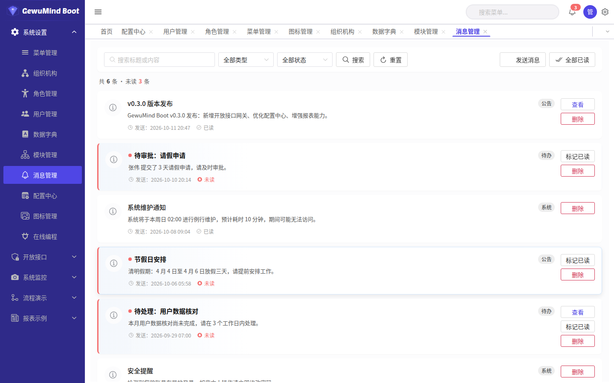

站内消息：系统公告、待办提醒、通知。

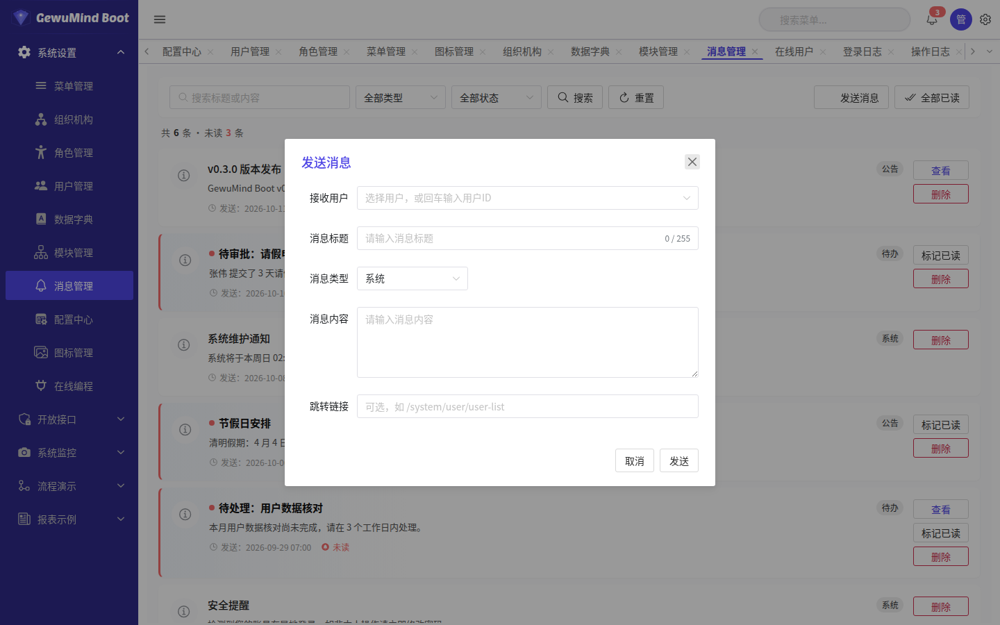

点「发送消息」可向指定用户推送消息：选择接收人（支持搜索、多选）、填标题、选类型（系统/公告/待办）、正文、可选跳转链接。

**类型语义**

| 类型 | 用途 | 接收人体验 |
|---|---|---|
| 系统 | 系统自动产生 | 铃铛红点 + 消息中心 |
| 公告 | 面向全员的通知 | 同上 |
| 待办 | 需要处理的事项 | 同上，点击可跳转处理页 |

顶部铃铛显示**未读数**，点击进入消息中心；已读消息在「已读」标签下。

### 3.9 配置中心


系统**运行期**参数的总开关。左右布局：左侧配置项列表，右侧授权状态面板。

- **左侧**：搜索框过滤配置项；「重启系统」按钮在顶部
- **每张卡片**：名称 + 配置键 + 当前值 + 说明；按类型提供不同编辑器
  - 文本 → 点击就地编辑
  - 长文本 → 点击展开文本框
  - 数字 → 数字输入框
  - 开关 → 拨动开关
  - 下拉 → 下拉选择
  - 图片 → 预览 + 上传 / 清空 / 恢复默认
  - 主题 → 色块 + 主题选择弹窗
  - JSON（Redis/MQTT/Kafka 等）→ 点击打开结构化编辑器
- **右侧**：当前授权状态（版本、有效期、已解锁能力、本机机器码）

大部分改动**即时生效**；少数需重启的会提示。逐项说明见 [第 10 章](#10--配置中心逐项详解)。

#### 切换皮肤主题

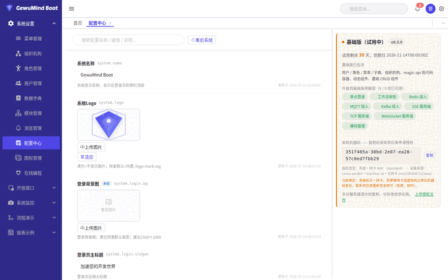

点主题配置项 → 弹窗展示 13 套预设（默认蓝/深邃蓝/活力橙/翡翠绿/浪漫紫/中国红/极简灰/樱花粉/琥珀金/暗夜黑/极光青/朝霞红 + 自定义）→ 选中后确定。

选「自定义」时可用取色器指定任意颜色，系统会以该色生成整套主题变量。

---

## 4 · 系统监控

### 4.1 在线用户

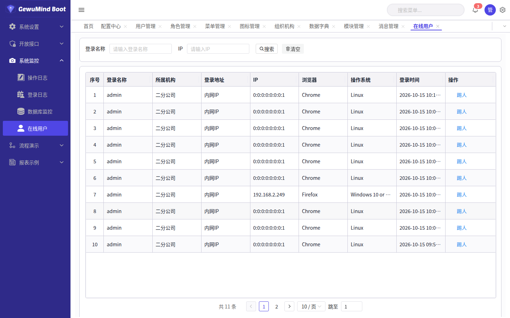

当前在线的会话列表。可**踢人**（强制某用户下线），常用于排查"账号被占用"。

### 4.2 登录日志

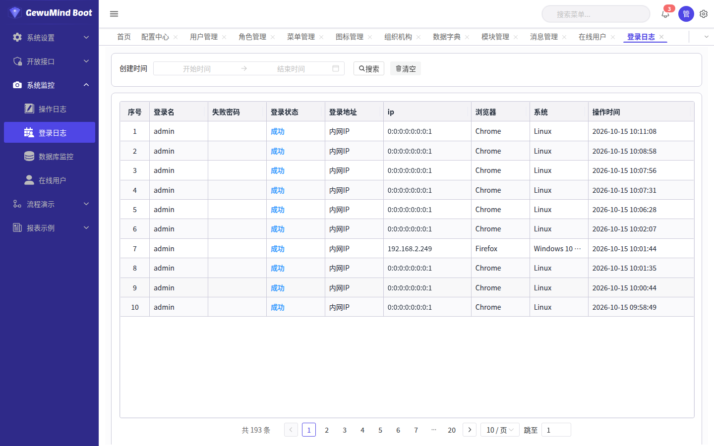

记录每次登录：账号、IP、时间、成功/失败。用于排查异常登录。

### 4.3 操作日志


记录关键写操作（新增/修改/删除），含操作人、时间、IP、影响行数。审计用。

> 登录日志记"谁进来了"，操作日志记"谁改了什么"，两者互补。

### 4.4 数据库监控

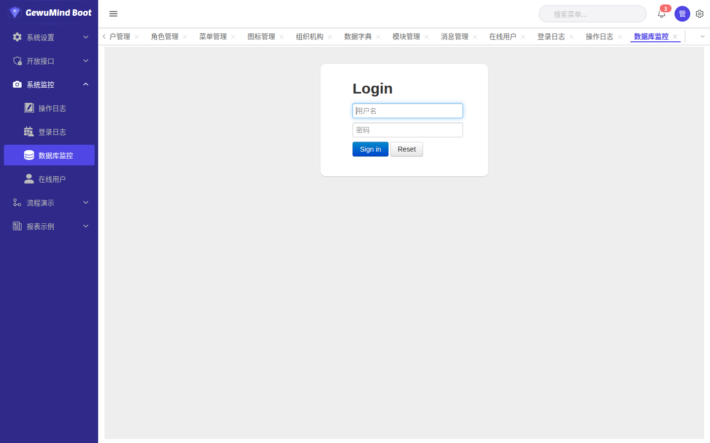

Druid 控制台：数据源概况、活跃连接、慢 SQL、会话列表、SQL 执行统计。

默认账号 `admin / 123456`（独立于后台账号）—— **生产环境务必修改或限制访问**。

---

## 5 · 开放接口

把 GewuMind Boot 的能力以标准 API 对外提供，供第三方系统调用。

### 5.1 应用管理

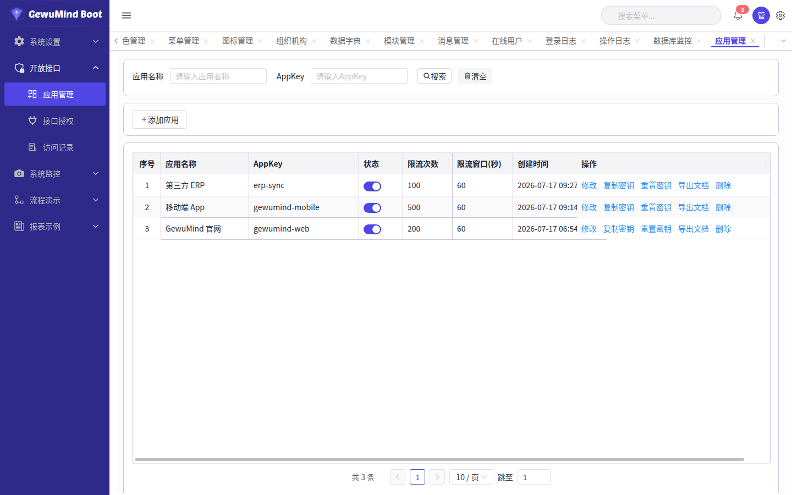

管理对外开放的应用，每个应用持有独立的 `appKey` / `appSecret`。**secret 只在创建时完整展示，请妥善保存。**

### 5.2 接口授权

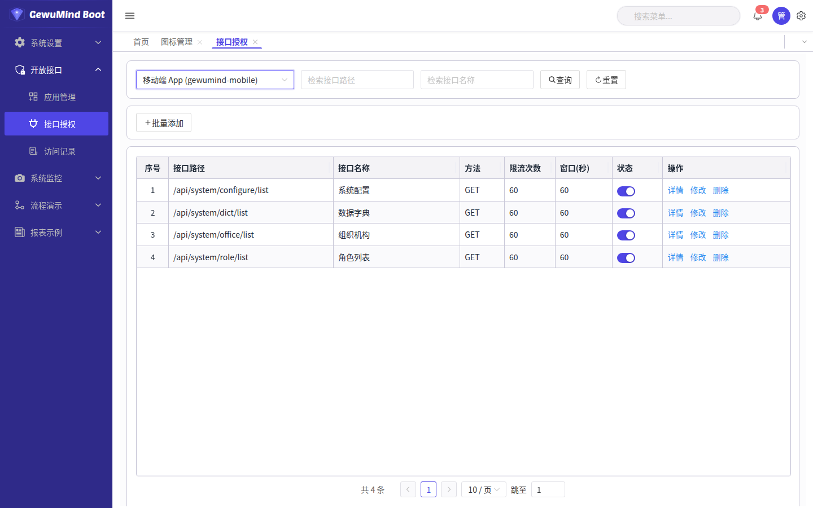

为应用授权具体接口与调用频率。授权后，第三方用 `appKey`/`appSecret` 换取 token，再调接口。

**基本流程**

```
第三方系统 ──登录凭证──▶ 换取 token
           ──带 token──▶ 调用被授权的接口
```

### 5.3 访问记录


第三方调用流水：应用、接口、耗时、结果码、IP、时间。排查对账与限流依据。

---

## 6 · 在线编程

### 6.1 在线编程（magic-api）

内置的低代码开发器：左侧资源树，右侧代码编辑，底部运行/调试面板。左侧竖排 7 个标签对应 7 类可编辑资源。

**接口** —— HTTP 接口定义（路径、方法、参数、脚本）

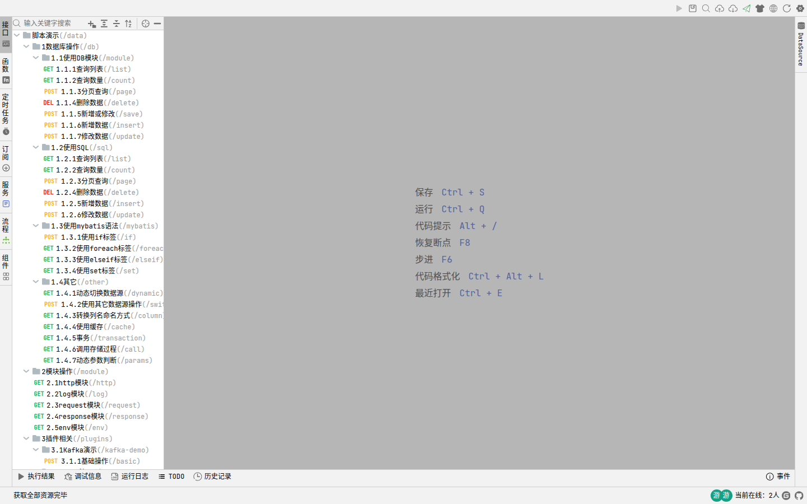

**函数** —— 可被脚本复用的公共函数

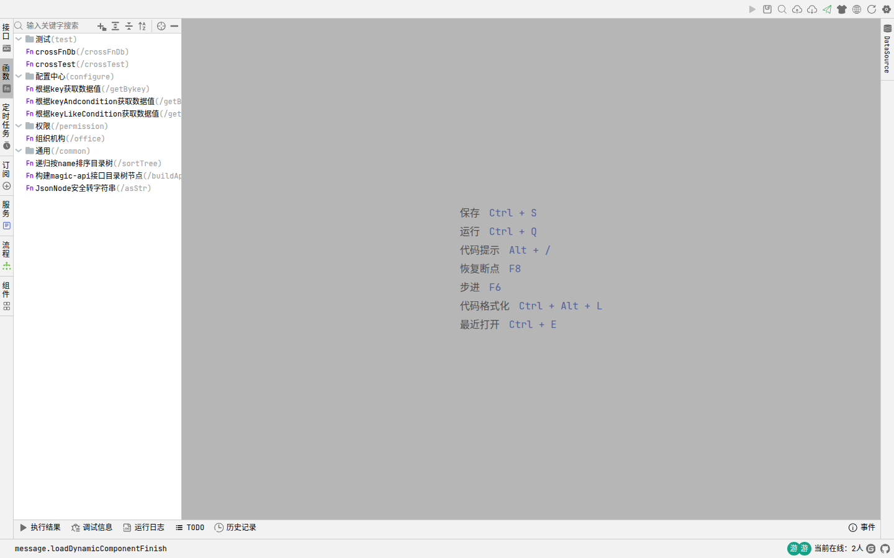

**定时任务** —— 按 cron 定时执行的脚本


**订阅** —— 消息订阅者


**服务** —— SSE / TCP / WebSocket 服务端

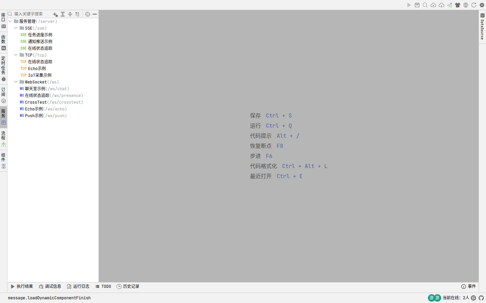

**流程** —— 工作流定义


**组件** —— 前端动态组件（SFC）

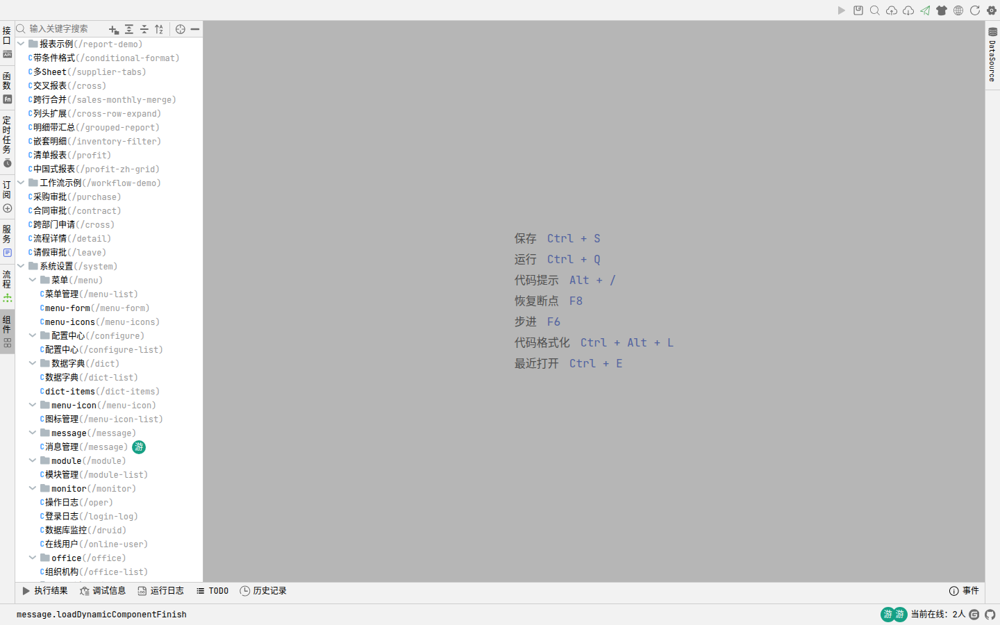

**在线调试** —— 打开任意接口即可在编辑器里直接运行，**无需重启、无需部署**：

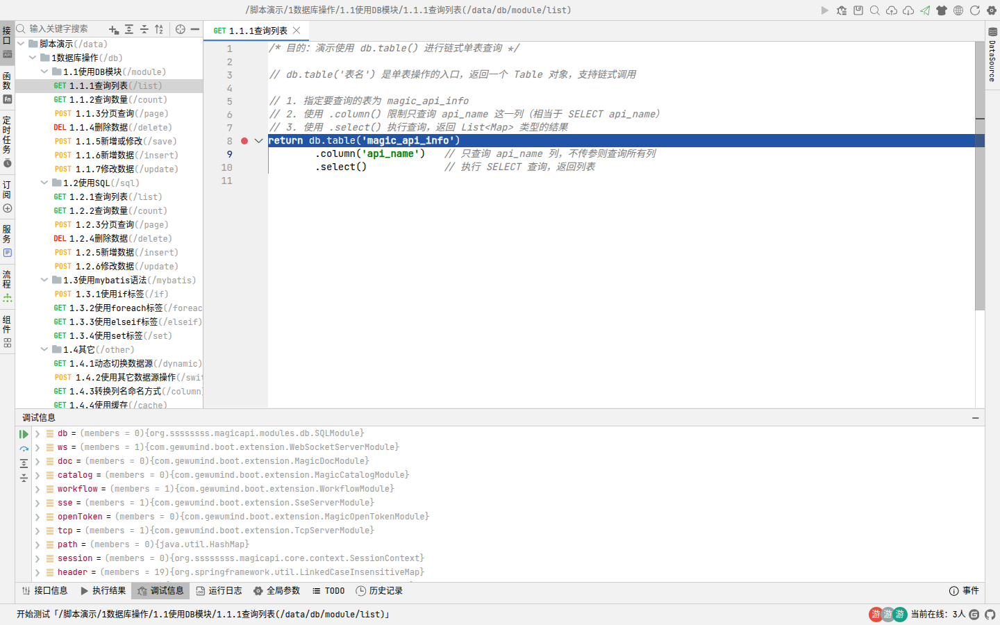

- 右上角绿色 **▶** 或 `Ctrl+Q` 运行，结果输出到底部「运行结果」面板
- `F8` 恢复断点、`F6` 单步，可逐行查看变量
- 底部面板：接口信息 · 运行结果 · 调试信息 · 运行日志 · 全局参数 · TODO · 历史记录
- `Ctrl+S` 保存 · `Alt+/` 代码提示 · `Ctrl+Alt+L` 格式化 · `Ctrl+E` 最近打开

> 详细教程（含调试、权限联调）见《低代码开发教程》。

### 6.2 组件（SFC）

「组件」标签用于维护前端动态组件（`.ms` 文件，含 template / script / style）。保存后**刷新页面**即生效。

> ⚠️ 若打开某个组件内容显示异常或为空，多半是 `.ms` 文件分隔符格式不对
> （后端要求 `\r\n` + 32 个 `=` + `\r\n`，缺首尾 `\r\n` 会让后端把整个文件当源码）。
> 详见《二次开发指南》。

> **说明**：「低代码」菜单组（低代码 / 代码生成 / 测试生成 / 动态组件）已整体下线。
> 接口、函数、任务、服务等开发能力全部保留在**在线编程**里，功能不受影响。

---

## 7 · 报表与流程

### 7.1 报表示例

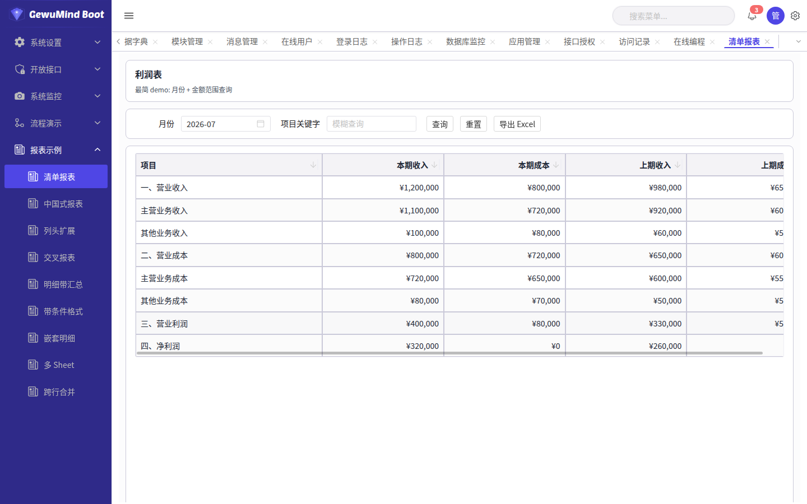

`报表达例` 菜单下预置了多种报表形态，可直接参考源码：清单报表、交叉报表、中国式报表、带条件格式、嵌套明细、多 Sheet、跨行合并、明细带汇总、列头扩展。

### 7.2 流程演示

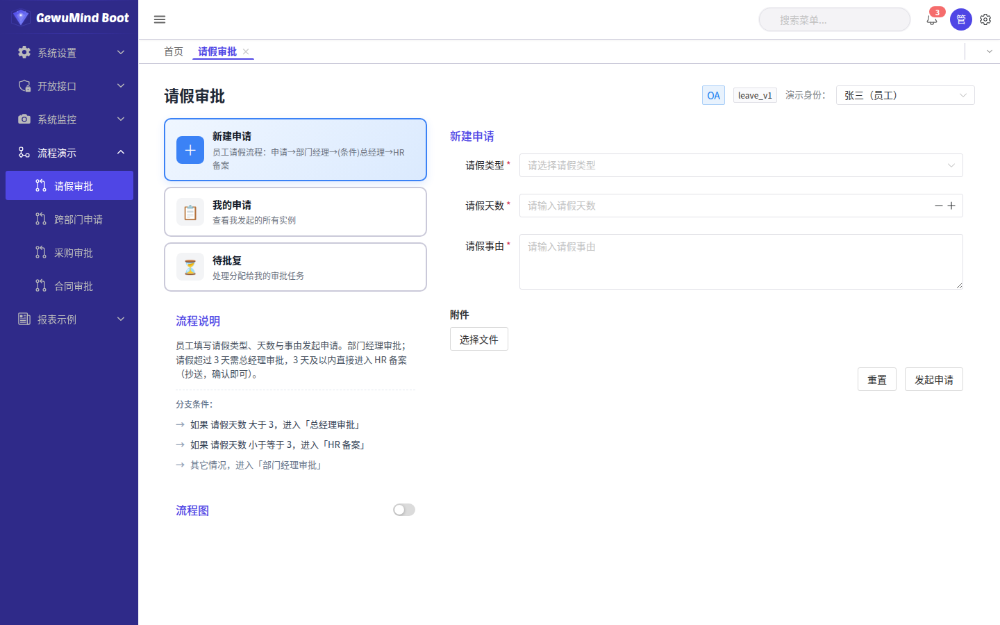

工作流（审批流）示例：请假审批、合同审批、采购审批、跨部门申请，以及流程详情页。

用于理解工作流的节点、条件分支与审批人配置。

> **说明**：「报表工具」（可视化报表设计器）尚无页面实现，菜单已下线。
> 当前报表能力通过 `data/zh/magic-api/report/` 下的报表定义文件 + 「报表示例」体现。

---

## 8 · 收费能力与授权

GewuMind Boot 分为**基础版**与**高级版**。基础版已包含用户 / 角色 / 菜单 / 字典 / 组织机构、
magic-api 低代码容器、动态组件与基础 CRUD；另有 **9 项高级能力** 属于收费范围。


> 这张图就是配置中心页面：左侧是各能力的开关与参数，右侧是**授权面板**——版本、有效期、
> 已解锁能力、本机机器码，以及「上传授权文件」入口。配置中心是查看授权状态最直接的地方。

### 8.1 九项收费能力一览

| 能力 | 配置开关 | 配置参数 | 作用 | 关闭后果 |
|---|---|---|---|---|
| **模块管理** | `system.module.enable` | — | 按模块分组授权菜单 | 菜单「模块管理」不可见/不可用 |
| **工作流审批** | `workflow.enabled` | — | 请假/合同/采购等审批流 | 「流程演示」菜单不可用 |
| **Redis 接入** | `redis.enabled` | `redis.config` | 缓存、分布式锁、会话共享 | 脚本里 `redis.*` 不可用 |
| **MQTT 接入** | `mqtt.enabled` | `mqtt.config` | IoT / 设备消息收发 | 脚本里 `mqtt.*` 不可用 |
| **Kafka 接入** | `kafka.enabled` | `kafka.config` | 消息队列、生产消费 | 脚本里 `kafka.*` 不可用 |
| **SSE 服务端** | `sse.enabled` | `sse.config` | 服务端单向实时推送 | 无法注册 SSE 端点 |
| **TCP 服务端** | `tcp.enabled` | —（端口写在脚本里） | 自定义协议长连接 | 脚本里的 `tcp.*` 不可用 |
| **WebSocket 服务端** | `ws.enabled` | `ws.config` | 双向长连接 | 无法注册 WS 端点 |
| **单点登录** | — | `application.yml` 的 `sso` 段 | 对接 IdP 统一登录 | 无法使用 SSO |

> ⚠️ **所有开关改完都需要重启服务**才生效。

### 8.2 怎么知道自己有哪些能力

配置中心右侧面板会直接显示：

- **版本**：基础版 / 基础版（试用中）/ 高级版
- **有效期**：到期日、剩余天数（到期前会高亮提醒）
- **已解锁能力**：以标签列出，`9 / 9 项已可用` 表示全部解锁
- **本机机器码**：申请授权时发给供应商

也可以调接口查看（返回每一项能力的 `enabled` 状态）：

```bash
curl -s http://<host>:9089/api/system/license/status
```

### 8.3 试用机制

- 首次启动自动记录试用起点，**默认 30 天**（由配置 `app.license-trial-days` 控制）
- 试用期内 **9 项能力全部可用**，与正式授权体验一致
- 到期后自动降级为**基础版**：收费能力被锁定，访问对应菜单会跳到「需商业授权」页
- 试用期起点记录在 `license.trial.startedAt`（**请勿手工修改**）

> 试用是从**本机首次运行**开始算的。换机器或重装系统会重新计时——这是离线授权的固有限制，
> 供应商签发的正式授权文件则与机器码绑定，不受此影响。

### 8.4 申请与激活正式授权

**第一步：把机器码发给供应商**

在配置中心右侧「本机机器码」处点「复制」，把这串指纹发给供应商，例如：

```
351f465a-30bd-2e07-ea28-57c0ed7fbb29
```

> ⚠️ 指纹由「系统标识 + 网卡 MAC」计算。换网卡或虚拟机迁移后机器码会变，需供应商重新签发。

**第二步：上传授权文件**

在面板底部点「**上传授权文件**」，选择供应商签发的 `license.json`，点「校验并生效」。

- 校验通过**立即生效，无需重启**
- 校验失败**不会覆盖**现有授权文件，安全
- 面板会随即显示客户名称、授权编号、生效/到期日期、已解锁能力数

**第三步：确认**

面板应显示版本为「高级版」且到期日期正常。

### 8.5 正式环境该注意什么

| 检查项 | 说明 |
|---|---|
| 机器码稳定性 | 云主机迁移、换网卡后机器码会变，需重新签发 |
| 时钟准确 | 系统时间被回拨会影响到期判定，面板会提示「时钟异常」告警 |
| 到期提醒 | 到期前建议提前续期，过期后收费能力会锁定 |
| 备份授权文件 | `license.json` 建议与数据库一起备份 |

> 授权校验是**离线**的：运行时只用公钥验证签名，不需要联网、不需要激活服务器。

### 8.6 常见问题

**Q：面板显示「基础版」但我没买过？**
说明试用期已结束。查看面板的到期日，或联系供应商。

**Q：上传授权文件后提示校验失败？**
多半是 `license.json` 与当前机器码不匹配（换了机器）。请把当前机器码重新发给供应商签发。

**Q：授权到期后会怎样？**
收费能力被锁定，访问对应菜单跳「需商业授权」页；已保存的数据不受影响。续期后恢复。

**Q：机器码和之前不一样了？**
网卡更换或虚拟机迁移导致。重新复制机器码发给供应商即可，原授权文件作废。

**Q：可以自己延长试用期吗？**
不建议。试用期起点与状态文件双重记录，篡改会被检测并可能触发告警。

> 各收费能力的**具体开发写法**（Redis/MQTT/Kafka/SSE/TCP/WebSocket 的脚本 API）见
> [低代码开发教程 · 收费能力详解](./低代码开发教程.md#11--收费能力商业版详解)。

---

## 9 · 多数据源

系统默认连 **MySQL**（发行包只内置 MySQL 驱动）。如果你还要连 PostgreSQL、Oracle、
SQL Server 或国产数据库，可以按下面配置。

> 只想知道「怎么加数据源」看本章；具体的脚本写法见
> [低代码开发教程 · 5.8 多数据源](./低代码开发教程.md#58-多数据源)。

### 9.1 配置方式

**方式 A · 改配置文件（适合固定数据源）**

编辑 `config/application.yml`：

```yaml
gewumind:
  datasource:
    master:                        # 名字随意，脚本里用它引用
      url: jdbc:mysql://localhost:3306/gewumind-boot?characterEncoding=UTF8&allowPublicKeyRetrieval=true
      username: root
      password: 你的密码
      driver-class-name: com.mysql.cj.jdbc.Driver
    analytics:                     # 第二个数据源
      url: jdbc:postgresql://10.0.0.9:5432/analytics
      username: postgres
      password: 你的密码
      driver-class-name: org.postgresql.Driver
```

改完**重启服务**生效。

**方式 B · 后台在线添加（适合运行期增删）**

在线编程 → **数据源**标签 → 新增，填名称 / JDBC 地址 / 账号密码。
保存后**即时生效**，无需重启，适合临时加一个库。

### 9.2 用非 MySQL 数据库要做什么

发行包**只内置 MySQL 驱动**。要连其它数据库，需要**自行加驱动并重新打包**：

| 数据库 | 驱动 Maven 坐标 |
|---|---|
| PostgreSQL | `org.postgresql:postgresql:42.7.3` |
| SQL Server | `com.microsoft.sqlserver:mssql-jdbc:12.6.1.jre11` |
| Oracle | `com.oracle.database.jdbc:ojdbc11:23.4.0.24.05` |
| 达梦 DM | `com.dameng:DmJdbcDriver18:8.1.3.140` |
| 人大金仓 | `cn.com.kingbase:kingbase8:8.6.0` |

在 `pom.xml` 加依赖后重新打包：

```bash
bash scripts/stop.sh
mvn -q -o package -DskipTests
bash scripts/start.sh
```

> 想支持驱动本身不支持的类型（如 ClickHouse、TDengine），需要自己实现数据源扩展，
> 详见《二次开发指南》与 magic-api 官方文档的自定义数据源章节。

### 9.3 怎么确认配好了

```bash
# 看启动日志有没有数据源相关报错
grep -i "datasource\|数据源" logs/gewumind-boot-app.log | head

# 在脚本里试一下（在线编程 → 接口 → 新建）
return db.analytics.select('select 1')
```

### 9.4 常见问题

| 现象 | 原因 |
|---|---|
| `ClassNotFoundException: com.mysql...` | 驱动没打进包，检查依赖并重新打包 |
| `The driver could not be found` | 驱动与 JDK 版本不兼容（如旧 ojdbc 只支持 JDK8） |
| 连接超时 | 网络不通，或防火墙/安全组没放行 |
| `Public Key Retrieval is not allowed` | MySQL 8 需在 url 加 `allowPublicKeyRetrieval=true` |
| 脚本里 `db.xxx` 报未定义 | key 名写错，与配置里的名字不一致 |

---

## 10 · 配置中心逐项详解

> 下表为系统内置的全部配置项。**「需重启」列为「是」的项，改完请用页面顶部「重启系统」或重启服务。**

### 10.1 品牌与外观

| 配置键 | 名称 | 默认值 | 说明 | 需重启 |
|---|---|---|---|---|
| `system.name` | 系统名称 | `GewuMind Boot` | 显示在侧栏顶部、登录页、浏览器标题 | 否 |
| `system.logo` | 系统Logo | `/logo-mark.svg` | 侧栏与登录页图标 | 否 |
| `system.theme` | 默认皮肤 | `custom` | 13 套预设之一，或 `custom` 用自定义色 | 否 |
| `system.theme.color` | 自定义主题颜色 | `#4f46e5` | **仅当 `system.theme=custom` 时生效** | 否 |
| `system.ui.size` | 默认界面大小 | `small` | 界面密度：`small`/`medium`/`large` | 否 |

#### 系统 Logo 的三个动作


| 动作 | 效果 |
|---|---|
| **上传图片** | 换成你上传的图（建议 256×256 透明 PNG，≤2MB） |
| **清空** | **真的置空** —— 侧栏不显示图标，回落为系统名首字母 |
| **恢复默认** | 回到内置 `/logo-mark.svg` |

> 上传图片会转为 Base64 存库，因此换图后**旧图无法撤销**，只能重新上传或恢复默认。
> 三个动作语义相互独立：「清空」不会自动恢复默认，需要时点「恢复默认」。

#### 皮肤主题

内置 13 套预设。选「自定义」后可用取色器指定任意颜色，系统据此生成整套主题变量。

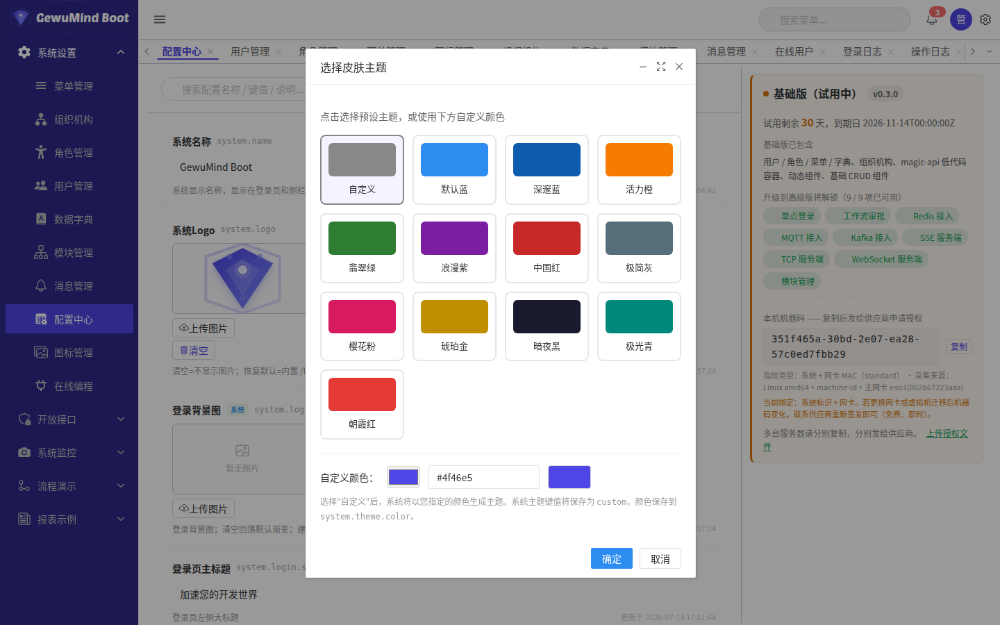

### 10.2 登录页外观

| 配置键 | 名称 | 默认值 | 说明 | 需重启 |
|---|---|---|---|---|
| `system.login.bg` | 登录背景图 | 空 | 留空则用内置渐变背景 | 否 |
| `system.login.slogan` | 登录页主标题 | `加速您的开发世界` | 登录页大字 | 否 |
| `system.login.subtitle` | 登录页副标题 | `轻松启动您的创意` | 主标题下方小字 | 否 |
| `system.login.copyright` | 登录页版权 | `© 2026 GewuMind` | 页脚版权 | 否 |

### 10.3 安全策略

| 配置键 | 名称 | 默认值 | 说明 | 需重启 |
|---|---|---|---|---|
| `verification-code.enable` | 启用登录验证码 | `false` | 开启后登录需填图形验证码 | 否 |
| `password.strength` | 密码强度 | `2` | `1`=弱（不限制）；`2`=强（≥8 位，且大小写/数字/特殊符至少三类） | 否 |
| `password.expiry.enable` | 启用密码过期 | `false` | 开启后密码到期强制修改 | 否 |
| `password.expiry.days` | 密码过期天数 | `60` | 配合上一项生效 | 否 |
| `watermark.enable` | 启用水印 | `false` | 页面叠加防截图水印 | 否 |

> 密码强度设为「强」后，**已存在的弱密码不受影响**，只约束新建与修改。
> 内网环境建议保持验证码关闭以提升体验，对外暴露时务必开启。

### 10.4 运行与外观开关

| 配置键 | 名称 | 默认值 | 说明 | 需重启 |
|---|---|---|---|---|
| `system.auto-restart.enable` | 自动重启开关 | `false` | 定时自动重启服务 | 否 |
| `system.auto-restart.cron` | 自动重启 cron | `0 0 1 * * ?` | 每天 01:00。**仅在上一项开启时生效** | 否 |
| `system.module.enable` | 启用模块管理 | `false` | **高级授权能力**，关闭时「模块管理」不可用 | 否 |

> ⚠️ 启用自动重启会中断在线用户，请仅在有维护窗口时开启。

### 10.5 高级服务（JSON 配置）

以下为**商业授权能力**。未授权时相关服务不启用；启用方式为把对应的 `*.enabled` 打开，并在其 `*.config` 中填写参数。

| 配置键 | 说明 | 关键参数 |
|---|---|---|
| `redis.enabled` / `redis.config` | Redis 缓存 | `host` `port` `password` `database` `pool.max-active` |
| `mqtt.enabled` / `mqtt.config` | MQTT 接入 | `broker` `client-id` `username` `password` `timeout` `keepalive` |
| `kafka.enabled` / `kafka.config` | Kafka 接入 | `bootstrap-servers` `producer.acks` `producer.retries` `consumer.group-id` `consumer.auto-offset-reset` |
| `ws.enabled` / `ws.config` | WebSocket 服务端 | `wsPort` `wsPath` `wssEnabled` `wssPort` `keystore` `keystorePassword` `keystoreType` `keyAlias` |
| `sse.enabled` / `sse.config` | SSE 服务端 | `path` `timeout` |
| `tcp.enabled` | TCP 服务端 | 端口号 |
| `sa-token.redis.enabled` | SaToken Redis 共享登录 | 需先启用 Redis |
| `workflow.enabled` | 工作流 | 默认已开启 |

> ⚠️ 这些配置多为 **JSON 结构**。点配置项会打开结构化编辑器，按字段填写。
> **含 `password` / `apiKey` 的字段是密码型输入（留空表示不修改）**，改完点「测试连接」验证后再保存。

### 10.6 授权相关

| 配置键 | 名称 | 说明 |
|---|---|---|
| `license.trial.startedAt` | 试用期起始时间 | 授权相关，勿手工改 |
| `license.lastSeenAt` | 上次校验时间 | 授权相关，勿手工改 |

---

## 11 · 权限码速查

配置角色时按需勾选。格式统一为 `<模块>:<动作>`。

| 模块 | 权限码 |
|---|---|
| 用户 | `user:view` `user:save` `user:delete` `user:change:login:status` |
| 角色 | `role:view` `role:save` `role:delete` |
| 菜单 | `menu:view` `menu:save` `menu:delete` `menu:icon:save` `menu:icon:delete` |
| 组织机构 | `office:view` `office:save` `office:delete` |
| 数据字典 | `dict:view` `dict:save` `dict:delete` `dict:items:view` `dict:items:save` `dict:items:delete` `dict:items:sort:up` |
| 配置中心 | `configure:view` `configure:save` `configure:delete` |
| 消息 | `message:view` |
| 在线用户 | `online:view` `online:logout` |
| 模块 | `module:view` `module:save` `module:delete` |

> **给新角色配权限的顺序**：菜单权限（决定看得到什么）→ 页面按钮权限（决定点得了什么）→ 接口权限（决定后端放不放行）。
> 三者缺一不可，尤其**接口权限不能漏**，否则会「看得到按钮、一点就 403」。

---

## 相关文档

| 文档 | 内容 |
|---|---|
| [部署指南](./部署指南.md) | 环境准备、部署、升级、备份 |
| [低代码开发教程](./低代码开发教程.md) | 写接口、写组件、报表、工作流 |
| [二次开发指南](./二次开发指南.md) | 从源码构建、架构、扩展点 |
